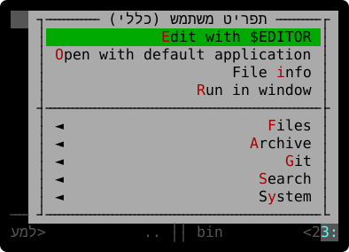

# תפריט המשתמש ושיוכי קבצים

## תפריט המשתמש

`F2` פותח תפריט של פקודות משלכם. Navigator מחפש קובץ בשם `.navigator-menu.ini` בתיקייה של הלוח ובכל תיקייה
שמעליה; זה התפריט ה*מקומי*. כשאין כזה הוא משתמש בתפריט ה*כללי*, `menu.ini` שבתיקיית התצורה של Navigator.



בתפריט, `F2` מחליף בין התפריט המקומי לכללי, ו-`F4` פותח בעורך את זה שמוצג. גם *אפשרויות > הגדרת תפריט כללי*
ו-*הגדרת תפריט מקומי* עורכים אותם.

### כתיבת תפריט

```ini
# A comment
~S~how the file = less !.!

[Archive]
~P~ack this file = tar czf !.tar.gz !.!
-
~L~ist = tar tf !.!
```

- `Caption = command` הוא פריט. שורות מוזחות מתחתיו הן פקודות נוספות לאותו פריט.
- `[Name]` מתחיל תת-תפריט, ו-`[Name/Inner]` תת-תפריט בתוכו.
- שורה שיש בה רק `-` היא קו מפריד.
- `~` לפני אות הופך אותה למקש הקיצור של הפריט. כיתוב שמתחיל ב-`F1` עד `F12` ורווח נבחר במקש הזה.

אלה מייצגים את הקובץ שתחת הסמן בלוח הפעיל:

| כותבים | זה הופך ל |
|---|---|
| `!` | השם בלי הסיומת |
| `.!` | הסיומת, עם הנקודה שלה |
| `!.!` | השם המלא |
| `!\` | התיקייה, מסתיימת ב-`/` |
| `!/` | התיקייה, בלי ה-`/` שבסוף |
| `!!` | `!` |

אותם צירופים עם `$` במקום `!` מייצגים את הקובץ שבלוח השני, ולכן כתבו `$$` עבור `$` משלכם. `%1` הוא קובץ שמפרט
את השמות המתויגים של הלוח הפעיל, ו-`%2` את אלה של הלוח השני.

`%3` עד `%9` הן מילים שאתם נשאלים עליהן כשהפריט רץ. שורה `<Title` נותנת לשאלה כותרת, ו-`<=text` ממלא תשובה
להתחיל ממנה.

שמות מצוטטים עבור המעטפת במקום שבו הם צריכים זאת, ולכן אל תשימו סביבם מירכאות. הפקודות רצות במעטפת של המסוף,
כאילו הקלדתם אותן.

## שיוכי קבצים

חמישה קבצים נוספים בתיקיית התצורה קובעים איך מטופל כל סוג של קובץ. בכל אחד מהם יש סעיף לכל מסכת קבצים.

| קובץ | מה הוא קובע | נערך מתוך |
|---|---|---|
| `extensions.ini` | מה `Enter` מריץ עבור קובץ | *אפשרויות > עריכת קובץ סיומות* |
| `viewers.ini` | מה `F3` מריץ במקום המציג | *אפשרויות > מציגים* |
| `editors.ini` | מה `F4` מריץ במקום העורך | *אפשרויות > עורכים* |
| `quickrun.ini` | מה `Ctrl+Shift+F1` עד `Ctrl+Shift+F10` מריצים | *אפשרויות > עריכת קובץ הרצה מהירה* |
| `highlight.ini` | איך העורך והמציג צובעים קובץ, ואפשרויות העורך עבורו | *אפשרויות > עריכת קובץ הדגשה* |

`Alt+F3` משתמש תמיד במציג של Navigator עצמו. `Alt+F4` משתמש בתוכנית של `editors.ini` כש-`F4` משתמש בעורך של
Navigator, ולהפך; ראו [העורך](editor.md#פתיחת-קובץ). כל קובץ נכתב עם דוגמאות בפעם הראשונה ש-Navigator
מופעל. `highlight.ini` מתואר תחת [הדגשת תחביר](editor.md#הדגשת-תחביר).
