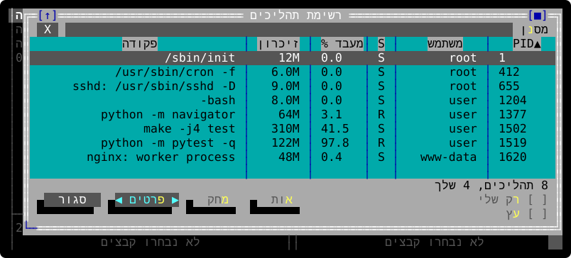
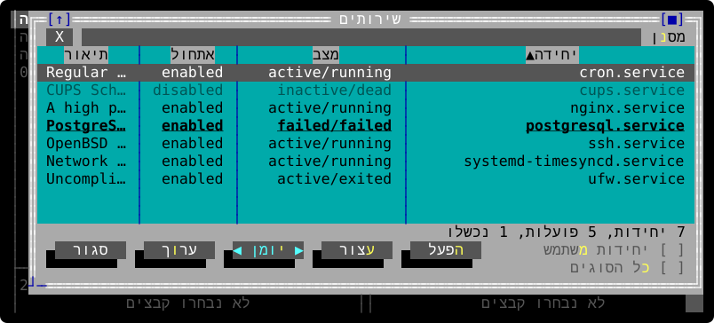
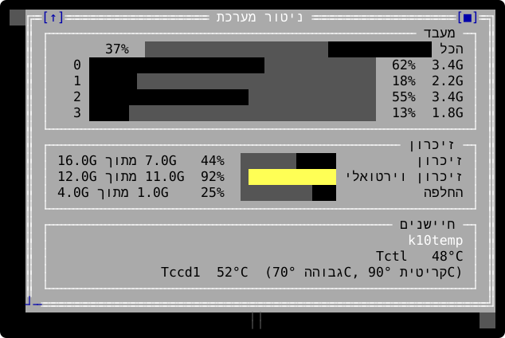
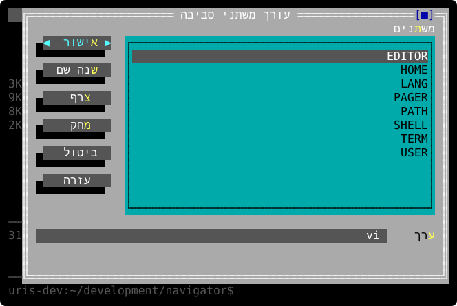
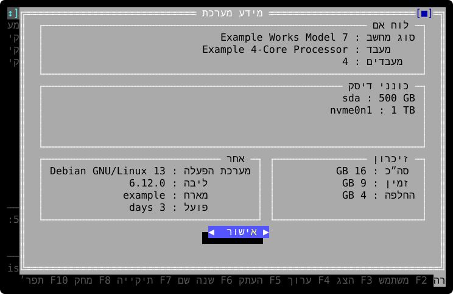
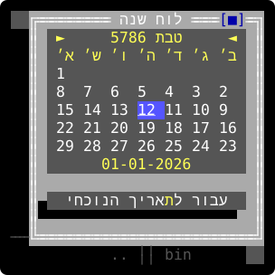
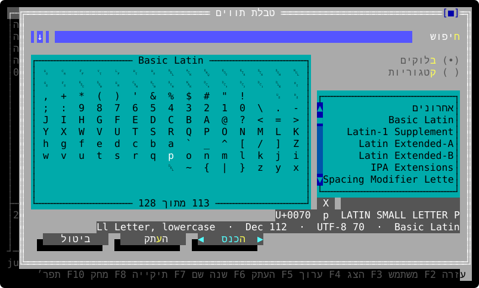

# כלים

## רשימת תהליכים

*כלים > רשימת תהליכים* מציג את התהליכים שרצים.

| מקש | מה הוא עושה |
|---|---|
| הקלדה, `F4` | סינון הרשימה לתהליכים שהפקודה, השם, המשתמש או המספר שלהם מכילים את הטקסט; `Esc` מנקה אותו |
| `Ctrl+T` | הצגת התהליכים כעץ של הורים וילדים |
| `Ctrl+H` | הצגת התהליכים שלכם בלבד |
| `Ctrl+P`, `Ctrl+U`, `Ctrl+E`, `Ctrl+L`, `Ctrl+Z`, `Ctrl+N` | מיון לפי מספר, משתמש, מצב, עומס מעבד, זיכרון, פקודה |
| `Left`, `Right` | גלילת פקודות ארוכות |
| `F3` | הצגת הפרטים של תהליך |
| `F7` | שליחת אות שאתם בוחרים |
| `F8`, `Del` | סיום התהליך, אחרי שאלה |
| `Ctrl+R` | קריאה חוזרת של הרשימה |

לחיצה על כותרת עמודה ממיינת לפיה. כשאות נדחה מחוסר הרשאה, מוצע לכם לשלוח אותו כ-root.

## שירותים

*כלים > שירותים* מציג את השירותים של המערכת ושולט בהם, דרך systemd, OpenRC, runit או SysVinit.

| מקש | מה הוא עושה |
|---|---|
| `Enter` | הצגת הפרטים של שירות |
| `F3` | הצגת היומן שלו, ומעקב אחריו |
| `F4` | עריכת התצורה שלו |
| `F5`, `F6`, `F7` | הפעלה, הפעלה מחדש, טעינה מחדש |
| `F8`, `Del` | עצירה, אחרי שאלה |
| `Ctrl+E`, `Ctrl+D` | הפעלה וביטול של ההפעלה באתחול |
| `Ctrl+U` | הצגת השירותים שלכם |
| `Ctrl+A` | הצגת יחידות מכל סוג |
| `Ctrl+S` | סינון הרשימה |
| `Ctrl+R` | קריאה חוזרת של הרשימה |

שינוי של שירות מערכת דורש בדרך כלל root, וזה מוצע לכם.

## ניטור מערכת

*כלים > ניטור מערכת* מציג את העומס על כל מעבד, את הזיכרון ושטח ההחלפה שבשימוש, ואת הטמפרטורות ומהירויות
המאווררים שהמחשב מדווח.

## עריכת הסביבה

*כלים > ערוך סביבה* מציג את משתני הסביבה שניתנים לתוכניות שמופעלות מ-Navigator, ומאפשר לשנות אותם.

- *משתנים* מציג את השמות. הערך של זה שתחת הסמן נמצא בשורה *ערך*, ושם אפשר לערוך אותו.
- *שנה שם* נותן למשתנה שם אחר.
- *הוסף* מוסיף משתנה חדש.
- *מחק* מסיר את המשתנה שתחת הסמן.
- *אישור* שומר את השינויים; *ביטול* מוותר על כולם.

השינויים מגיעים לתוכניות ש-Navigator מפעיל מאותו רגע ואילך: המציג והעורך החיצוניים, הפקודות של תפריט המשתמש,
והמעטפת שבמסוף. הם תקפים עד שאתם יוצאים מ-Navigator.

## מידע על המערכת

*כלים > מידע מערכת* מציג מה המחשב: *לוח אם* והמעבד, *כונני דיסק*, *זיכרון*, ותחת *אחר* את המערכת, הליבה שלה,
שם המארח וכמה זמן הוא פועל.

## לוח שנה

*כלים > לוח שנה* מציג חודש, והיום מסומן בו. מתחת לשבועות, היום שתחת הסמן כתוב במלואו בתבנית התאריך של
ההגדרות [אזור](settings.md#אזור).

| מקש | מה הוא עושה |
|---|---|
| חיצים | מעבר מיום ליום |
| `PgUp`, `PgDn` | החודש הקודם והחודש הבא |
| `Ctrl+PgUp`, `Ctrl+PgDn` | השנה הקודמת והשנה הבאה |
| `M`, `Y` | בחירת חודש, או שנה, מרשימה |
| `T` | מעבר להיום; וגם הכפתור *עבור לתאריך הנוכחי* |
| `C` | החלפה בין לוח השנה האחר ללוח הגרגוריאני |
| `Esc` | סגירת לוח השנה |

בתפריט *לוח שנה* יש אותן פקודות ועוד שתיים. *סוג לוח שנה* מציג את החודש בלוח שנה אחר, כמו העברי, המוסלמי או
הפרסי. *תצוגת לוח שנה* קובע מה ממנו מוצג לצד החודש הגרגוריאני: החודש שלו בלבד, היום כתוב בו במלואו מתחת לחודש
הגרגוריאני, החודש שלו והיום הגרגוריאני כתוב במלואו מתחתיו, או שני החודשים זה לצד זה.

## טבלת תווים

`Ctrl+B`, או *כלים > טבלת תווים*, מוצא תו ומקליד אותו במקום שבו נמצא הסמן.

- *חיפוש* מוצא תווים לפי שם, כמו `arrow` או `euro`.
- הרשימה שמשמאל בוחרת קבוצת תווים, והשורה שמתחתיה מצמצמת את הקבוצות לפי שם.
- הרשת שמימין מציגה את הקבוצה. התו שתחת הסמן מתואר בתחתית.
- *הכנס* מקליד את התו, ו-*העתק* שם אותו בלוח הגזירים.

במסוף שמוגדר לתווי ASCII פשוטים, הטבלה היא *טבלת ASCII* של DOS Navigator: 256 תווים, והקוד של התו שתחת הסמן
בעשרוני ובהקסדצימלי.

## SmartPad

`Alt+Q`, או *SmartPad* בתפריט `≡`, פותח פנקס רשימות שנשמר מהפעלה להפעלה. בכל פעם שהוא נפתח הוא מוסיף בסופו
שורה עם התאריך והשעה ומציב את הסמן מתחתיה, כך שהפנקס נקרא כיומן. זהו חלון [עורך](editor.md), והוא שומר את עצמו
כשאתם סוגרים אותו.

## תפריט המערכת

בתפריט `≡`, בקצה השמאלי של שורת התפריט, נמצא מה ששייך ל-Navigator כולו.

| פריט | מה הוא עושה |
|---|---|
| *אודות* | הצגת הגרסה, הרישיון והמחבר |
| *לוח פקודות* | מציאת כל [פקודה](windows.md#לוח-הפקודות) לפי כמה מהאותיות שלה |
| *רענן תצוגה* | ציור מחדש של כל המסך, מעל מה שתוכנית אחרת השאירה עליו |
| *שומר מסך* | הפעלת שומר המסך עכשיו |
| *לוכד מסך*, `Shift+Alt+Ins` | העתקת מלבן מהמסך ללוח הגזירים |
| *מסך משתמש*, `Alt+F5` | הצגת [המסוף](console.md#המסוף) עד ללחיצה על מקש |
| *חלון פלט*, `Ctrl+O` | הסתרת החלונות כדי להקליד במסוף, והחזרתם |
| *SmartPad*, `Alt+Q` | פתיחת [פנקס הרשימות](#smartpad) |
| *הצג/הסתר פח אשפה* | הצגה או הסתרה של פח האשפה שגוררים אליו קבצים כדי למחוק אותם |
| *משחק*, `Alt+F9` | פתיחת [המשחק](game.md) |

`Alt+X` יוצא מ-Navigator. הוא שואל קודם; *אל תשאל שוב* בשאלה, או *אישור יציאה* בעמוד
[אישורים](settings.md#אישורים), מבטל את השאלה.
