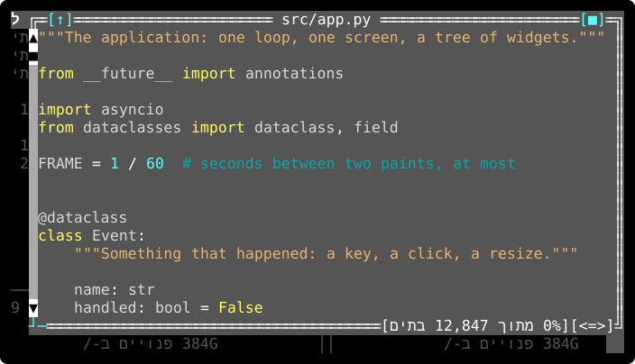
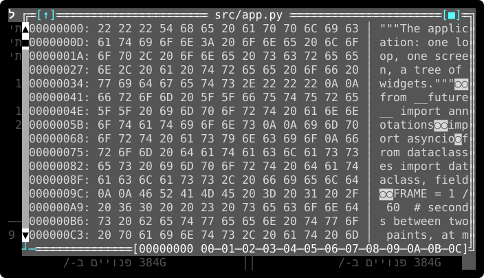
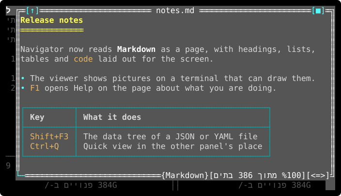
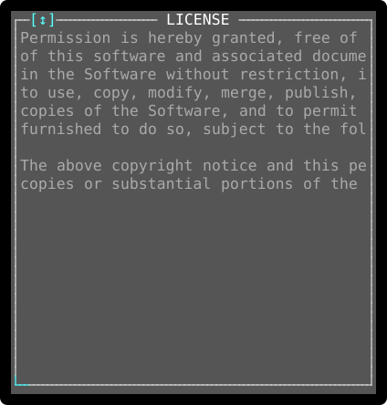
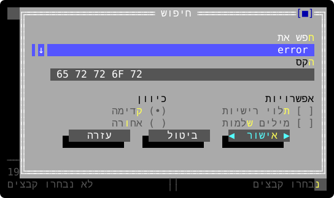
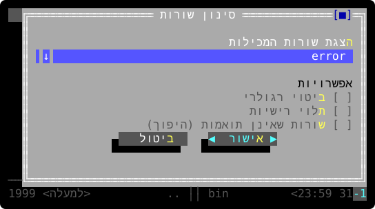
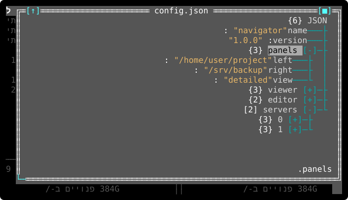
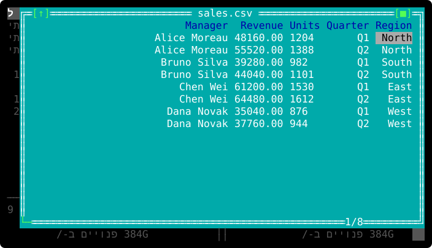

# המציג

`F3` מציג את הקובץ שתחת הסמן בלי לשנות אותו. הוא נפתח מיד, גדול ככל שיהיה הקובץ.

## מקשים

| מקש | מה הוא עושה |
|---|---|
| `Up`, `Down`, `PgUp`, `PgDn` | גלילה |
| `F2` | גלישת שורות ארוכות, או הפסקת הגלישה |
| `F4` | מעבר בין טקסט, הקס ו-dump |
| `F5` | מעבר לכתובת |
| `F6` | שינוי מסנן התווים |
| `F7` | חיפוש; `Shift+F7` מחפש שוב, `Ctrl+F7` אחורה |
| `Shift+F3` | הצגת קובץ Markdown, ‏HTML או דומה כשהוא מעובד, או כמקור |
| `Shift+F4` | עריכת הקובץ |
| `Shift+F5` | שמירת הקובץ בשם אחר |
| `Shift+F6` | בחירת הקידוד שבו נקרא הטקסט |
| `Ctrl+T` | מעקב אחר סוף קובץ שהולך וגדל |
| `Ctrl+G` | הצגת השורות שתואמות טקסט בלבד |
| `Alt+PgDn` | רשימת הקבצים שהוצגו קודם |
| `Esc`, `F3` | סגירת המציג |

אותן פקודות נמצאות בתפריט *הצגה*, שמופיע בשורת התפריטים כל עוד מציג פתוח.

במצב הקס אפשר לשנות בתים: הקלידו ספרות הקס מעליהם, או לחצו `Tab` והקלידו תווים. `Shift+F2` כותב את השינויים
לקובץ.

## פתיחת קובץ

| מקש או פריט | מה הוא עושה |
|---|---|
| `F3`, *קובץ > הצגה > כמו שהוא* | מציג את הקובץ שתחת הסמן בדרך שמתאימה לסוג שלו ביותר, ראו להלן |
| `Alt+F3`, *קובץ > הצגה > תצוגה חלופית* | מציג אותו במציג של Navigator, אף פעם לא כטבלה, כארכיון או בתוכנה של `viewers.ini` |
| *קובץ > הצגה > כטקסט*, *כהקס* | פותח את המציג במצב טקסט או במצב הקס |
| *קובץ > הצגה > כמסד נתונים* | פותח קובץ dBase או SQLite כ[טבלה](#טבלאות), יהיה שמו אשר יהיה |
| *קובץ > הצגה > כגיליון אלקטרוני* | פותח קובץ CSV או TSV כטבלה |
| *קובץ > הצגה > פתח...* | מציג קובץ שבוחרים ב[תיבת קבצים](dialogs.md#בחירת-קובץ), בלי צורך במנהל הקבצים |
| `Alt+PgDn` | מציג קובץ מרשימת הקבצים שהוצגו קודם |

`F3` פותח קובץ dBase, ‏SQLite או CSV כטבלה ונכנס לתוך ארכיון, כמו `Enter`. אחרת, כש-`viewers.ini` מציין תוכנה
עבור הקובץ, התוכנה הזו מציגה אותו ([שיוכי קבצים](user-menu.md#שיוכי-קבצים)); ואם לא, המציג של Navigator.
כש*מציג פנימי* אינו מסומן בעמוד [מערכת](settings.md#מערכת) של ההגדרות, `F3` מריץ את התוכנה של `viewers.ini`,
ואם אין, את `$PAGER`.

`F3` על תיקייה סופר את הגודל של כל מה שבתוכה.

## מה מוצג בדרך מיוחדת

יש קבצים שמוצגים כמשהו אחר מהטקסט שלהם. `Shift+F3`, או *הצגה > תצוגה מעובדת*, עובר בין התצוגה הזו לבין הטקסט של
הקובץ עצמו; סימן על המסגרת התחתונה, כמו `{Markdown}`, מוצג מחוק כל עוד רואים את הטקסט, וגם לחיצה עליו עוברת.

- **Markdown, ‏reStructuredText ו-HTML** מוצגים כעמוד: כותרות, רשימות, טבלאות, ציטוטים ובלוקי קוד מסודרים,
  ופסקאות שזורמות לרוחב החלון. ייתכן שהמסוף שלכם יפתח קישור שבעמוד. חיפוש עם `F7` מחפש בטקסט של הקובץ עצמו ומראה
  את המקום בעמוד.
- **PDF** מוצג כטקסט שלו, עמוד אחר עמוד. התמונות שבו מושמטות, ו-`F7` לא מוצא את הטקסט של PDF, שארוז בתוך הקובץ.
- **תמונה** מצוירת כתמונה במסוף שיודע לצייר תמונות, דרך פרוטוקול הגרפיקה של kitty או sixel. רוב סוגי התמונות
  דורשים את חבילת Python ‏Pillow (`pip install navigator-fm[images]`); בלעדיה מצויר רק PNG ב-kitty. במקומות אחרים
  מוצגים הבתים של התמונה. `--graphics` ב[שורת הפקודה](command-line.md#צבעים-ותווים) אומר מה המסוף יודע
  לעשות כשהשאלה אליו משתבשת.
- **JSON, ‏YAML, ‏TOML, ‏XML ורשימות מאפיינים (property lists)** נפתחים כטקסט, ו-`Shift+F3` מציג אותם כ[עץ
  נתונים](#עץ-הנתונים).
- **קובצי dBase, ‏SQLite ו-CSV** נפתחים כ[טבלה](#טבלאות) של רשומות בחלון משלהם.

קובץ גדול מ-4 MB, או PDF או תמונה גדולים מ-64 MB, מוצג כטקסט שלו. ההגדרות של [סוגי מציג](settings.md#סוגי-מציג)
קובעות אילו סוגים מוצגים בדרך מיוחדת, ולפי אילו מסכות קבצים.

## תצוגה מהירה

`Ctrl+Q` מציג את הקובץ שתחת הסמן במקומו של הלוח השני, ועוקב אחר הסמן כשהוא זז. `Tab` מעביר את המקלדת לתצוגה,
ושם פועלים המקשים של המציג.

## חיפוש

`F7` מחפש בקובץ. `Shift+F7` מחפש שוב ו-`Ctrl+F7` מחפש אחורה.

- *חפש את* הוא הטקסט לחיפוש. *הקס* הוא אותו חיפוש שנכתב כבתים בספרות הקס; הקלידו בשורה שמתאימה למה שאתם מחפשים.
- *תלוי רישיות* מבחין בין אותיות גדולות לקטנות.
- *מילים שלמות* מדלג על הטקסט במקומות שבהם הוא חלק ממילה ארוכה יותר.
- *כיוון*: *קדימה* לעבר סוף הקובץ, או *אחורה* לעבר תחילתו.

חיפוש בקובץ גדול מציג את ההתקדמות שלו, ו*עצור*, `Esc` או `Enter` מסיימים אותו.

## מעבר לכתובת

`F5` במצב הקס מבקש *כתובת*, מיקום בקובץ שנכתב בהקס, ומציג את הקובץ משם.

## סינון שורות

`Ctrl+G`, או *הצגה > סינון שורות*, מציג רק את השורות שמכילות טקסט.

- *ביטוי רגולרי* מתייחס לטקסט כביטוי רגולרי.
- *תלוי רישיות* מבחין בין אותיות גדולות לקטנות.
- *שורות שאינן תואמות (היפוך)* מציג את השורות שאינן מכילות אותו.

## עץ הנתונים

`Shift+F3` על קובץ JSON, ‏YAML, ‏TOML, ‏XML או רשימת מאפיינים מציג את הנתונים שלו כעץ, ו-`Shift+F3` שוב חוזר
לטקסט. השורה בתחתית היא הנתיב של הצומת שתחת הסמן.

| מקש | מה הוא עושה |
|---|---|
| `F7` | חיפוש במפתחות ובערכים; `Shift+F7` מחפש שוב |
| `Ctrl+S` | מציאת מפתח תוך כדי הקלדתו |
| `Ctrl+Ins` | העתקת הנתיב של הצומת ללוח הגזירים |
| `Ctrl+Shift+C` | העתקת הערך של הצומת ללוח הגזירים |
| `Shift+F4` | עריכת הקובץ |
| `Esc` | סגירת החלון |

בתפריט *נתונים* יש אותן פקודות, וגם *פתיחת הכול*.

## חיפוש בטבלה

`F7` בטבלה מחפש טקסט ברשומות. `Shift+F7` חוזר על החיפוש.

- *טקסט לחיפוש* הוא הטקסט שמחפשים.
- *תלוי רישיות* מבחין בין אותיות גדולות לקטנות.
- *תחום*: *בשדה הנוכחי* מחפש רק בעמודה שבה נמצא הסמן, *כל השדות* בכל העמודות.
- *כיוון*: *קדימה* מהסמן לעבר הרשומה האחרונה, *אחורה* לעבר הראשונה, או *מתחילת התחום* מהרשומה הראשונה והלאה.

## טבלאות

קובץ dBase, ‏SQLite או CSV נפתח כטבלה של רשומות.

- `F2` מציג את המבנה של הטבלה: השדות שלה והסוגים שלהם.
- `F3` על שדה memo מציג את הטקסט של ה-memo בתיבה, ושם פועלים המקשים של המציג.
- `F6` על קובץ SQLite מבקש שאילתה. רק שאילתה שקוראת מורצת; הקובץ לעולם אינו משתנה.
- `Shift+F6` על קובץ CSV או TSV קובע איך הוא נחתך לתאים: ה*מפריד* (*פסיק*, *נקודה ופסיק*, *טאב*, *צינור*, או
  *אחר* עם התו שמוקלד לידו), האם *השורה הראשונה היא כותרת*, וה*קידוד*.
