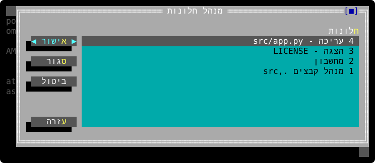
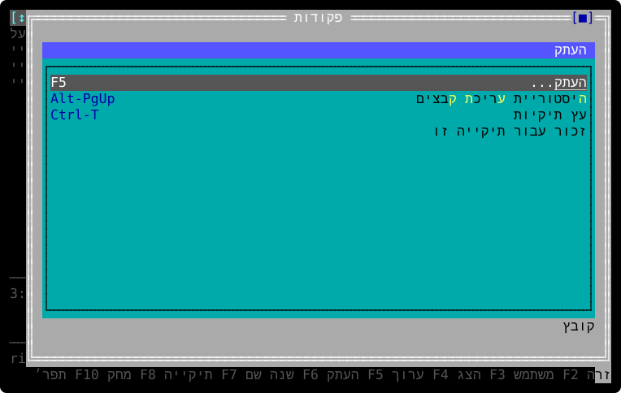

# חלונות

מנהלי קבצים, מציגים, עורכים וכלים נפתחים כל אחד בחלון משלו על שולחן העבודה. התפריט *חלון* מסדר אותם.

## עבודה עם חלונות

| מקש | מה הוא עושה |
|---|---|
| `F9` | מעבר לחלון הבא |
| `Shift+F9` | מעבר לחלון הקודם |
| `Alt+0` | רשימת החלונות |
| `Alt+Z` | הגדלת החלון לכל שולחן העבודה, וחזרה |
| `Ctrl+F5` | הזזת החלון בחיצים, או שינוי גודלו ב-`Shift` ובחיצים; `Enter` משאיר אותו, `Esc` מחזיר אותו |
| `Ctrl+F4` | סגירת החלון |

*חלון > פרוש* ו-*מדורג* מסדרים את כל החלונות בבת אחת, ו-*סגור הכול* סוגר את כולם. בעכבר, גררו חלון בקצה העליון
שלו, שנו את גודלו בפינה הימנית התחתונה, ולחצו על חלון כדי להביא אותו לחזית.

לכל חלון יש מספר, שמוצג ברשימת החלונות.

## שתי תצוגות של אותו טקסט

*חלון > תצוגה חדשה*, או *עורך > קובץ > תצוגה חדשה*, פותח חלון שני על הטקסט של העורך שבחזית. שניהם מציגים את
אותו טקסט: מה שאתם מקלידים באחד מופיע בשני, והם חולקים היסטוריית ביטול אחת ושמירה אחת. לכל אחד יש סמן, גלילה
ובלוק משלו, כך שאפשר לעבוד בשני מקומות של קובץ ארוך בבת אחת.

## פעולות ברקע

אפשר לשלוח העתקה, העברה או מחיקה לרקע בכפתור *ברקע* שבתיבת ההתקדמות שלה. אחוז בשורת התפריט מראה אז כמה ממנה
הושלם, ו-`?` שהיא ממתינה לתשובה. *חלון > פעולת רקע*, או לחיצה על האחוז, מחזירים את תיבת ההתקדמות; כשרצה יותר
מפעולה אחת, הוא מציג אותן קודם, הישנה ביותר ראשונה, והסמן על אחת שממתינה לתשובה.

## שמירת שולחן העבודה

*אפשרויות > שמור שולחן עבודה* שומר את החלונות הפתוחים: כל מנהל קבצים עם התיקיות, התצוגות והמיון של הלוחות שלו,
כל עורך על הקובץ והמקום שלו, כל מציג על הקובץ והמקום שלו, כל טבלה על הרשומה שלה, חלון העץ, החלון כרכים,
המחשבון, לוח השנה, והמקום שבו עומד כל חלון. *אפשרויות > טען שולחן עבודה* סוגר את החלונות הפתוחים עכשיו ומחזיר
את השמורים; הלוח הפעיל נשאר בתיקייה שבה הוא נמצא עכשיו, אלא אם *השאר תיקייה* מסומן בעמוד
[הפעלה](settings.md#הפעלה) של ההגדרות. כש-*שמירה אוטומטית של שולחן* מסומן שם, שולחן העבודה נשמר כשאתם יוצאים
ומוחזר בהפעלה הבאה; תיקיות שניתנו ב[שורת הפקודה](command-line.md) גוברות על השמורות.

## רשימת החלונות

`Alt+0`, או *חלון > רשימה*, מציג את החלונות הפתוחים, זה שבחזית ראשון.

- *אישור*, או `Enter`, עובר לחלון שתחת הסמן.
- ספרה עוברת ישר לחלון שזה המספר שלו.
- *סגור* סוגר את החלון שתחת הסמן. הרשימה נשארת פתוחה, כך שאפשר לסגור כמה.
- *ביטול* משאיר הכול כמו שהוא.

## לוח הפקודות

`Alt+Shift+P`, או *לוח פקודות* בתפריט `≡`, מציג כל פקודה שחלה במקום שבו אתם נמצאים: הפריטים של התפריטים, ובהם
אלה של החלון הפעיל עצמו, והפקודות שרק מקש מריץ. כל אחת מוצגת עם המקש שלה, ופקודה שאי אפשר להריץ עכשיו מוצגת
באפור.

הקלידו כמה אותיות של פקודה, לפי הסדר, כדי לצמצם את הרשימה. `Enter` מריץ את הפקודה שתחת הסמן, ו-`Esc` סוגר את
הרשימה.
