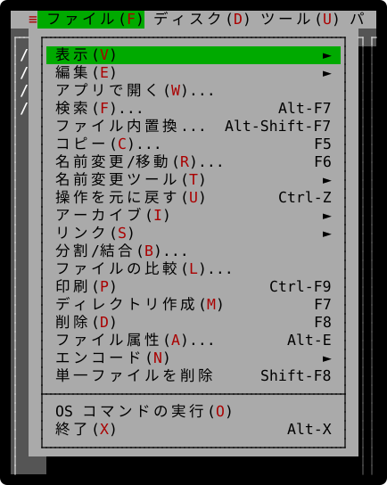

# Navigator ヘルプ

Navigator は、2 画面ファイルマネージャ DOS Navigator を現代の端末向けに再現したものです。これらのページはそのマニュアルで、
同じファイルが Navigator の中で `F1` を押したときに表示されます。

## はじめに

画面には、上部にメニューバー、ファイルを表示する 2 枚の[パネル](panels.md)、その下に[コマンドライン](console.md)、最下行に
ファンクションキーの働きを示すキーバーがあります。修飾キーを報告する端末では、`Alt`、`Ctrl`、`Shift` を押しているあいだ、
そのキーを押したときの働きが表示されます。

| キー | 動作 |
|---|---|
| `Tab` | パネルを切り替える |
| `Enter` | ディレクトリに入る、ファイルを開く |
| `F3`, `F4` | ファイルを[表示](viewer.md)、[編集](editor.md)する |
| `F5`, `F6` | [コピー、名前の変更と移動](file-operations.md#コピーと移動) |
| `F7` | ディレクトリを作る |
| `F8` | 削除する |
| `F10` | メニューを開く |
| `Ctrl+O` | ウィンドウの背後の[コンソール](console.md)を表示する |
| `Alt+X` | 終了する |
| `F1` | 今している操作のヘルプ。[ヘルプの使い方](help.md)を参照 |

どのコマンドもメニューにあり、横にキーが示されています。`Alt+Shift+P` を押して名前の一部を入力すると、コマンドを探せます。

## 目次

ファイルとディレクトリ:

- [パネル](panels.md): 移動、表示形式、並べ替え、タグ付け、情報パネル、列、フィルタ、ファイルと重複ファイルの検索、リストファイル
- [ファイル操作](file-operations.md): コピーと移動、名前の変更、削除、元に戻す、属性、リンク、分割と結合、UU、チェックサム、暗号化、
  テキストの変換、別のアプリケーションで開く、印刷
- [アーカイブ](archives.md): 形式、開く、テスト、アーカイブの作成と展開
- [比較](compare.md): ディレクトリ、同期ウィンドウ、2 つのファイル
- [ディレクトリツリー](trees.md): パネルの横のツリー、ディレクトリの変更、ツリーウィンドウ、ディレクトリサイズ
- [ディスク以外の場所](drives.md): アーカイブ、サーバー、コンテナ、ボリューム、ディスクイメージ、ごみ箱
- [root としての作業](as-root.md): 権限のない操作を行う方法と root アクセス
- [接続](connections.md): リンクマネージャ、パスワード、ホスト鍵、ポート転送、保存済みリンク
- [ブックマーク](bookmarks.md): 一覧とそのキー

ファイルを見る、変える:

- [ビューア](viewer.md): キー、ファイルを開く、ページ、PDF と画像、検索、行の絞り込み、データツリー、テーブル
- [エディタ](editor.md): キー、ファイルを開く、ブロック、検索と置換、行へ移動、余白、構文の強調表示
- [マクロ](macros.md): 記録したキーと、エディタのマクロ

Navigator を使う:

- [コマンドラインとコンソール](console.md): コマンドの実行、コマンドウィンドウ、履歴
- [Navigator の起動](command-line.md): `nav` コマンドのオプション
- [ウィンドウ](windows.md): ウィンドウ間の移動、1 つのテキストの 2 つのビュー、バックグラウンドの処理、デスクトップの保存、
  ウィンドウ一覧、コマンドパレット
- [ダイアログボックス](dialogs.md): キーと、ファイルの選択
- [コピーと貼り付け](clipboard.md): キー、クリップボードのツール、各端末での扱い
- [設定](settings.md): 設定 > 設定 のすべてのページ
- [キーと色](customizing.md): キー割り当て、テーマの色
- [ユーザーメニューとファイルの関連付け](user-menu.md)

ツール:

- [電卓](calculator.md): 4 つのフェイス、式、キー
- [ツール](utilities.md): プロセス一覧、サービス、システムモニタ、環境変数、システム情報、カレンダー、文字表、SmartPad、システムメニュー
- [ゲーム](game.md): キー、トップテン、設定

- [ヘルプの使い方](help.md): 今いる場所のヘルプと、このウィンドウのキー
