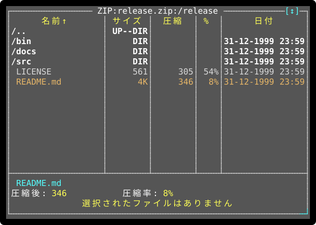
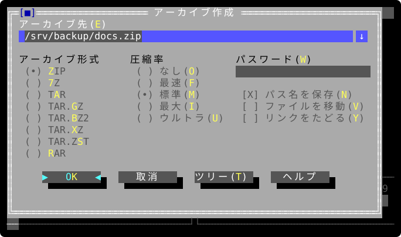
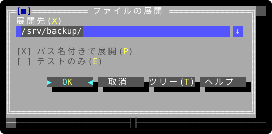

# アーカイブ

Navigator はアーカイブをディレクトリとして表示します。zip や tar ファイルで `Enter` を押すとその中に入り、中のファイルは
他のファイルと同じように表示したりコピーして取り出したりできます。このページでは、アーカイブを開く、作る、展開する方法を説明します。

## アーカイブを開く

アーカイブ上で `Enter` か `Ctrl+PgDn` を押すとその中に入り、最上位の `..` で外へ出ます。`Enter` はアーカイブを名前で判別します。
`.zip`、`.tar.gz`、`.7z`、`.deb` などです。*ファイル > アーカイブ > アーカイブを開く*、または `Ctrl+PgDn` は、名前にかかわらず
カーソル位置のファイルをアーカイブとして開きます。静的ライブラリ (`.a`) や、`Enter` では実行されてしまう AppImage の中を
見るにはこれを使います。設定の[ファイルパネル](settings.md#ファイルパネル)ページで *Enter でアーカイブを開く* の
チェックを外すと、`Ctrl+PgDn` だけがアーカイブを開きます。

中では `F5` でファイルをコピーして取り出します。変更できる形式では、`F8` でファイルを削除したり、ファイルをコピーして入れたりもできます。
詳細表示では、各ファイルの圧縮後のサイズと圧縮率が表示されます。

| 形式 | 必要なもの | 変更できるか |
|---|---|---|
| ZIP、TAR、gzip・bzip2・xz で圧縮した TAR | なし | はい |
| gzip・bzip2・xz・lzma で圧縮した単一ファイル | なし | その 1 ファイルのみ |
| zstd で圧縮した TAR または単一ファイル | Python 3.14 より前では `zstd` プログラム | はい。単一ファイルはそのファイルのみ |
| 7Z | 7-Zip (`7z`、`7zz`、`7za`) | はい |
| RAR | `unrar`、または 7-Zip の `7z` か `7zz` | RARLAB の `rar` がある場合のみ |
| Debian・RPM パッケージ、CPIO、静的ライブラリ (`.a`) | なし | いいえ |
| SquashFS イメージと AppImage | squashfs-tools の `unsquashfs` | いいえ |

プログラムがないとき、`Enter` はファイルを実行する代わりに、どれをインストールすればよいかを知らせます。パスワード付きの
アーカイブではパスワードを尋ねます。

## アーカイブのテスト

アーカイブの中で *ファイル > アーカイブ > アーカイブをテスト* を実行すると、選択したファイルを最後まで読んでそれぞれを検査します。
カーソルが `..` にあり何もタグ付けしていなければ、アーカイブ全体を検査します。検査に失敗したファイルは名前が示されます。
[展開](#ファイルの展開)ボックスの *テストのみ* は、外から同じことをします。

## アーカイブの作成

`Shift+F1`、または *ファイル > アーカイブ > アーカイブ作成* で、選択したものを新しいアーカイブにまとめます。

- *アーカイブ先* はアーカイブの名前です。この行はもう一方のパネルのディレクトリが入った状態で開きます。ディレクトリのない名前では、
  現在のディレクトリにアーカイブを作ります。*ツリー* はツリーからディレクトリを選びます。アーカイブがすでにある場合は、
  追加するか置き換えるかを尋ねます。
- *アーカイブ形式* で形式を選びます。名前の拡張子は形式に合わせて変わり、拡張子を入力すると形式が選ばれます。
  インストールされていないプログラムが必要な形式は灰色になり、ボタンの上の行にそのプログラムが示されます。
- *圧縮率* は時間とサイズの兼ね合いで、*なし* から *ウルトラ* まであります。形式にないレベルは灰色になります。
  プレーンな TAR にはレベルがありません。
- *パスワード* はアーカイブを暗号化します。7-Zip がインストールされていれば ZIP と 7Z で、また RAR で使えます。
  パスワードはもう一度入力を求められます。

オプション:

- *パス名を保存* は、名前だけでなく各ファイルのディレクトリもアーカイブ内に保持します。
- *ファイルを移動* は、アーカイブに入れた後にファイルを削除します。
- *リンクをたどる* は、リンクそのものではなくリンク先のものをまとめます。

## ファイルの展開

アーカイブ上で `Shift+F2`、または *ファイル > アーカイブ > アーカイブを展開* で、指定したディレクトリに展開します。
アーカイブの中では、*展開* で選択したものを展開します。

- *パス名付きで展開* は、アーカイブ内のディレクトリを作ります。チェックがなければ、すべてのファイルが展開先のディレクトリに直接入ります。
- *テストのみ* はアーカイブのエラーを検査し、何も書き込みません。

*ツリー* はツリーから展開先のディレクトリを選びます。
