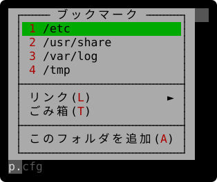

# ブックマーク

ブックマークは、よく行くディレクトリです。`Alt+F1` で左パネルの一覧が、`Alt+F2` で右パネルの一覧が、`Alt+C` でアクティブなパネルの一覧が開きます。*管理* メニューの *左のブックマーク* と *右のブックマーク* からも開けます。

## 一覧

各ブックマークにはキーがあり、`1` から `9`、`0`、その後は英字です：そのキーを押すか、ブックマークに移動して `Enter` を押すと、パネルがそこへ移ります。今はディレクトリが存在しないブックマークは灰色で表示されます。

| キー | 動作 |
|---|---|
| `Enter`、またはブックマークのキー | ディレクトリへ移る |
| `F2` | ブックマークにラベルを付ける。ラベルはパスの代わりに表示される。空のラベルで取り除く |
| `Ctrl+Up`、`Ctrl+Down` | ブックマークを一覧の上または下へ動かす |
| `Del` | ブックマークを削除する |
| `Esc` | 一覧を閉じる |

最後の項目は *このフォルダを追加* で、パネルのディレクトリをブックマークします。すでにブックマーク済みのときは *このフォルダを削除* になります。

区切り線の下には、今マウントされていてブックマークになっていないディスク (USB メモリなど) が並びます。これらは移動先であって、保存はされません。一覧には *リンク* の部分もあり、[保存した接続](connections.md) が並びます。

削除する前には確認されます。その質問の *今後は確認しない*、または [確認](settings.md#確認) ページの *ブックマーク削除* で、質問をオフにできます。

## 一覧を使わずに

`Alt+1` から `Alt+9` で、アクティブなパネルを最初の九つのブックマークへ直接移します。`Alt+Shift+1` から `Alt+Shift+9` で、パネルのディレクトリをその位置にブックマークします。

## 最初のブックマーク

Navigator は最初の起動時に、ホームディレクトリ、存在するデスクトップのフォルダ (ドキュメントやダウンロードなど)、ディスクがマウントされているディレクトリをブックマークします。その後、一覧はあなたのものです：削除したブックマークが戻ってくることはありません。
