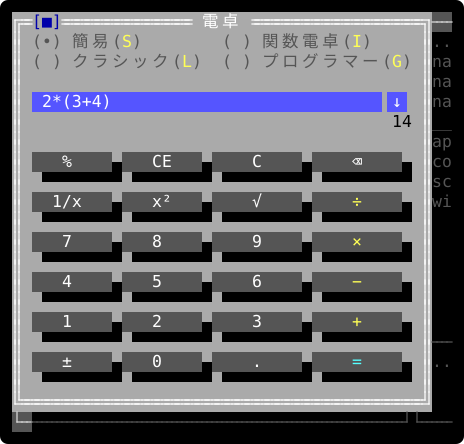
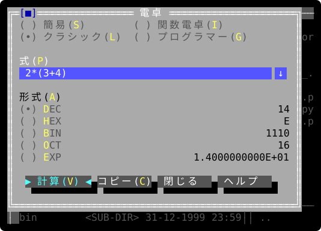
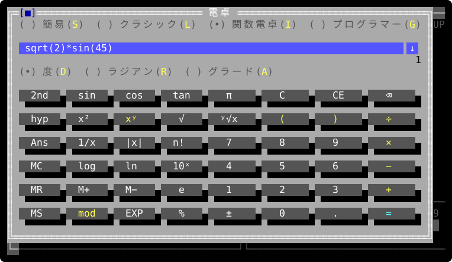
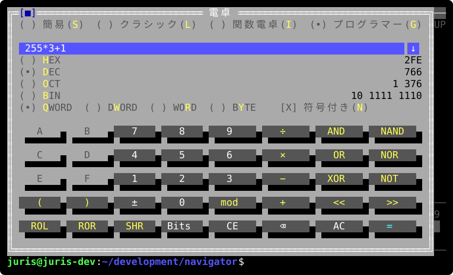

# 電卓

`Ctrl+F6`、または *ツール > 電卓* で電卓を開きます。行に式を入力すると、入力に合わせてその値が計算されます。`Enter` で式を確定すると、
式は行の履歴に入り、値は選択された状態で残ります。そのため数字を打てば新しい計算が始まり、演算子を打てばその値から続けられます。

## 4 つのフェイス

電卓には 4 つのフェイスがあり、上部の帯、*電卓* メニュー、またはもう一度 `Ctrl+F6` を押して次のフェイスへ進むことで選びます。
最後に使ったフェイスを覚えています。

- *簡易* はポケット電卓です。数字と四則演算。
- *クラシック* は値を 5 つの形式で同時に表示します。10 進数、16 進数、2 進数、8 進数、指数表記です。
- *関数電卓* は、関数、角度の単位の選択、メモリ、直前の答えを加えます。
- *プログラマー* は、選んだサイズの整数を 4 つの基数で扱います。

*簡易*、*関数電卓*、*プログラマー* では、行の下のキーパッドがキーボードと同じように行に入力します。関数キーは
カーソルの前の数を囲みます。`9` の後に `√` を押すと `SQRT(9)` になります。

## 式

| 書くもの | 意味 |
|---|---|
| `12`, `1.5`, `.5`, `1E+3` | 数 |
| `$FF`, `0FFh`, `0x1F` | 16 進数 |
| `101b`, `0b101` | 2 進数 |
| `17o` | 8 進数 |
| `+`, `-`, `*`, `/` | 四則演算 |
| `^` | べき乗: `2^10` |
| `%` | 2 つの整数の割り算の余り |
| `&`, `\|`, `\`, `~` | ビットごとの AND、OR、排他的 OR、NOT |
| `<<`, `>>` | シフト |
| `=`, `<>`, `<`, `>`, `<=`, `>=` | 比較。1 か 0 になる |
| `&&`, `\|\|` | 2 つの真偽値の AND、OR |
| `(`, `)` | 括弧 |
| `PI` | 円周率 π |

大文字と小文字は区別しません。乗算と除算は加算と減算より先に、べき乗はそれらすべてより先に計算されます。

関数は `SIN`、`COS`、`TAN`、`CTAN`、`ARCTAN`、`SQR` (2 乗)、`SQRT` (平方根)、`LN`、`LG` (常用対数)、`EXP`、`SIGN`、
そして `IF(condition, a, b)` です。`IF` は条件が真なら `a`、そうでなければ `b` になります。

## クラシック

5 つの行が各形式で値を表示します。整数でない数は、16 進数、2 進数、8 進数では整数部を表示します。

- *計算* は `Enter` と同じように式を計算します。
- *形式* で形式を選び、*コピー* でその形式の値をクリップボードに入れます。
- *閉じる* で電卓を閉じます。

## 関数電卓

- *度*、*ラジアン*、*グラード* で、三角関数が受け取り返す単位を選びます。
- さらに使える関数: `ASIN`、`ACOS`、`ATAN`、`SINH`、`COSH`、`TANH`、`ABS`、`CBRT`、`ROOT(x, n)`、`LOG`、`LOG2`、
  `FACT`、そして数の後に付けて階乗を表す `!`。`E` はネイピア数 e です。
- `ANS`、または *Ans* キーは、最後に計算した値です。
- メモリキー: *MS* は値を記憶し、*MR* は呼び出し、*M+* と *M−* はそれに足し引きし、*MC* は消去します。
- *2nd* と *hyp* は関数キーが入力するものを変えます。逆関数と双曲線関数です。

## プログラマー

- *HEX*、*DEC*、*OCT*、*BIN* で、数を入力する基数を選びます。値は 4 つすべてで表示されます。
- *QWORD*、*DWORD*、*WORD*、*BYTE* で数のサイズを選びます。64、32、16、8 ビットです。収まらない結果はそのサイズに切り詰められます。
- *符号付き* は数を符号付きとして読みます。チェックを外すと負にはなりません。
- 除算の結果は整数になります。
- 演算は単語でも書けます。`AND`、`OR`、`XOR`、`NAND`、`NOR`、`NOT`、`MOD`、`SHL`、`SHR`、`SAR`、`ROL`、`ROR` です。
- *電卓* メニューの *ビット入力* は、キーの代わりに 64 ビットを表示します。クリックか `Space` でビットを反転します。

## キー

| キー | 動作 |
|---|---|
| `Enter` | 計算する |
| `Ctrl+F6` | 次のフェイス |
| `Ctrl+1` から `Ctrl+4` | 簡易、クラシック、関数電卓、プログラマー (端末がこれらのキーを送る場合) |
| 行での `Down` | 式の履歴 |
| `Esc` | 電卓を閉じる |
