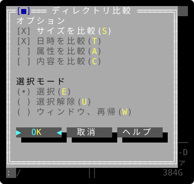
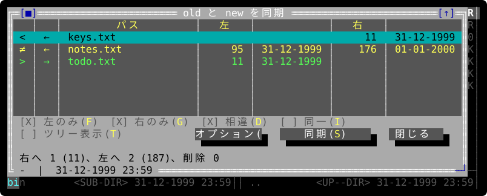
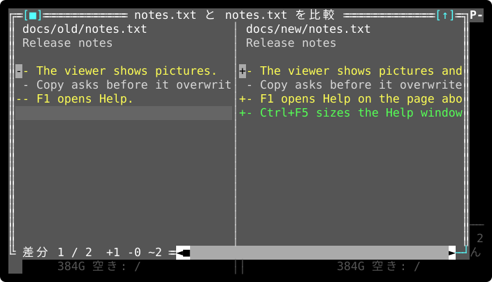

# 比較

## ディレクトリ比較

*パネル > ディレクトリ比較* は、2 枚のパネルのファイルを名前で比較します。

- *サイズを比較*、*日時を比較*、*属性を比較*、*内容を比較* で、同じ名前の 2 つのファイルを同一とみなす条件を選びます。
  ファイルを読むのは *内容を比較* だけで、時間がかかります。
- *選択* は、各パネルで、もう一方に対応するもののないファイルにタグを付けます。タグ付けしたファイルを反対側へコピーすれば、
  もう一方のディレクトリが最新になります。
- *選択解除* は、代わりにそれらのファイルのタグを外します。
- *ウィンドウ、再帰* は、ディレクトリをその中身すべてと共に比較し、同期ウィンドウを開きます。

## 同期

同期ウィンドウは、片側にしかないファイルや異なるファイルをすべて一覧し、左パネルのディレクトリを左に表示します。各行には動作があります。
右へコピー、左へコピー、削除、スキップです。ウィンドウが動作を提案し、*同期* メニューでカーソル位置の行またはすべての行の動作を
一度に変えられます。

- *同期* (`F5`) は、確認のうえ動作を実行します。
- *ファイル比較* (`Enter` または `F3`) は、行の 2 つのファイルを左右に並べて表示します。
- *再比較* (`Ctrl+R`) は、両方のディレクトリを読み直します。
- *左のみ表示*、*右のみ表示*、*相違を表示*、*同一のものも表示* で、一覧する行を選びます。
- *ツリー表示* (`Ctrl+T`) は、行をディレクトリのツリーとして一覧します。
- *オプション* は、ファイルの比較方法と、対象とするファイルの[ファイルマスク](panels.md#ファイルマスク)を設定します。

### オプション

同期ウィンドウの *オプション* は、何をどう比較するかを設定します。*OK* で両方のディレクトリを再び比較します。

- *マスク* は対象とするファイルを選びます。空ならすべてを比較します。パターンは `;` で区切ります。パターンの前の `-` はその
  ファイルを除外し、パターンの後の `/` はディレクトリを表します。例: `*.py;-.git/`。
- *同じとみなす時刻* は、2 つの時刻がどれだけ近ければよいかを決めます。*正確に、秒単位で*、*2 秒以内 (FAT)*、*1 分以内 (FTP)* です。
- *ちょうど 1 時間ずれていても同じ* は、1 時間ずれた時刻も同じとみなします。夏時間の切り替えで FAT ディスクにこのずれが生じます。
- *非対称: 右を左のコピーにする* は、右側にしかないものの削除と、異なるファイルすべての右へのコピーを、どちらが新しいかにかかわらず提案します。

## ファイル比較

*ファイル > ファイル比較* は、2 つのファイルを左右に並べ、違いに印を付けて表示します。アクティブなパネルでタグ付けした 2 つのファイルを
使います。タグ付けしたものがなければ、カーソル位置のファイルと、もう一方のパネルの同じ名前のファイル (その名前のものがなければ
もう一方のパネルのカーソル位置のファイル) を使います。

