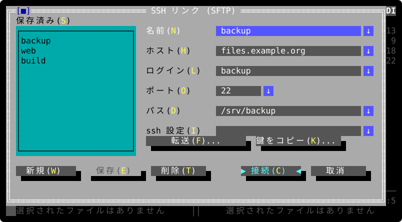
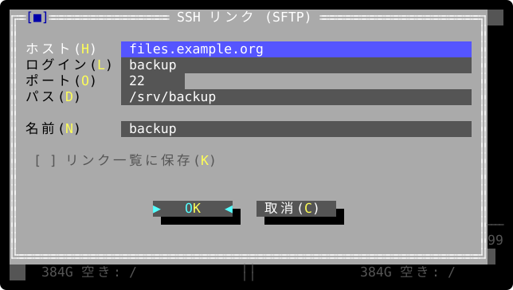
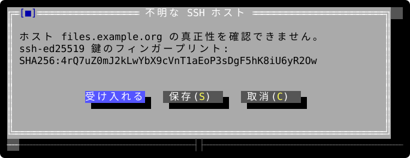
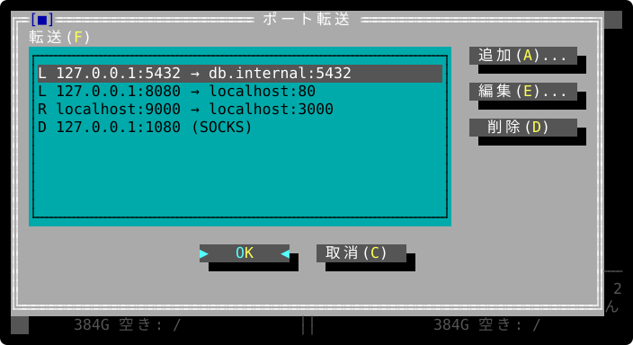
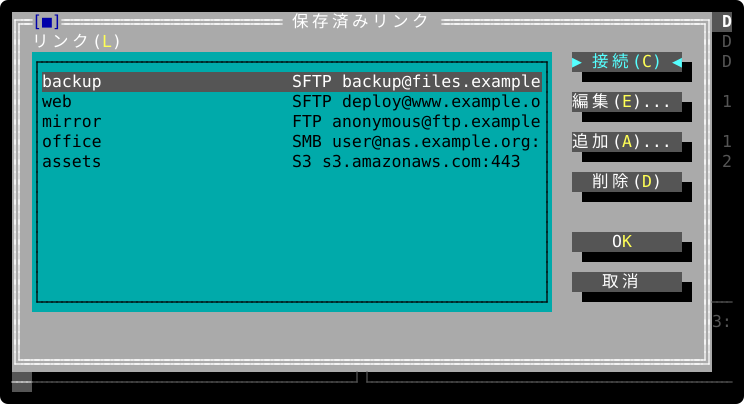

# 接続

パネルをサーバー上に置く方法と、使う接続を保存しておく方法です。それぞれの場所の種類と、そこへ到達する他の方法については、
[ディスク以外の場所](drives.md)にあります。

## リンクマネージャ

*ツール > リンク* の各項目、たとえば *SSH (SFTP)* (`Alt+F11`) は、そのプロトコル用に保存した接続を左に、1 つの接続の各行を右に
表示するボックスを開きます。

- ボックスは各行が空の状態で開きます。入力して *接続* を押すと、保存しない接続になります。
- *保存済み* の下で接続を選ぶと、その内容が各行に入ります。ダブルクリックで接続します。
- *新規* は保存する接続を作ります。名前は上書きして入力できます。*保存* は変更を保存します。変更した接続には `*` が付き、
  そこから離れようとすると保存するかどうかを尋ねます。*削除* は接続を取り除きます。
- *接続* はアクティブなパネルをそこへ移します。*ツール > リモートシェル* から開いた場合は、代わりにウィンドウでシェルを開きます。

各行は[接続](#接続の各行)の行です。各行は以前の内容を覚えており、行で `Down` を押すとその履歴が開きます。

SSH マネージャにはさらに 3 つあります。

- *ssh 設定* は、リモートシェルを開くときに `ssh` に渡されます。
- *転送* は、接続の[ポート転送](#ポート転送)を設定します。
- *鍵をコピー* は、公開鍵の 1 つをサーバーに置き、以後の接続でパスワードを不要にします。

rclone マネージャの *設定* は、`rclone config` を実行してリモートを設定します。

## 接続の各行

| 行 | 内容 |
|---|---|
| *ホスト* | サーバーの名前またはアドレス。SSH では `~/.ssh/config` の `Host` 名も使え、空のログインとポートはそのファイルの内容で補われる |
| *ログイン* | 接続するユーザー |
| *ポート* | プロトコルの標準ポートでない場合のポート |
| *パス* | サーバー上でパネルが最初に開く場所 |
| *名前* | 接続を保存するときの名前 |

行はプロトコルによって少し異なります。FTP 接続には FTPS にする *TLS で暗号化* があり、GVfs/KIO の場所には *名前* と *URI* しかありません。

*リンク一覧に保存* は、接続をその名前で保存し、次回はワンステップで接続できるようにします。

## パスワードとパスフレーズ

サーバーのパスワードや秘密鍵のパスフレーズは、接続に必要になったときに尋ねられます。*キーリングに保存* は、それをデスクトップの
キーリングに記憶し、次からは尋ねないようにします。これは保存先のキーリングがある場合にだけ表示されます。

## 不明なホスト鍵

SSH サーバーに初めて接続するとき、そのホスト鍵は `~/.ssh/known_hosts` にないので、`ssh` と同じように続行するかどうかを尋ねられます。

- *受け入れる* は、この接続に限って鍵を信頼します。
- *保存* は、さらに鍵を `~/.ssh/known_hosts` に書き込み、次からは尋ねないようにします。
- *取消* は接続しません。

受け入れる前に、表示されたフィンガープリントをサーバーの管理者から入手したものと照合してください。

## ポート転送

SSH マネージャの *転送* は、接続のポート転送を一覧します。*追加*、*編集*、*削除* で一覧を変更し、一覧は接続を保存するときに
一緒に保存されます。

| 種類 | 動作 |
|---|---|
| *ローカル (-L)* | このマシンのポートが、サーバーから到達する転送先につながる |
| *リモート (-R)* | サーバーのポートが、このマシンから到達する転送先につながる |
| *動的、SOCKS (-D)* | このマシンのポートが、サーバーを経由する SOCKS プロキシになる |

*待受アドレス* と *待受ポート* は接続を待つ側で、*転送先ホスト* と *転送先ポート* は接続の送り先です。動的転送には転送先がありません。

## 保存済みリンク

*ツール > 保存済みリンク* は、すべてのプロトコルの保存した接続を 1 つのボックスに一覧します。*接続* はカーソル位置の接続を開き、
*編集* は変更し、*追加* は新しく作り、*削除* は取り除きます。変更は *OK* で閉じたときに保存されます。

*ツール > 切断* (`Alt+H`) は接続を閉じます。その接続を表示していたパネルはディスクに戻ります。
