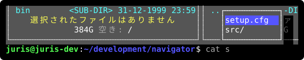
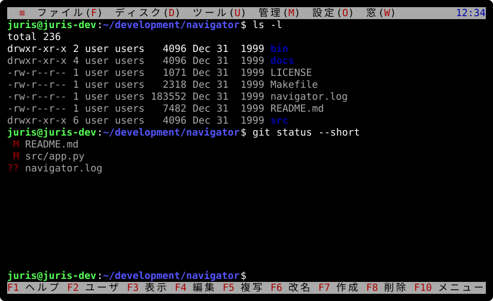
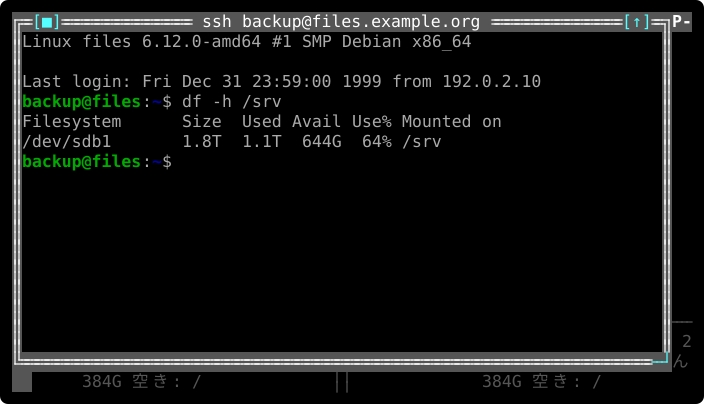
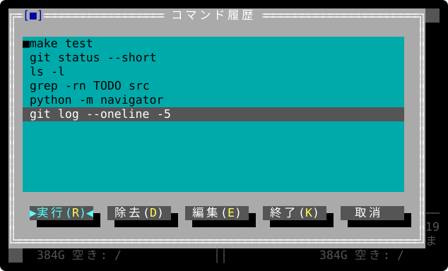

# コマンドラインとコンソール

パネルの下にはコマンドラインがあり、ウィンドウの背後にはコンソールがあります。コンソールは、シェルが動いている端末です。

## コマンドライン

パネルがキーボードを持っているときに入力したものは、コマンドラインに入ります。`Enter` を押すと、アクティブなパネルの
ディレクトリでシェルがそれを実行し、出力はコンソールに表示されます。

| キー | 動作 |
|---|---|
| `Enter` | コマンドを実行する |
| `Ctrl+Enter` | カーソル位置のファイルの名前を行に入れる |
| `Ctrl+E`, `Ctrl+X` | 前のコマンド、次のコマンドを呼び出す |
| `Tab` | 行に文字があるとき、入力中の単語を補完する |
| `Esc` | 行を消去する |

行に文字があるあいだは、`Left`、`Right`、`Home`、`End` で行を編集します。パネルのプログラム上で `Enter` を押すとそれを実行します。

コマンドの後、パネルはディレクトリを読み直し、コマンドがディレクトリを変えた場合はアクティブなパネルがシェルに追従します。

## コンソール

`Ctrl+O` でウィンドウを隠してコンソールを表示し、もう一度 `Ctrl+O` でウィンドウを戻します。ウィンドウを隠しているあいだ、
キーはシェル、またはシェルで実行中のプログラムに送られます。

`Shift+PgUp` と `Shift+PgDn` でコンソールがこれまでに表示した内容をさかのぼってスクロールし、`Shift+Up` と `Shift+Down` で
1 行ずつスクロールします。

コンソールでプログラムが実行中のあいだは、`F1` や `F10` を含むすべてのキーがそのプログラムに送られます。先にそのプログラムの
方法で終了してください。

## ウィンドウでのコマンド

コマンドは、コンソールではなく、パネルの横の専用ウィンドウで実行することもできます。コマンドラインを `&` で始めるか、
`Enter` の代わりに `Shift+Enter` を押します。

ウィンドウ内のプログラムは、別のウィンドウを前面に出すキー以外のすべてのキーを受け取ります。プログラムが終わると、ウィンドウは
出力を残し、題に終了のしかたが示されます。`Esc` か `Enter` で閉じます。プログラムの実行中にウィンドウを閉じると、プログラムは終了します。

*ツール > リモートシェル* は、サーバー、コンテナ、デバイスのシェルをこのようなウィンドウで開きます。

## コマンドの実行

*ファイル > OS コマンドの実行* は、コマンドラインと履歴を共有する行でコマンドを尋ねます。

- *ウィンドウで* は、コンソールではなく専用のウィンドウで実行します。
- *最大化* は、そのウィンドウをデスクトップ全体に広げて開きます。
- *モーダル* は、閉じるまでキーボードをそのウィンドウに留めます。

## コマンド履歴

`Alt+F8`、または *ツール > コマンド履歴* で、入力したコマンドを、最新のものを最後にして一覧します。

- *実行*、または `Enter` で、カーソル位置のコマンドを実行します。
- *挿入* は、実行せずにコマンドラインに入れます。
- *編集* はボックスで変更します。変更したコマンドが最新のものになります。
- *終了*、または `Del` で、履歴から取り除きます。

*ツール > 履歴のあいまい検索* (`Alt+Shift+F8`) は、ここで入力したコマンドとシェルで入力したコマンドを `fzf` で検索します。

## ファイル履歴

`Alt+PgDn` で以前に表示したファイルを、`Alt+PgUp` で以前に編集したファイルを一覧します。これらは *ツール* メニューの
*ファイル表示履歴* と *ファイル編集履歴* です。*開く* でカーソル位置のファイルを再び開き、*記録を削除* で一覧から取り除きます。
