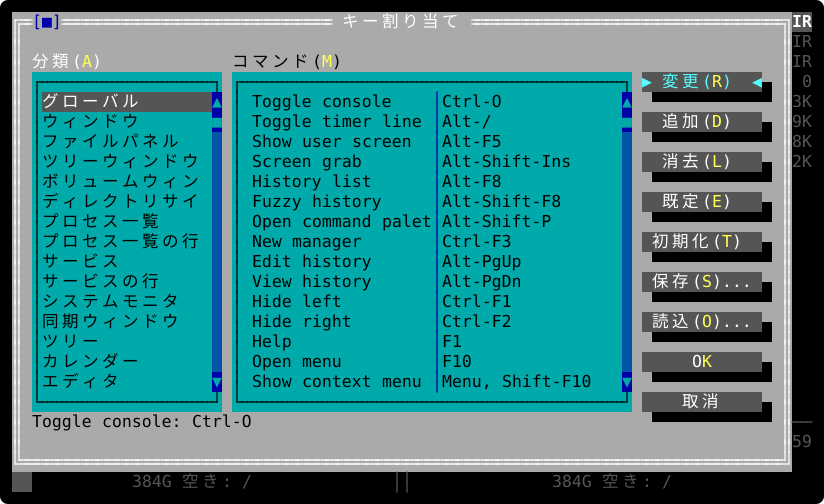
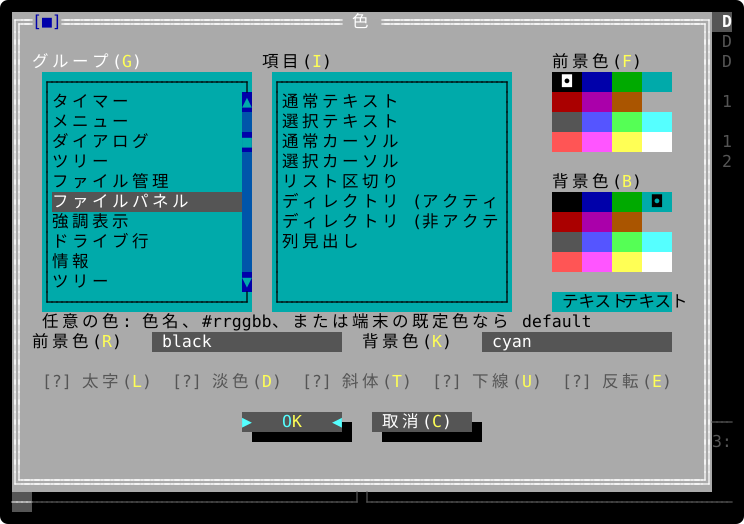

# キーと色

## キー割り当て

*設定 > 構成 > キー割り当て* で、どのキーが何をするかを変更できます。キーは、それが働く場所ごとのセクションに分けて並んでいます：どこでも、ファイルマネージャー、エディター、ビューアー、ダイアログなどです。

コマンドを選び、割り当てたいキーを押します。

*保存* は割り当て一式をファイルに書き出し、*読込* はファイルから読み込みます。Navigator には四つのセットが付属しています：既定のセットと、WordStar、DOS Navigator 1.51、Emacs にならったセットです。

割り当ては設定ディレクトリの `keybindings.ini` に保存されます。一覧やテキストの中でカーソルを動かすキーは固定です。

## 色

*設定 > 色* で、使用中のテーマの色を変更できます。

- *グループ* と *項目* で、何に色を付けるかを選びます。
- *前景色* と *背景色* は十六色から選びます。その横の入力行には、任意の色を名前または `#rrggbb` で入力できます。
- 五つのボックスで太字、淡色、斜体、下線、反転を設定します。`?` と表示されたボックスは、その属性を項目が継承するままにします。

変更すると画面はすぐに追従します。*OK* でこのテーマへの変更を確定し、*取消* ですべて元に戻します。

*パレットを保存* は色を独自のテーマとして保存し、それは `--theme` と *パレットを読み込み* から見つけられるようになります。*パレットを読み込み* は別のテーマの色を取り込みます。

別のテーマを使うには、Navigator を `--theme NAME` で起動します。`--list-themes` でテーマの名前が一覧できます。
