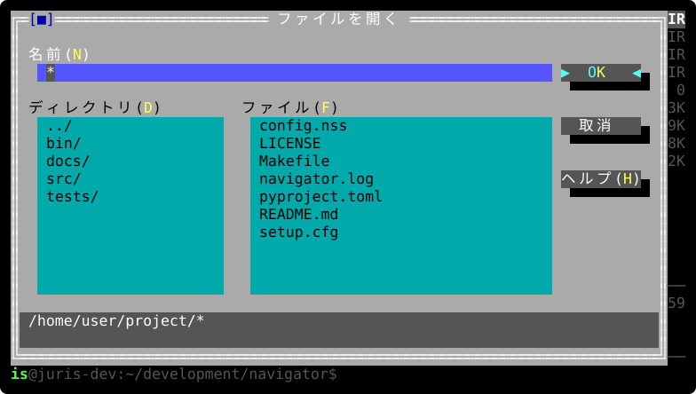

# ダイアログボックス

ダイアログボックスは、閉じるまでキーボードを占有します。

## ダイアログボックスでのキー

| キー | 動作 |
|---|---|
| `Tab`、`Shift+Tab` | 次または前のコントロールへ移る |
| `Alt` と強調表示された文字 | その文字のコントロールへ移る |
| `Enter` | 既定のボタン (矢印の付いたボタン) を押す |
| `Esc` | 何もせずにボックスを閉じる |
| `Space` | チェックボックスをオンにする、またはラジオボタンを選ぶ |
| 横に `↓` がある行で `Down` | その行の履歴を開く |
| `F1` | このボックスのヘルプを表示する |

履歴一覧では、`Enter` で項目を取り込み、`Del` で項目を忘れさせます。

## ファイルの選択

いくつかのコマンドは、同じボックスでファイルを尋ねます：一行に名前、その下に表示中の場所のファイルとディレクトリが並びます。

- *名前* はファイルの名前です。パス全体を入力することもできます。`*` や `?` を含む名前、またはディレクトリの名前を入力すると、一つを選ぶ代わりにそれらのファイルが一覧されます。
- *ファイル* は一致するファイルの一覧です。そこで文字を入力すると、その文字で始まる名前を探します。
- *ディレクトリ* はディレクトリの一覧です。一つの上で `Enter` を押すとその中に入ります。
- 下部の枠には、パスと、カーソル位置のファイルのサイズと日付が表示されます。
- *OK*、またはファイルの上で `Enter` を押すと、そのファイルが選ばれます。

`Left` と `Right` で一覧とボタンの間を移動します。
