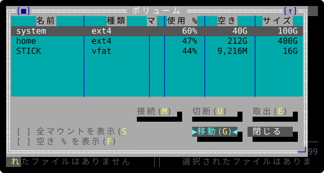
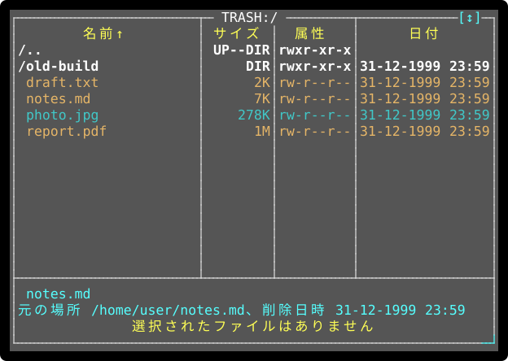

# ディスク以外の場所

パネルには、ディスク上のディレクトリ以外のものも表示できます。どこであっても、ファイルの表示、編集、コピー、削除は同じ方法で行えます。

## アーカイブ

zip や tar ファイルなどのアーカイブ上で `Enter` を押すと、ディレクトリと同じようにその中に入ります。`F5` でファイルを
コピーして取り出したり、入れたりします。作成と展開については[アーカイブ](archives.md)で説明しています。

## サーバー、コンテナ、デバイス

*ツール > リンク* は、別のマシンやサービス上にパネルを開きます。各項目は、作った接続の一覧を保存しておき、再び接続できるようにします。
そのボックスについては[接続](connections.md)で説明しています。

| 項目 | 到達できる場所 |
|---|---|
| *SSH (SFTP)*, `Alt+F11` | SSH 経由のサーバー |
| *FTP* | FTP または FTPS サーバー |
| *SMB* | Windows の共有 |
| *S3* | S3 または互換サービスのバケット |
| *Docker コンテナ*, *Podman コンテナ* | 実行中のコンテナ内のファイル |
| *Android デバイス* | `adb` 経由のスマートフォンやタブレット |
| *rclone リモート* | Google Drive や Dropbox など、`rclone` で設定した任意のリモート |
| *GVfs/KIO リンク* | MTP 経由のスマートフォンや WebDAV サーバーなど、デスクトップが到達できるあらゆる場所 |

必要なプログラムがインストールされていない項目は灰色になり、そのツールチップにプログラムの名前が示されます。

ディレクトリを尋ねられる場所では、`sftp://user@host/dir` や `smb://host/share` のようなアドレスを入力することもできます。

*ツール > リモートシェル* は、サーバー、コンテナ、デバイスでシェルを開きます。*ツール > 切断* (`Alt+H`) は接続を閉じます。
その接続を表示していたパネルはディスクに戻ります。

## ボリューム

*ディスク > ボリューム* は、ディスクとリムーバブルメディアを一覧し、マウント、マウント解除、取り出しを行います。

### ディスクイメージ

ディスクイメージ (`.iso` や `.img` ファイル) 上で `Enter` を押すか、カーソルをその上に置いて *ディスク > イメージをマウント* を選ぶと、
読み取り専用でマウントしてパネルで開きます。イメージの中またはその上で *ディスク > イメージのマウントを解除* を選ぶと、マウントを解除し、
その中にあったパネルをイメージファイルに戻します。これには udisks2 が必要で、ほとんどのデスクトップで動いています。
設定の[ファイルパネル](settings.md#ファイルパネル)ページの *ENTERでイメージをマウント* で、`Enter` によるマウントをオフにできます。

## ごみ箱

設定の[ファイルパネル](settings.md#ファイルパネル)ページで *F8 でごみ箱へ移動* にチェックを付けると、`F8` はディスク上のファイルを
削除する代わりにごみ箱へ移します。このとき[削除](file-operations.md#削除)ボックスの *ごみ箱へ移動* にチェックが付いています。
チェックを外すと、ファイルを完全に削除します。[元に戻す](file-operations.md#元に戻す) (`Ctrl+Z`) で、最後のごみ箱への移動を取り消せます。

*ディスク > ごみ箱*、またはごみ箱アイコンのダブルクリックで、ごみ箱内のファイルをアクティブなパネルに表示します。パネルの下の行には、
カーソル位置のファイルの元の場所と削除された日時が表示されます。

- *ファイル > ごみ箱から復元* は、選択したファイルを元の場所に戻します。
- そこで `F8` を押すと、ファイルを完全に削除します。
- `F5` は、他のディレクトリと同じようにファイルをコピーして取り出します。

*ディスク > ごみ箱を空にする* は、確認のうえ、ごみ箱内のすべてを完全に削除します。

## ブックマーク

`Alt+F1` と `Alt+F2` は左右のパネル用に、`Alt+C` はアクティブなパネル用に、ブックマークしたディレクトリの一覧を開きます。
一覧のキーは[ブックマーク](bookmarks.md)にあります。
