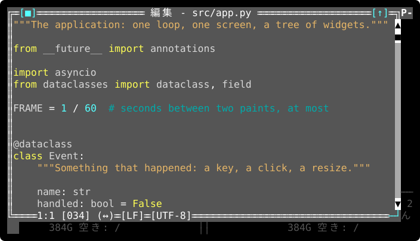
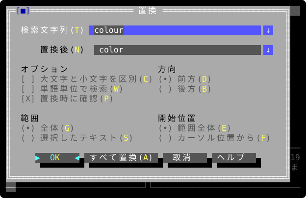
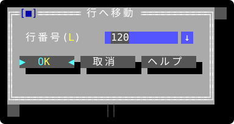
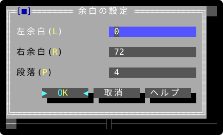

# エディタ

`F4` でカーソル位置のファイルをエディタで開きます。どのコマンドも *エディタ* メニューにあり、このメニューはエディタを開いているあいだ
メニューバーに現れます。



## キー

| キー | 動作 |
|---|---|
| `F2` | 保存する |
| `Shift+F2` | 別の名前で保存する |
| `Ctrl+F4` | エディタを閉じる。テキストが変更されていれば先に確認する |
| `Alt+Backspace` | 元に戻す |
| `Alt+Shift+Backspace` | やり直す |
| `Ctrl+Y` | 行を削除する |
| `Ctrl+Backspace` | 左の単語を削除する |
| `Ctrl+N` | 行を挿入する |
| `F7`, `Ctrl+F7` | [検索と置換](#検索と置換) |
| `Alt+G` | [行へ移動](#行へ移動) |
| `Alt+PgUp` | 以前に編集したファイルを一覧する |

## ファイルを開く

| キーまたは項目 | 開くもの |
|---|---|
| `F4` | カーソル位置のファイル |
| `Alt+F4`, `Ctrl+K`, *ファイル > 編集 > 別のエディタ* | カーソル位置のファイルをもう一方のエディタで (下記参照) |
| `Shift+F4`, *ファイル > 編集 > 新規ファイルを編集* | [ファイルボックス](dialogs.md#ファイルの選択)で名前を指定したファイル。まだない名前は保存したときに作られる |
| *ファイル > 編集 > 開く* | ファイルボックスで選んだファイル。ファイルマネージャは不要。まだない名前は保存したときに作られる |
| `Alt+PgUp` | 以前に編集したファイルの一覧から選んだファイル |

`F4` は Navigator のエディタを使い、*別のエディタ* は別のプログラムを使います。そのプログラムは、`editors.ini` がそのファイルに
指定しているもの ([ファイルの関連付け](user-menu.md#ファイルの関連付け))、なければ端末にインストールされている `vim` や `nano` などの
エディタの一覧から選んだもので、専用のウィンドウで実行されます。設定の[システム](settings.md#システム)ページで *内蔵エディタ* の
チェックを外すと、2 つのキーの役割が入れ替わります。`F4` は `editors.ini` のプログラム (なければ `$EDITOR`) を実行し、
*別のエディタ* が Navigator のエディタを使います。`Ctrl+K` があるのは、多くのウィンドウマネージャが `Alt+F4` で端末を閉じてしまうからです。

ディレクトリ上で `F4` を押すと、その[ファイル属性](file-operations.md#ファイル属性)が開きます。

以前に編集したファイルは、前回終えた位置で開きます。

## ブロックとクリップボード

`Shift` を押しながらカーソルを動かすか、マウスでドラッグしてブロックを選択します。

| キー | 動作 |
|---|---|
| `Ctrl+Ins`, `Ctrl+C` | ブロックをコピーする |
| `Shift+Del`, `Ctrl+X` | ブロックを切り取る |
| `Shift+Ins`, `Ctrl+V` | 貼り付ける |
| `Ctrl+Del` | ブロックを削除する |
| `Alt+Shift+I`, `Alt+Shift+O` | ブロックのインデントを増やす、減らす |
| `Alt+Shift+U`, `Alt+Shift+L` | ブロックを大文字にする、小文字にする |
| `Alt+T` | ブロックの行を並べ替える |
| `Alt+H` | ブロックを隠す、表示する |

どの端末でどのコピー・貼り付けキーが働くかは、[コピーと貼り付け](clipboard.md)で説明しています。

*オプション* サブメニューでは、自動インデント、行番号、構文の強調表示など、このウィンドウの動作を切り替えます。
新しいエディタの初期状態は、設定の[エディタ/ビューア](settings.md#エディタビューア)ページで設定します。

## 検索と置換

`F7` で文字列を検索し、`Ctrl+F7` で置換します。`Shift+F7` は前回の検索を、置換も含めて繰り返します。

ボックスは、探しているものを推測した状態で開きます。選択したテキストが 1 行に収まっていればそれを、そうでなければ
カーソル位置の単語を使います。



- *検索文字列* は探す文字列です。この行で `Down` を押すと、以前の検索の履歴が開きます。
- *置換後* は、置換のとき代わりに入れる文字列です。

### オプション

- *大文字と小文字を区別* は、大文字と小文字を区別します。
- *単語単位で検索* は、より長い単語の一部になっている一致を飛ばします。
- *置換時に確認* は、置換のたびに確認します。*はい*、*いいえ*、これ以降すべてを置換する *すべて*、*取消* から選びます。

### 検索する場所

- *方向*: テキストの末尾へ向かう *前方*、先頭へ向かう *後方*。
- *範囲*: *全体* はテキスト全体を、*選択したテキスト* は選択したブロックだけを検索します。
- *開始位置*: *範囲全体* は範囲の先頭から、*カーソル位置から* はカーソルから始めます。

### 置換

*OK* は最初の一致を置換します。*すべて置換* はすべての一致を置換し、置換した数を知らせます。置換はそれぞれ
個別に元に戻せます。

### 検索バー

`Ctrl+F` と `Ctrl+R` は、ボックスの代わりにエディタウィンドウ内にバーを開きます。入力に合わせて検索し、画面上の
一致をすべて強調表示し、正規表現でも検索できます。

## 行へ移動



`Alt+G` で行番号を尋ね、その行にカーソルを置きます。行は 1 から数えます。ボックスには前回入力した数が入った状態で開きます。

## 余白



*エディタ > 段落 > 余白* では、段落の整形に使う 3 つの数を設定します。この値はこのエディタウィンドウだけに適用され、
初期値はエディタの設定から取られます。

- *左余白* は、各行が始まる桁です。
- *右余白* は、行が届いてよい最後の桁です。
- *段落* は、段落の最初の行が始まる桁です。

段落を整形するには、それをブロックとして選択し、`Alt+J` で両端揃え、`Alt+L` で左余白に揃え、`Alt+R` で右に揃え、
`Alt+C` で中央に揃えます。ブロック全体が 1 つの段落として扱われます。

## 構文の強調表示

エディタとビューアは、プログラム、ウェブページ、設定ファイルなど多くのファイルのテキストを、各部分の役割に応じて色分けします。
どの色分けを使うかは `highlight.ini` でファイルの名前によって決まり、既知の拡張子を持たないスクリプトでは `#!/bin/sh` のような
最初の行によって決まります。*設定 > 強調表示ファイルの編集* でこのファイルをエディタで開きます。

```ini
[*.conf]
lexer = ini

[*.txt]
lexer = none
autowrap = on
right_margin = 72
```

- 各セクションは[ファイルマスク](panels.md#ファイルマスク)です。ファイルに一致し、`lexer` を指定している最初のセクションが
  言語を決めます。どのセクションにも当てはまらないファイルは、Pygments の推測に任せます。
- `lexer` は言語を Pygments での名前で指定します (`python3 -m pygments -L lexers` で一覧できます)。`none` は何も色分けせず、
  `auto` は名前と内容から Pygments に推測させます。
- セクションでは、そのファイル用のエディタのオプションも、`navigator.ini` の `[editor]` セクションと同じ名前で設定できます。
  `auto_indent`、`insert_tabs`、`line_numbers`、`soft_wrap`、`autowrap`、`right_margin`、`line_ending` などです。
  各オプションは、それを設定している最初の一致セクションから取られます。すべてのオプションはファイル自身のコメントに
  一覧されています。以前に編集したファイルは、前回のオプションを保ちます。

1 つのウィンドウについては、*エディタ > ファイルの種類* (`Ctrl+Shift+H`) で別の言語を選び、*エディタ > オプション > 構文の強調表示*
で色分けをオフ・オンします。色はテーマのものです。
