# ファイル操作

コピー、移動、リンク、分割、エンコードは選択範囲に対して働きます：アクティブなパネルでマークしたファイル、何もマークしていなければカーソル位置のファイルです。ほとんどの操作は、結果を置く場所としてもう一方のパネルのディレクトリを初期値にして開きます。

## コピーと移動

`F5` は選択範囲をコピーし、`F6` は名前を変更するか移動します。どちらも同じボックスを開きます：コピー先を書く行、コピーのモード、四つのオプションです。

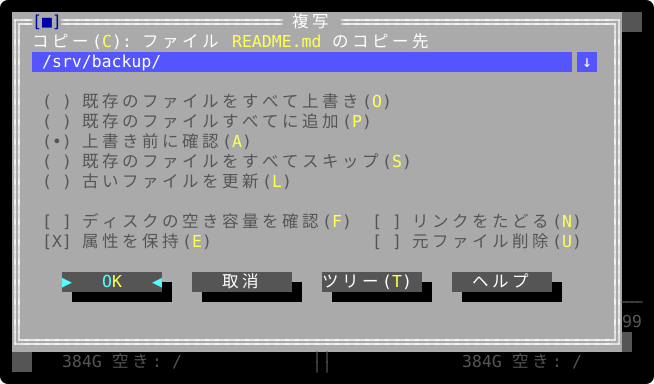

### コピー先

行に何を入力するかで、何が起きるかが決まります：

| 入力するもの | 意味 |
|---|---|
| 存在するディレクトリ、または `/` で終わる名前 | ファイルはそのディレクトリの中へ入る |
| `*` や `?` を含む名前 | 各ファイルは、行き先でそのマスクに従って名前が変わる |
| その他の名前で、ファイルを一つ選択しているとき | ファイルの新しい名前 |
| その他の名前で、ファイルを複数選択しているとき | 作成してその中へコピーするディレクトリ |

マスクは名前と拡張子に別々に当てはめられます：`*.bak` はすべてのファイルに拡張子 `bak` を付けます。ドットのないマスクは名前全体に当てはまるので、`*` は各名前をそのまま保ちます。

`F10`、または *ツリー* ボタンで、ツリーからディレクトリを選びます。行で `Down` を押すと、以前にコピーした先の履歴が開きます。

### 既存のファイルの扱い

| モード | 動作 |
|---|---|
| *既存のファイルをすべて上書き* | 確認せずに置き換える |
| *既存のファイルすべてに追加* | 各ファイルを、既にあるファイルの末尾に追加する |
| *上書き前に確認* | 一つずつ確認する。答えを残りすべてに適用することもできる |
| *既存のファイルをすべてスキップ* | 既存のファイルはそのままにして、ほかをコピーする |
| *古いファイルを更新* | コピーするファイルのほうが新しいときだけ置き換える |

確認されたときは、*改名* でコピーに別の名前を付けることもできます。

### オプション

- *ディスクの空き容量を確認* は、コピー先の空きが足りないとき、コピーする前に止めます。
- *属性を保持* は、コピーに権限、所有者、時刻を引き継ぎます。引き継げなかったものは報告されますが、コピー自体は成功します。
- *リンクをたどる* は、リンクそのものではなく、リンクの指す先をコピーします。
- *元ファイル削除* は、コピーし終えた元のファイルを削除します。これでコピーは移動になります。

モードとオプションは、Navigator を終了するまで記憶されます。

### 実行中

進行状況ボックスには、速度と残り時間が表示されます。*裏処理* でコピーを裏に回すと、作業を続けられます：メニューバーにパーセンテージが現れ、それをクリックするとボックスが戻ります。裏に回っている間にコピーから質問があると、パーセンテージに `?` が表示され、あなたを待ちます。*停止* は、コピーを中止する前に確認します。

コピーされたファイルはマークが外れ、スキップされたファイルはマークが残ります。

`Ctrl+Z` でコピーを取り消せます。[元に戻す](#元に戻す)を参照してください。

## ディレクトリの作成

`F7` は、アクティブなパネルにディレクトリを作ります。`a/b/c` のようなパスを入力すると途中のディレクトリもすべて作り、`;` で区切って複数の名前を入力すると複数作ります。

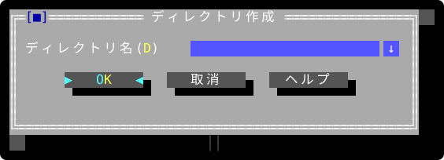

## クイック名前変更

`Shift+F6`、または *ファイル > 名前変更ツール > 簡易名前変更* は、小さなボックスでカーソル位置のファイルの新しい名前を尋ねます。ファイル一つを、その場で名前変更します。ファイルを移動したり、複数のファイルをマスクで名前変更したりするには `F6` を使ってください。

## 一括名前変更

`Alt+A`、または *ファイル > 名前変更ツール > 一括名前変更* は、マークしたファイルを一つのパターンで名前変更します。下半分の一覧には、何かが行われる前にすべての新しい名前が表示され、その下の行には、名前が使えないときにその理由が表示されます：空の名前、`/` を含む名前、二つのファイルに同じ名前が付く場合、既に使われている名前です。

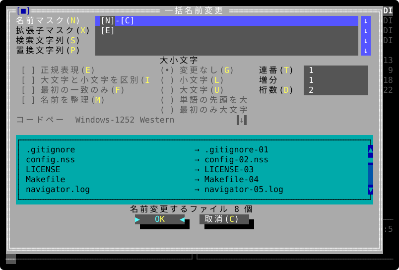

新しい名前は三つの段階で作られます。

**マスク。** *名前マスク* は名前を、*拡張子マスク* は拡張子を作ります。テキストはそのまま使われ、角括弧で囲んだプレースホルダーは置き換えられます：

| プレースホルダー | 意味 |
|---|---|
| `[N]` | 拡張子を除いた古い名前 |
| `[N3]` | その三文字目 |
| `[N2-5]` | その二文字目から五文字目 |
| `[N2-]` | 二文字目以降 |
| `[N2,4]` | 二文字目から四文字分 |
| `[N-3-]` | 最後の三文字 |
| `[E]` | 古い拡張子。同じ方法で切り出せる |
| `[P]` | ファイルのあるディレクトリの名前。同じ方法で切り出せる |
| `[C]` | *連番*、*増分*、*桁数* による連番 |
| `[C10+5:3]` | 10 から始まり、5 ずつ増え、三桁の連番: 010、015、020 |
| `[Y]` `[M]` `[D]` `[h]` `[m]` `[s]` | ファイルの更新日時 |
| `[[]` `[]]` | `[` と `]` |

拡張子マスクが空なら、名前にドットは付きません。

**検索と置換。** *検索文字列* と *置換文字列* は、マスクが作った名前全体に対して働きます。

- *正規表現* は、検索を正規表現として扱います。その場合、置換ではグループに `\1` を使えます。
- *大文字と小文字を区別* は、大文字と小文字を区別します。
- *最初の一致のみ* は、各名前で一致をすべてではなく一つだけ置き換えます。

**大小文字。** *変更なし*、*小文字*、*大文字*、*単語の先頭を大文字*、*最初のみ大文字* のいずれかです。

*名前を整理* は、三つの段階の前に名前を修復します：UTF-8 でないバイトは選んだ *コードページ* で読まれ、制御文字は `_` になり、一つのディレクトリの中で大文字と小文字だけが違う名前には番号が付きます。

名前が同じになるファイルはそのままです。ファイルの間で入れ替わる名前 (`a` を `b` に、`b` を `a` に) も、正しく名前変更されます。

### 整理が必要な名前

*ファイル > 名前変更ツール > 不正な名前を選択* は、*名前を整理* で変わる名前を持つパネル内のすべてのファイルをマークします：正しい UTF-8 でない名前、Unicode の分解形で書かれた名前、制御文字を含む名前、ほかの名前と大文字と小文字だけが違う名前です。そのあと *名前を整理* をチェックして `Alt+A` を使うと、それらの名前が変更されます。

## 削除

`F8`、またはコマンドラインが空のときの `Del` は、確認したうえで選択範囲を削除します。`Shift+F8`、`Shift+Del`、または *ファイル > 単一ファイルを削除* は、マークにかかわらずカーソル位置のファイルを削除します。

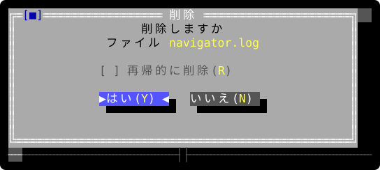

- *再帰的に削除* は、ディレクトリを中身ごと、一つずつ確認せずに削除します。
- *ごみ箱へ移動* は、[ごみ箱](drives.md#ごみ箱)を使っているときに表示されます。チェックを外すと、ファイルは完全に削除されます。

*再帰的に削除* なしでは、空でないディレクトリと、書き込めないファイルについて確認されます。どの質問も、残りすべてに対して答えられます。そもそもどの質問をするかは、設定の [確認](settings.md#確認) ページで決めます。

長い削除は、コピーと同じようにバックグラウンドに回せます。

## 元に戻す

`Ctrl+Z`、または *ファイル > 操作を元に戻す* は、最後のファイル操作を取り消します。もう一度押すとその前の操作を取り消し、五十回までさかのぼれます。何をしようとしているかを示して、先に確認します。

| 操作 | 元に戻す動作 |
|---|---|
| コピー (`F5` または貼り付け) | コピーで作られたものを取り除く。ただし、その後何も変わっていないファイルだけ。ディスク上ならごみ箱へ、それ以外では完全に削除する |
| 移動 (`F6` または切り取りと貼り付け) | ファイルを元へ戻す |
| 名前変更 (`F6`、`Alt+F6`、`Shift+F6`、`Alt+A`) | 古い名前に戻す |
| [ごみ箱](drives.md#ごみ箱)への削除 | ごみ箱からファイルを復元する |
| `F7` で作った新しいディレクトリ | まだ空なら取り除く |

コピーや移動で置き換えられたファイルは完全に失われており、確認の質問にその数が示されます。完全な削除、属性、リンクは取り消せません。アーカイブの中へ、またはアーカイブの中からのコピーや移動も取り消せません。操作の一覧は Navigator を終了するまで残り、すべてのファイルマネージャーのウィンドウで共有されます。コマンドラインにテキストがある間は、`Ctrl+Z` はコマンドラインに任されます。

## ファイル属性

`Alt+E` は選択範囲の属性を変更します。変更したものだけが適用されるので、ほかの点で違いのあるファイルはその違いを保ちます。*再帰* は、ディレクトリの中のすべてにも変更を適用します。

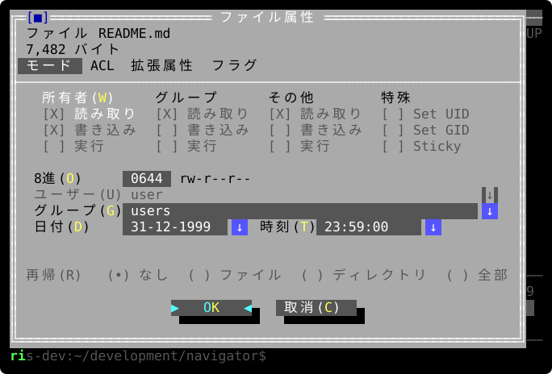

- *モード* には権限があります：所有者、グループ、その他それぞれの読み取り、書き込み、実行の格子、同じ内容を表す8進数、所有者とグループ、日付と時刻です。格子では `R`、`W`、`X` で一行分をまとめてチェックします。
- *ACL* は、モード以外のアクセス制御エントリを一覧し、追加、編集、削除します。
- *拡張属性* は拡張属性を一覧します。
- *フラグ* には、変更不可や追記のみといった、ファイルシステムのフラグがあります。

`?` と表示されたボックスは、ファイルによってそこが違うことを意味します。各ファイルをそのままにするには、触らずにおきます。

### ACL エントリ

*ACL* ページの *追加* と *編集* は、エントリを一つ開きます。*種類* はユーザーとグループのどちらを指すかを、*名前* はどれかを選び、*権限* は *読み取り*、*書き込み*、*実行* です。*デフォルト (新規ファイルが継承)* は、それをディレクトリのデフォルトエントリにします：ディレクトリの中に作られるものがそれを継承します。

### 拡張属性

*拡張属性* ページの *追加* と *編集* は、属性を一つ、その *名前* と *値* を開きます。値はテキストか、`0x` に続く16進数字か、`0s` に続く base64 です。値を引用符で囲むと、テキストのままになります。

## リンク

`Shift+F5` は、指定したディレクトリに選択範囲へのリンクを作ります。

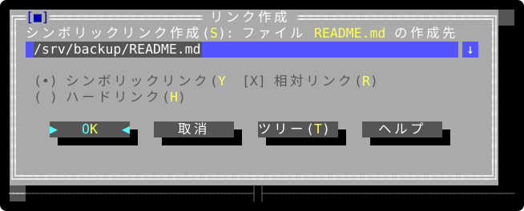

- *シンボリックリンク* は、元のファイルのパスを収めた小さなファイルを作ります。ディレクトリも、別のディスクも指せます。
- *ハードリンク* は、ファイルに二つ目の名前を与えます。ファイルにだけ、同じファイルシステムの中でだけ使えます。
- *相対リンク* は、リンクからの相対パスを書き込むので、リンクと元のファイルを一緒に移動できます。シンボリックリンクにだけ適用されます。

*ファイル > リンク* にはさらにコマンドがあります：リンクの指す先の編集、リンクを相対または絶対にする、壊れたリンクのマーク、ハードリンクされたファイルが持つすべての名前の表示です。

### リンクの指す先の変更

*ファイル > リンク > リンク先の編集* は、選択したシンボリックリンクを変更します。

- リンクを一つ選択していると、その指す先が行に入っていて、編集できます。*相対リンク* は、新しい指す先をリンクからの相対パスで書き込みます。
- 複数選択していると、*検索文字列* と *置換文字列* で、すべての指す先の同じ部分を変更します。ツリーを移動したときに必要なのがこれです。

*相対パスにする* と *絶対パスにする* は、選択した各リンクの指す先を逆の形に書き直し、同じファイルに届くようにします。*壊れたリンクを選択* は、どこも指していないパネル内のすべてのリンクをマークします：アイコンを表示していない一覧で `!` の付いているリンクです。

### ファイルのすべての名前

ハードリンクのあるファイルは、ことによると別々のディレクトリに、いくつもの名前を持っています。*ファイル > リンク > ハードリンクを表示* は、カーソル位置のファイルがそのファイルシステム上に持つすべての名前を探し、[ファイル検索](panels.md#ファイル検索)が見つけたものを並べるのと同じようにパネルに一覧します。`..` の上で `Enter` を押すと戻ります。読めないディレクトリは飛ばされるので、見つかる名前はファイルが持つ数より少ないことがあります。詳細表示の *リンク数* 列には、ファイルが持つ名前の数が表示されます。

## 分割と結合

*ファイル > 分割/結合* はカーソル位置のファイルに働き、ファイルの名前によって二つのどちらを行うかが決まります。

### 分割

普通のファイルなら何でも、指定したディレクトリに `NAME.001`、`NAME.002` などの名前の部分に分割されます。

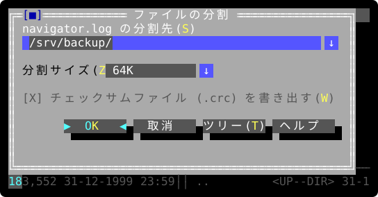

- *分割サイズ* は各部分のサイズです：バイト数、または数の後に `K`、`M`、`G` を付けたもの (`100M` や `1.44M` など) です。
- *チェックサムファイル (.crc) を書き出す* は、ファイルの名前、サイズ、チェックサムを収めた `NAME.crc` も書き出します。これがあれば、結合したファイルを検査できます。

部分一つより大きくないファイルは分割されません。これらの部分は Total Commander、Double Commander、7-Zip でも結合できます。

### 結合

部分 (`NAME.001`) の上、または一組の `NAME.crc` の上でこのコマンドを使うと、指定したディレクトリにファイルを元どおりに組み立てます。部分を順番に、欠けているものに当たるまで読みます。`.crc` ファイルがあれば結果も検査し、チェックサムが一致しなければ、ファイルを残したうえでそのことを知らせます。

## UU エンコードとデコード

UU エンコードは、どんなファイルでも、テキストしか許されない場所に送れるプレーンテキストに変えます。

### エンコード

`Ctrl+F7` は、カーソル位置のファイルを `NAME.uue` にエンコードします。大きなファイルは、区間ごとに一ファイルずつ書き出されます。

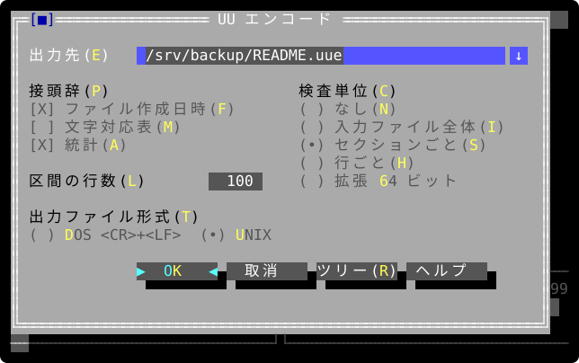

- *接頭辞* は、データの前に行を加えます：ファイルの日付と時刻、使った文字表、統計です。
- *検査単位* は、デコード時に損傷を見つけられるようにチェックサムを加えます：なし、ファイル全体、区間ごと、行ごと、または 64 ビットのものです。
- *区間の行数* は、一つの区間に入れるデータの行数です。
- *出力ファイル形式* は、行の終わり方を選びます：DOS 式か UNIX 式かです。

### デコード

`Ctrl+F8` は、カーソル位置のファイルを、指定したディレクトリにデコードします。一つのファイルに、エンコードされた複数のファイルとその区間が、どんな順序で入っていてもかまいません。

- *既存のファイルを確認* は、既にあるファイルを置き換える前に確認します。
- *エラーメッセージを表示* は、データに見つかった各エラーを表示します。
- *壊れたファイルも保存* は、データが損傷していてもファイルを書き出します。

## チェックサム

チェックサムリストには各ファイルのダイジェストが収められていて、後でファイルが損傷したり変わったりしていないか検査できます。

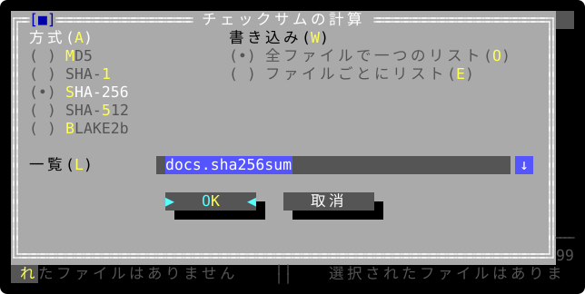

*ファイル > エンコード > チェックサム > 計算* は、マークしたファイルと、マークしたディレクトリの中のすべてのハッシュを計算します。

- *方式* は *MD5*、*SHA-1*、*SHA-256*、*SHA-512*、*BLAKE2b* のいずれかです。
- *全ファイルで一つのリスト* は、*一覧* の行で名前を付けたリストを一つ書き出します。*ファイルごとにリスト* は、各ファイルの横にリストを書き出します。

*検証* は、マークしたリスト、またはカーソル位置のリストを読み、そこに書かれたファイルのハッシュを計算し直して、いくつ一致したかを報告します。一致しなかったファイルや見つからないファイルは、*問題* の下に一覧されます。

これらのリストは `md5sum`、`sha256sum` とその仲間が書き出し、検査するものと同じなので、どちらの側でも相手のリストを検証できます。リストのアルゴリズムは、`.sha256sum`、`.sha256`、`SHA256SUMS` のような名前から、それがなければダイジェストの長さから判断されます。

## 暗号化

*ファイル > エンコード > 暗号化* は、GnuPG (`gpg`) または `age` でファイルを暗号化、復号します。インストールされていないプログラムは灰色で表示されます。

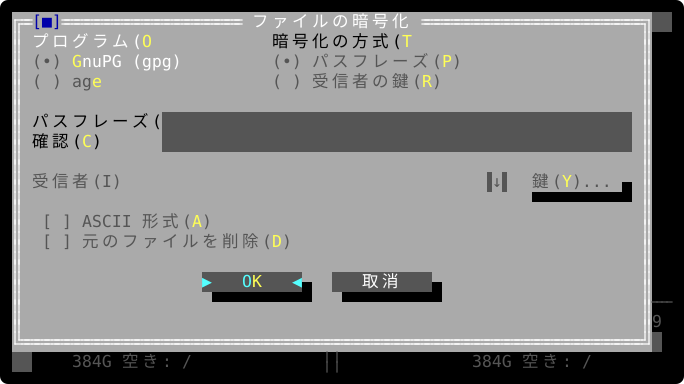

*暗号化* は、マークしたファイルと、マークしたディレクトリの中のすべてに働きます。各ファイルは、その横に `NAME.gpg` または `NAME.age` として書き出されます。

- *プログラム* は *GnuPG (gpg)* または *age* です。
- *暗号化の方式* は、二回入力する *パスフレーズ*、または *受信者の鍵* です。受信者は空白で区切ります：gpg なら鍵 ID かフィンガープリント、age なら鍵か鍵のファイルです。*鍵...* は gpg の鍵から選びます。
- *ASCII 形式* は、暗号化したファイルをテキストとして書き出します。gpg はそれを `NAME.asc` と名付けます。
- *元のファイルを削除* は、暗号化したコピーを書き出し終えた各ファイルを削除します。

*復号* は、マークした暗号化ファイル、またはカーソル位置のファイルに働き、それぞれをその横に、末尾を除いた名前で書き戻します。パスフレーズは、それが必要なファイルがあるときだけ、全部に対して一度だけ尋ねられます。

## テキストの変換

*ファイル > エンコード > テキストの変換* は、マークしたテキストファイル、またはカーソル位置のファイルを、別のエンコーディングや別の行末で書き直します。各ファイルはその場で変更されます。

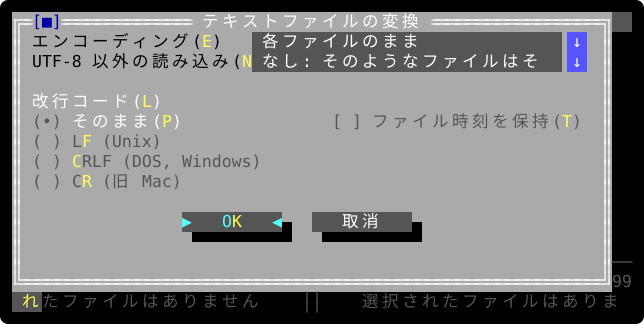

- *エンコーディング* は、ファイルを書き出すエンコーディングです。
- *UTF-8 以外の読み込み* は、UTF-8 でなくバイトオーダーマークもないファイルに想定するエンコーディングです。何も選ばなければ、そのようなファイルはそのままにされます。
- *改行コード*：*そのまま*、*LF (Unix)*、*CRLF (DOS, Windows)*、*CR (旧 Mac)* のいずれかです。
- *ファイル時刻を保持* は、書き直した各ファイルに元の時刻を与えます。

バイナリに見えるファイル、選んだエンコーディングでテキストを書けないファイル、非常に大きなファイルはそのままにされ、その理由が知らされます。変わらない結果になるファイルは書き出されません。

## アプリで開く

*ファイル > アプリで開く* は、カーソル位置のファイルを、その種類を扱うデスクトップのアプリケーションの一覧 (いつも使うものが先頭) から選んで開きます。

- *その他のアプリ* は、インストールされているほかのすべてのアプリケーションを一覧します。
- *既定に設定* は、今後その種類を開くアプリケーションを選びます。何も開きません。
- *コマンド...* は、自分で書くコマンドラインを尋ねます。その中の `!.!` はファイルを表し、それがなければファイルの名前が末尾に付きます。コマンドはコンソールで実行され、拡張子ごとに使ったコマンドの履歴が残ります。

デスクトップの `gio` か KDE のツールが必要です。設定の [通信](settings.md#通信) ページの *デスクトップ連携* を参照してください。サーバー上のファイルは、まず取得されます。アプリケーションが変更したものは送り返されませんが、*コマンド...* が変更したものは、コマンドが終わると送り返されます。

[ファイルパネル](settings.md#ファイルパネル) ページで *他はデスクトップに渡す* がチェックされている間は、`extensions.ini` のどの項目にも当てはまらないファイルの上で `Enter` を押しても、デスクトップのアプリケーションで開きます。

## 印刷

`Ctrl+F9`、または *ファイル > 印刷* は、確認したうえで選択したファイルを印刷します。ファイルは `lp`、`lp` がなければ `lpr` を通してシステムのプリンターに送られ、これらは `$PRINTER` または既定のプリンターで印刷します。ディレクトリは飛ばされ、各ファイルはプリンターに送られるとマークが外れます。エディターは `F8` でテキストを印刷します。
