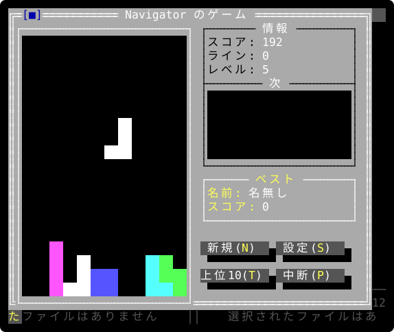

# ゲーム

`Alt+F9`、または `≡` メニューの *ゲーム* でゲームが開きます：図形がグラスの中に落ちてきて、埋まった行は消えます。七種類の図形を使うテトリスと、二十七種類の図形を使うペンティックスの二つの種類があります。

## キー

| キー | 動作 |
|---|---|
| `Left` または `Home` | 図形を左へ動かす |
| `Right` または `PgUp` | 図形を右へ動かす |
| `Up` | 図形を回転する |
| `Down` または `Space` | 図形を落とす |
| `F2` | 新しいゲームを始める |
| `F3` | 一時停止し、再開する |
| `F4` | トップ10 を表示する |
| `F5` | ゲームを設定する：開始レベル、種類、プレビュー |
| `Gray +` | レベルを上げる |
| `Gray *` | 次の図形を表示または非表示にする |
| `Esc` | ゲームを閉じる |

別のウィンドウに切り替えると、ゲームは自動的に一時停止します。

## トップ10

トップ10 に入る得点でゲームが終わると、一覧に載せる名前を尋ねられます。名前が空のとき、または *取消* を選んだときは *名無し* として載ります。一覧は種類ごとに一つあります。

## 設定

`F5`、または *設定* ボタンでゲームを設定します。

- *レベル* はゲームの開始レベルで、*1 - 赤ちゃん* から *10 - 療養所* まであります。レベルが上がるごとに図形の落下が速くなります。
- *種類* は *クラシックテトリス* または *Pentix* です。
- *次のピースを表示* はグラスの横に次の図形を表示します。
