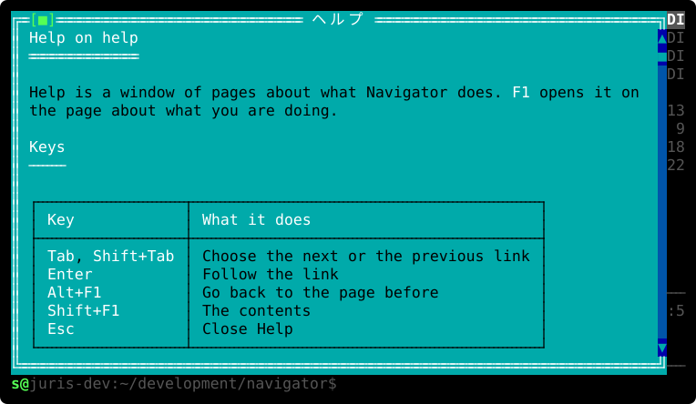

# ヘルプの使い方

`F1` は、今している操作についてのページでこのマニュアルを開きます。ページは互いにリンクしています。リンクは専用の色で表示され、
そのうちの 1 つが常に選択されています。

## 今いる場所のヘルプ

`F1` はどこでも使え、キーボードを持っているものについてのページを開きます。

- ダイアログボックスでは、そのボックスについての節。多くのボックスには同じことをする *ヘルプ* ボタンもあります。
- 開いたメニューでは、強調表示された項目、またはそのメニューについてのページ。
- ビューア、エディタ、電卓などのウィンドウでは、そのウィンドウのページ。
- パネルでは、パネルについてのページ。

今している操作についてのページがなければ、[目次](README.md)が開きます。`Esc` でヘルプを閉じると元の場所に戻り、メニューが開いていれば
開いたままです。コンソールでプログラムが実行中のあいだは、`F1` はそのプログラムのものです。

## キー

| キー | 動作 |
|---|---|
| `Tab` | 次のリンクを選択する |
| `Shift+Tab` | 前のリンクを選択する |
| `Enter` | 選択したリンク先へ移る |
| `Alt+F1` | 来た場所へ戻る |
| `Shift+F1` | [目次](README.md)を開く |
| `F1` | このページを開く |
| `Up`, `Down`, `PgUp`, `PgDn`, `Home`, `End` | ページをスクロールする |
| `Left`, `Right` | コードの行がウィンドウより広いとき、横にスクロールする |
| `Alt+Z` | ウィンドウを画面全体に広げる、元に戻す |
| `Ctrl+F5` | ウィンドウを動かし大きさを変える: 矢印で動かし、`Shift` と矢印で大きさを変え、`Enter` でその位置に確定し、`Esc` で元に戻す |
| `Esc` | ヘルプを閉じる |

これらのキーは 設定 > 構成 > キー割り当て の *ヘルプウィンドウ* で変更できます。

## マウス

リンクをクリックするとリンク先へ移ります。ホイールでページをスクロールし、ページがウィンドウより長いときはウィンドウ右端のバーでも
スクロールできます。ウィンドウより広いコードの行があるページには下端にもバーがあり、`Shift` を押しながらホイールで横にスクロールします。

## 他のサイトへのリンク

このマニュアルの外のウェブサイトへのリンクは、Navigator ではたどりません。端末が開ける場合があります。たいていの端末では `Ctrl` を
押しながらクリックします。
