# パネル

ファイルマネージャは 2 枚のパネルを左右に並べて表示し、それぞれが 1 つのディレクトリのファイルを一覧します。どちらか一方がアクティブで、
カーソルバーはそちらにあります。コマンドはアクティブなパネルのファイルに働き、結果の置き場所としてはたいてい
もう一方のパネルのディレクトリを提示します。

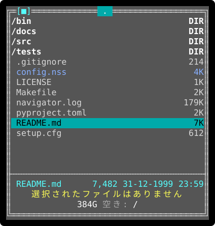

## 移動

| キー | 動作 |
|---|---|
| `Tab` | もう一方のパネルへ切り替える |
| `Up`, `Down`, `PgUp`, `PgDn`, `Home`, `End` | カーソルを動かす |
| `Enter` | ディレクトリやアーカイブに入る、プログラムを実行する、ファイルを開く |
| `Backspace`, `Ctrl+PgUp` | 親ディレクトリへ移動する |
| `Ctrl+\` | ルートディレクトリへ移動する |
| `Ctrl+R` | ディレクトリを読み直す |
| `Alt+Backspace` | これまでにいたディレクトリを一覧する |
| `Alt+=` | もう一方のパネルに同じディレクトリを表示する |
| `Ctrl+U` | 2 枚のパネルを入れ替える |

文字を入力すると、パネルの下のコマンドラインに書き込まれます。[コマンドライン](console.md)を参照してください。

ディレクトリの中身が変わると、パネルは自動的にそのディレクトリを読み直します。

## 表示形式

`Ctrl+Y` でパネルの 3 つの表示形式を順に切り替えます。

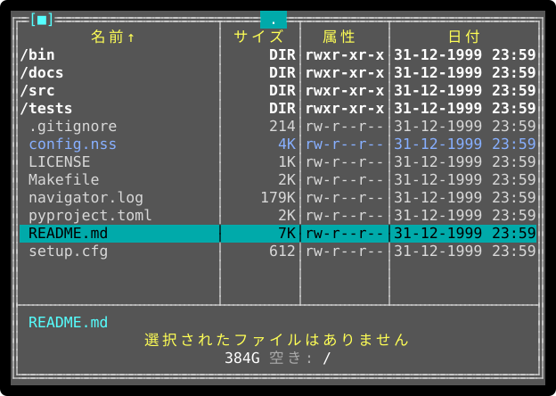

- *簡易*: 名前とサイズ。
- *詳細*: 名前に加えて、サイズ、属性、所有者、日付を列で表示します。`Alt+K` で列を選びます。
- *一覧*: 名前だけを複数の列に並べます。

簡易表示と詳細表示では、`Left` と `Right` で長い名前をスクロールします。詳細表示では列の見出しをクリックすると
その列で並べ替え、もう一度クリックすると順序が逆になります。

`Ctrl+H` で隠しファイルの表示・非表示を、`Alt+I` で一覧の下の行の表示・非表示を切り替えます。

## 並べ替え

`Alt+B` でパネルの並び順を選びます。名前、拡張子、サイズ、日時、属性、所有者、種類のいずれかで、それぞれ昇順・降順を選べるほか、
並べ替えなしも選べます。ディレクトリはファイルより先に並びます。

## ファイルのタグ付け

コマンドはタグ付けしたファイルに働きます。タグ付けしたファイルがなければ、カーソル位置のファイルに働きます。

| キー | 動作 |
|---|---|
| `Ins`、またはコマンドラインが空のときの `Space` | ファイルのタグを付け外しして、1 つ下へ移る |
| `Gray +` | マスクに一致するファイルにタグを付ける |
| `Gray -` | マスクに一致するファイルのタグを外す |
| `Gray *` | タグを反転する |
| `Ctrl+A` | すべてにタグを付ける |

マウスでは、中ボタンでファイルにタグを付け、中ボタンでドラッグすると通過したファイルすべてにタグが付きます。`Shift` か `Ctrl`
を押しながら左クリックすると、カーソルからクリックしたファイルまでにタグが付きます。

一覧の下の行には、タグ付けしたファイルの数と合計サイズが表示されます。

## クイック検索

`Ctrl+S` で名前による検索を始めます。先頭の何文字かを入力すると、その文字で始まる最初の名前へカーソルが移ります。
もう一度 `Ctrl+S` を押すと次の候補へ移ります。`Esc` で検索を終えます。それ以外のキーも検索を終え、そのキー本来の動作をするので、
`Enter` を押せば見つけたディレクトリへそのまま入れます。

## クリップボードによるコピー

`Ctrl+C` で選択をコピーし、`Ctrl+X` で切り取ります。別のディレクトリで `Ctrl+V` を押すとそこにファイルを貼り付けます。
その際の確認は[コピーと移動](file-operations.md#コピーと移動)と同じです。`Esc` で覚えたファイルを忘れます。
これらのキーは、コマンドラインが空のときにパネルで働きます。

## もう一方の側

アクティブでない側には、パネルの代わりに別のものを表示できます。

| キー | 表示するもの |
|---|---|
| `Ctrl+T` | ディレクトリのツリー |
| `Ctrl+Q` | カーソル位置のファイルのクイックビュー |
| `Ctrl+L` | ディレクトリ、ディスク、カーソル位置のファイルについての[情報](#情報パネル) |

同じキーでパネルに戻ります。`Ctrl+F1` と `Ctrl+F2` で左側と右側を隠し、`Ctrl+P` でアクティブでない側を隠します。
`Alt+Left` と `Alt+Right` で左右の境界線を動かします。

`Alt+F12` でミラーカラム表示に切り替わります。たどってきたディレクトリごとに 1 列ずつ細い列が並び、
カーソル位置のもののプレビューが付きます。

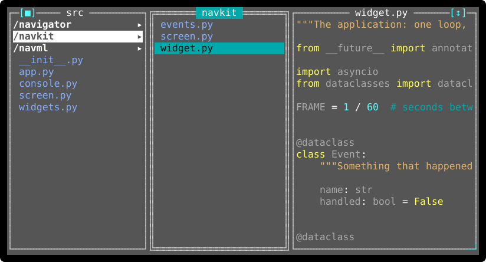

## 情報パネル

`Ctrl+L` でアクティブなパネルについての情報をもう一方のパネルの場所に表示し、もう一度 `Ctrl+L` でパネルに戻します。
情報はカーソルの移動に合わせてアクティブなパネルを追いかけます。

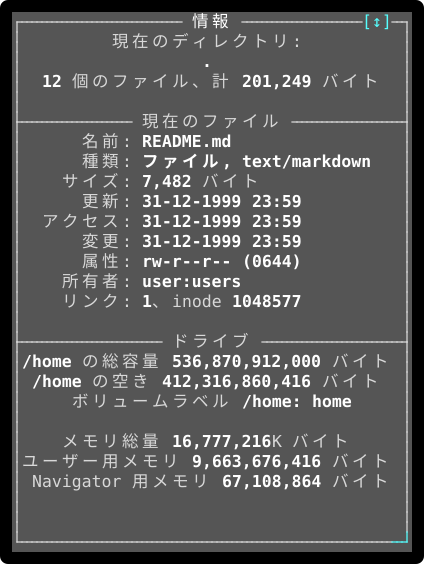

- ディレクトリの名前と、含まれるファイルの数および合計サイズ。
- カーソル位置のファイル: 種類、サイズ、日時、属性、所有者、リンク数、inode。画像、音声、動画、PDF、プログラムには
  さらに情報が加わります。ピクセル単位の大きさ、長さ、ストリーム、ページ数、プログラムが必要とするライブラリです。
  音声と動画の情報には FFmpeg の `ffprobe` が必要です。
- ディレクトリがあるファイルシステム: サイズ、空き容量、デバイスまたはラベル。サーバー上ではサーバーと接続方法、
  アーカイブの中ではそのアーカイブ。
- コンピューターのメモリ、プログラムがまだ使える量、Navigator 自身が使っている量。
- ディレクトリの情報ファイル `DirInfo` または `File_ID.DIZ` (ある場合)。

収まりきらないときは、`Tab` でキーボードを情報パネルに移し、矢印、`PgUp`、`PgDn` でスクロールします。
マウスホイールでもスクロールできます。どの行を表示するかは設定の[情報パネル](settings.md#情報パネル)ページで選びます。

## 複数のファイルマネージャ

`Ctrl+F3` で別のファイルマネージャウィンドウを開きます。ウィンドウ間の移動は[ウィンドウ](windows.md)を参照してください。

## ファイルマスク

ファイルマスクを受け付けるボックスがいくつかあります。マスクは `;` で区切った 1 つ以上のパターンで、`*` は任意の文字列、
`?` は任意の 1 文字を表します。`-` で始まるパターンは一致したものを除外し、名前に一致した最後のパターンが結果を決めます。
`*;-*.bak` はバックアップ以外のすべてのファイルです。

## パネルのオプション

`Alt+S`、または *パネル > パネルの設定* で、アクティブなパネルのファイルの一覧方法を設定します。新しいパネルすべてに使う同じ設定は、
[設定](settings.md#パネル既定値)の *パネルの既定* ページにあります。

- *並べ替え* は順序を選びます。名前、拡張子、サイズ、日時、属性、所有者、種類、または並べ替えなし。*逆順* で順序を逆にします。
- *ディレクトリサイズ* は各ディレクトリのサイズを数えて表示します。
- *現在のファイル*、*選択したファイル*、*合計*、*空き容量* で、一覧の下に表示する行を選びます。
- *ファイルの色分け* はファイルを種類で色分けします。
- *実行ファイルを先頭に* と *アーカイブを先頭に* は、それらのファイルを他より先に並べます。
- *マスク* は、[マスク](#ファイルマスク)に一致するファイルだけをパネルに表示します。

## フィルタ

`Alt+Del`、または *パネル > 選択 > 詳細フィルタ* で、パネルに表示するファイルを拡張子で選びます。
ボックスには `*` と、ディレクトリにある拡張子ごとのマスクが並びます。

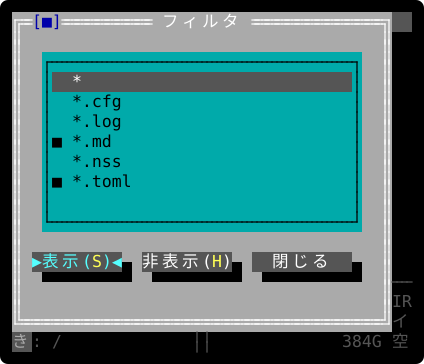

- `Space` か `Ins` でマスクに印を付け、次へ移ります。`+` ですべてに印を付け、`-` ですべて外し、`*` で印を反転します。
- *表示* は、印を付けたマスク (印がなければカーソル位置のマスク) に一致するファイルをパネルに表示します。
- *非表示* は、それらをパネルから除きます。
- *閉じる* でボックスを閉じます。*表示* や *非表示* の後もボックスは開いたままなので、続けて選べます。

`*` を選ぶと、再びすべてを表示します。

## ファイル検索

`Alt+F7`、または *ファイル > 検索* で、名前と内容でファイルを検索します。

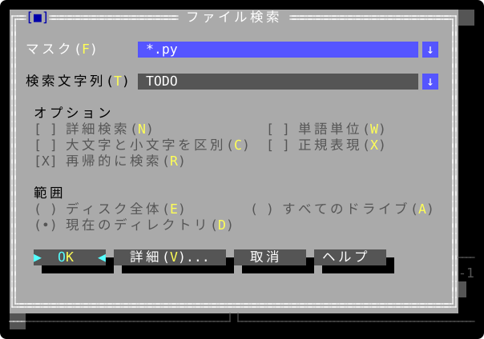

- *マスク* は探す名前です。`*` もドットも含まない単語だけを書くと、その単語で始まるすべての名前が見つかります。
- *検索文字列* を指定すると、その文字列を含むファイルに絞り込みます。空にすると名前だけで検索します。

### オプション

- *詳細検索* は、*詳細* ボタンで設定した条件も適用します。
- *大文字と小文字を区別* は、文字列の大文字と小文字を区別します。
- *再帰的に検索* は、サブディレクトリも探します。
- *単語単位* は、より長い単語の一部になっている文字列を除きます。
- *正規表現* は、文字列を正規表現として読み、行をまたいで照合します。

### 範囲

- *ディスク全体* は、パネルのあるディスク全体を検索します。
- *現在のディレクトリ* は、パネルのディレクトリを検索します。
- *すべてのドライブ* は、すべてのディスクを検索します。

### 検索結果

見つかったファイルは、*検索:* とマスクを題にしてパネルに一覧されます。そこで他のファイルと同じように表示、編集、コピー、削除できます。
パネルの下の行には、各ファイルのあるディレクトリが表示されます。`..` で `Enter` を押すと、検索を始めたディレクトリへ戻ります。

### 詳細検索

*詳細* ボタンでは、*詳細検索* にチェックがあるあいだ適用される条件を設定します。

- *この日付より後* と *この日付より前* は、変更日時でファイルを絞り込みます。日付は年-月-日の順に、
  `2026-01-31` のように書きます。
- *これより大きい* と *これより小さい* は、サイズで絞り込みます。
- *種類* は、実行ファイル、シンボリックリンク、隠しファイル、読み取り専用ファイル、壊れたリンクのいずれかに絞り込みます。

*すべて消去* で条件をすべて取り除きます。

### ファイル内の置換

`Alt+Shift+F7` で、*置換文字列* の行が 1 つ加わった同じボックスを開きます。同じ方法でファイルを探し、
それぞれのファイルの中の文字列を置き換えます。

## リストファイルの作成

`Alt+L`、または *パネル > リストファイル作成* で、タグ付けしたファイルの名前をテキストファイルに書き出します。

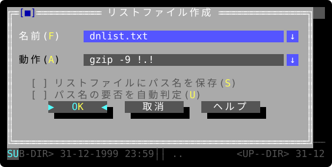

- *ファイル名* は書き出すファイルです。すでにある場合は、置き換えるか末尾に追加するかを尋ねます。
- *動作* を入力すると、リストはスクリプトになります。ファイルごとに 1 行で、入力したテキストにファイルの名前が埋め込まれます。
  1 ファイルあたり複数の行にするには `;` で区切ります。
- *リストファイルにパス名を保存* は、名前だけでなく各ファイルの完全なパスを書きます。
- *パス名の要否を自動判定* は、リストファイル自身と同じディレクトリにないファイルにだけパスを書きます。

動作の中では、次の記号が各ファイルの名前の一部を表します。

| 書くもの | 置き換わるもの |
|---|---|
| `!` | 拡張子を除いた名前 |
| `.!` | ドット付きの拡張子 |
| `!\` | ファイルのディレクトリ (末尾に `/` 付き) |
| `!/` | ファイルのディレクトリ (末尾の `/` なし) |
| `!!` | `!` そのもの |

これらをどれも含まない動作では、末尾にファイルの名前が加わります。`cp` は `cp name` になります。

## グループ選択

`Gray +` でパネル内の[ファイルマスク](#ファイルマスク)に一致するファイルにタグを付け、`Gray -` でタグを外します。
*パネル* メニューの *グループ選択* と *グループ選択解除* でも同じことができます。

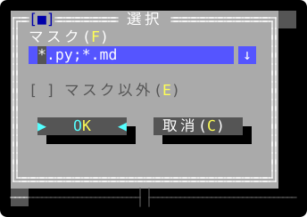

*マスク以外* はマスクを反転し、一致しないファイルにタグを付けたり外したりします。

## 列の設定

`Alt+K`、または *パネル > 列の設定* で、詳細表示で名前の横に表示するものを選びます。*サイズ*、*属性*、
*リンク数*、*所有者*、*日付* です。

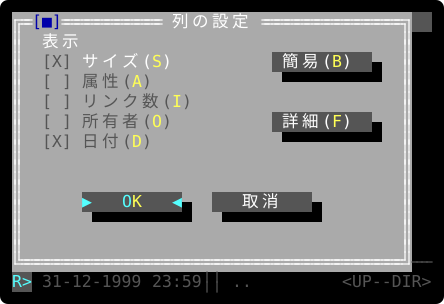

- *OK* はチェックを付けた列を表示します。
- *簡易* は名前だけを表示します。
- *詳細* は *リンク数* 以外のすべての列を表示します。

新しいパネルの初期の列は、設定の[列](settings.md#列)ページにあります。

## 重複ファイルの検索

*パネル > 重複ファイルの検索* は、パネルのディレクトリ以下で内容が同じファイルを探し、検索と同じようにパネルに一覧します。

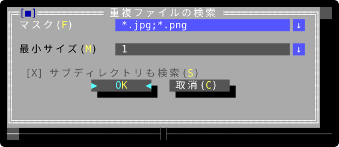

- *マスク* で比べるファイルを選びます。
- *最小サイズ* より小さいファイルは除外します。
- *サブディレクトリも検索* は、下のディレクトリも探します。

無駄になっている容量が最も大きいグループから先に並び、パネルの並び順にかかわらず同じグループのファイルはまとまったままです。
タグは付きません。不要なコピーにタグを付けて `F8` で削除してください。シンボリックリンクは飛ばされ、
同じファイルへの 2 つのハードリンク名は重複とみなされません。

## コマンド結果をパネルに

`Alt+Y`、または *パネル > コマンド結果をパネルに* で、パネルのディレクトリでシェルコマンドを実行し、
そのコマンドが 1 行に 1 つずつ出力したファイル名をパネルの一覧にします。「どのファイルか?」に答えるコマンド向けです。

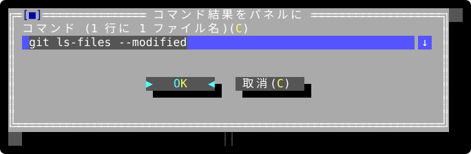

```sh
git ls-files -m
grep -l TODO *.py
```

`|` で始まるコマンドラインは、ボックスを使わずに同じことをします。

## ディレクトリ履歴

`Alt+BkSp`、または *パネル > ディレクトリ履歴* で、パネルが訪れたディレクトリを新しい順に一覧します。
*移動* はカーソル位置のディレクトリをアクティブなパネルで開き、*記録を削除* はそれを一覧から取り除きます。

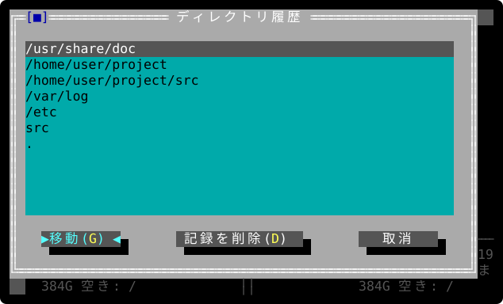

## ディレクトリの記憶

*パネル > このディレクトリで記憶* は、パネルの現在の並び順、表示形式、ファイルマスクを記憶し、
パネルがそのディレクトリにいるときはいつでもそれを使います。*サブディレクトリにも適用* を付けると、下のすべてのディレクトリも
同じように表示します。ただし、個別に記憶したディレクトリは除きます。

*記憶したディレクトリ一覧* は記憶したディレクトリを表示します。`Enter` でそこへ移動し、`Del` で記憶を消します。
