# 設定

*設定 > 設定* には、すべての設定が十五のページに分かれて収められています。`Ctrl+PgUp` と `Ctrl+PgDn` でページを切り替えます。*設定 > 構成* と *設定 > ファイルマネージャ* の下の項目は、このボックスをそれぞれのページで開きます。オプションの上にマウスを置くと、その働きが表示されます。

*OK* は変更をすぐに適用し、`navigator.ini` に書き込みます。*取消* は変更を破棄します。

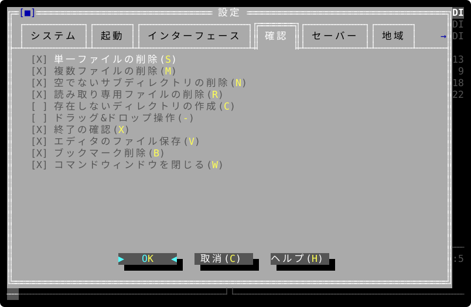

## システム

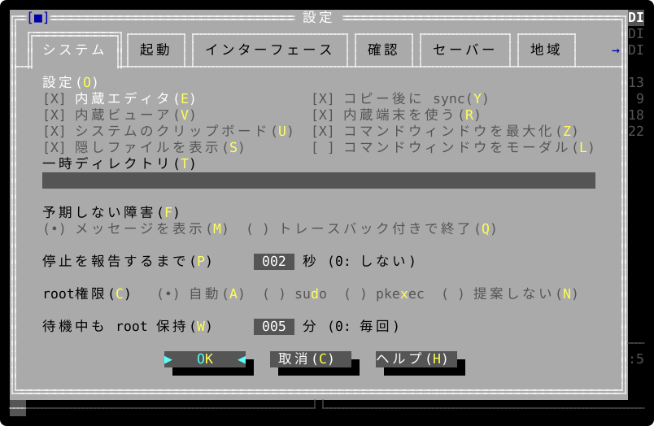

- *内蔵エディタ* と *内蔵ビューア*：`F4` と `F3` で Navigator 自身のエディターとビューアーを使います。オフにすると、`$EDITOR` と `$PAGER` に指定されたプログラムを実行します。
- *システムのクリップボード*：デスクトップのクリップボードにコピーし、そこから貼り付けます。オフにすると、Navigator は独自のクリップボードを持ちます。
- *隠しファイルを表示*：新しいパネルに隠しファイルを表示します。`Ctrl+H` はパネル一つ分を切り替えます。
- *コピー後に sync*：コピーした各ファイルは、完了とみなされる前にディスクまで書き込まれます。
- *内蔵端末を使う*：`Ctrl+O` で Navigator の中にコンソールを表示します。オフにすると、端末全体をシェルに渡します。
- *コマンドウィンドウを最大化* と *コマンドウィンドウをモーダル*：専用のウィンドウで実行するコマンドの開き方です。
- *一時ディレクトリ*：一時ファイルの置き場所です。空なら `$TMPDIR` です。
- *予期しない障害*：予期しないエラーが起きたとき、詳細付きのメッセージを表示するか、Navigator を終了して詳細を出力するかを選びます。
- *停止を報告するまで*：Navigator が応答しなくなってから何秒で、その理由を `errors.log` に書き込むかです。
- *root権限*：権限がないため拒否された操作を root としてやり直す方法です：`sudo` を使う、`pkexec` を使う、またはやり直さない、のいずれかです。
- *待機中も root 保持*：最後に使ってから何分間 root 権限を開いたままにするかです。[root としての作業](as-root.md)を参照してください。

## 起動

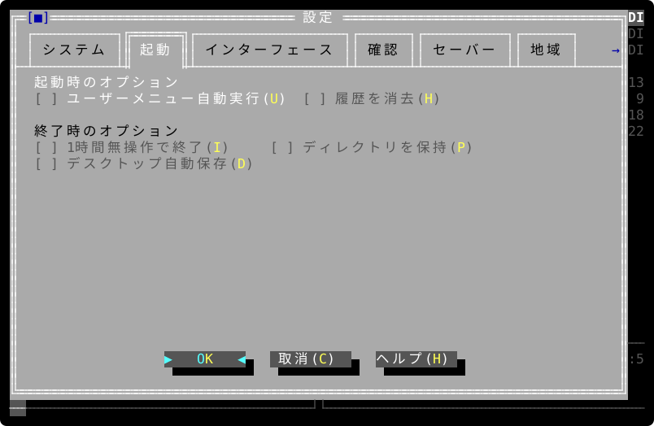

- *ユーザーメニュー自動実行*：Navigator の起動時にユーザーメニュー (`F2`) を開きます。
- *履歴を消去*：起動のたびに、固定されていない履歴項目を削除します。
- *1時間無操作で終了*：キー操作もクリックもないまま一時間たつと、Navigator を終了します。
- *デスクトップ自動保存*：終了時にウィンドウを保存し、次の起動時に元に戻します。
- *ディレクトリを保持*：アクティブなパネルは、コマンドの後も、復元したデスクトップでも、そのディレクトリを保ちます。

## インターフェース

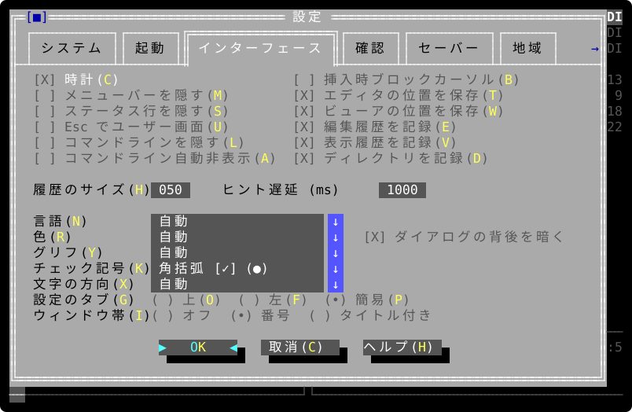

- *時計*、*メニューバーを隠す*、*ステータス行を隠す*：メニューバーの時計、`F10` を押すまでのメニューバーそのもの、最下行のキーバーです。
- *Esc でユーザー画面*：コマンドラインが空のとき `Esc` を押すと、次のキーまでコンソールを表示します。
- *コマンドラインを隠す* と *コマンドライン自動非表示*：コマンドラインを常に隠すか、空の間だけ隠します。
- *挿入時ブロックカーソル*：コマンドラインでブロック型のカーソルを使います。
- *エディタの位置を保存* と *ビューアの位置を保存*：ファイルを、閉じたときのウィンドウと位置で開き直します。
- *編集履歴を記録*、*表示履歴を記録*、*ディレクトリを記録*：`Alt+PgUp`、`Alt+PgDn`、`Alt+Backspace` が表示する一覧を記録します。
- *履歴のサイズ*：各履歴一覧に残す項目の数です。
- *ヒント遅延 (ms)*：ヒントが表示されるまでマウスを止めておく時間です。0 なら表示しません。
- *言語*：キャプションとメッセージの言語です。
- *色*：端末に送る色の数です。
- *グリフ*：端末のフォントにあると想定する文字です：ただの ASCII、Unicode、または Nerd Font のアイコンです。
- *ダイアログの背後を暗く*：ダイアログの背後にあるものを淡く描きます。
- *チェック記号*：チェックボックスとラジオボタンの描き方です。
- *文字の方向*：左から右、右から左、または言語の読み方に従います。
- *設定のタブ*：このボックスがタブを表示する位置です。
- *ウィンドウ帯*：開いているウィンドウをメニューバーに番号で並べるか、タイトル付きで並べるか、並べないかです。

## 確認

それぞれのボックスで、次の操作の前に Navigator が確認するようにします：ファイル一つの削除、複数の削除、空でないディレクトリの削除、読み取り専用ファイルの削除、コピー先として指定されたディレクトリの作成、ドラッグ&ドロップ、終了、エディターでの保存、ブックマークの削除、そしてコマンドがまだ実行中のコマンドウィンドウを閉じること。

## セーバー

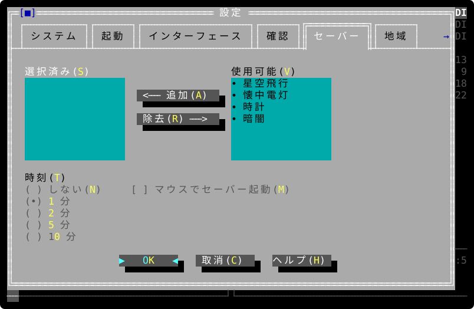

キー操作もクリックもないまま一定の時間がたつと、スクリーンセーバーが画面を引き継ぎます。

- *選択済み* のセーバーが順番に使われます。*追加* は *使用可能* から一つを移し入れ、*除去* はそれを取り除きます。
- *時刻* は待つ時間、または *しない* です。
- *マウスでセーバー起動*：ポインターを右上の隅に動かすとすぐにセーバーが始まり、右下の隅にある間はセーバーが始まりません。

## 地域

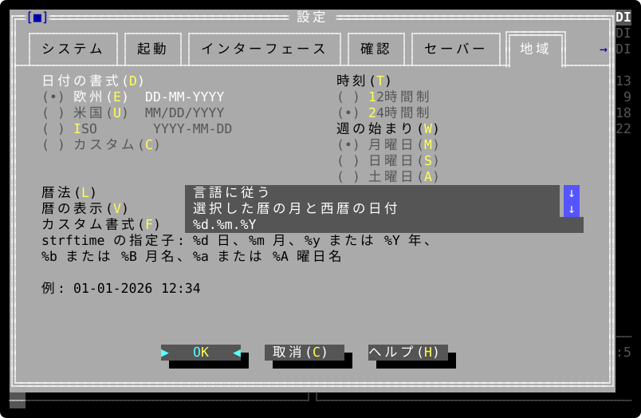

- *日付の書式*：日付を書く順序、または *カスタム* (書式は *カスタム書式* の行に書きます) です。
- *時刻*：12時間制または24時間制の時計です。
- *週の始まり*：カレンダーでの週の最初の曜日です。
- *暦法* と *暦の表示*：カレンダーウィンドウに表示する暦と、それをグレゴリオ暦と並べるかどうかです。

*例* は、選んだ形式で書いた日付と時刻を示します。

## エディタ/ビューア

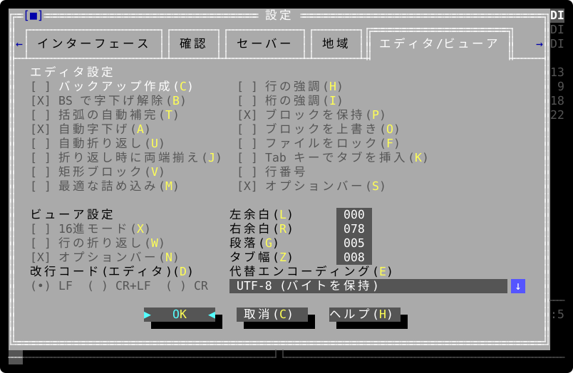

新しいエディターやビューアーのウィンドウの初期状態です。エディターのオプションの多くは、ウィンドウの *オプション* メニューからそのウィンドウだけ切り替えられます。

エディターのオプション：

- *バックアップ作成*：`F2` で保存するとき、古いファイルを `NAME.bak` として残します。
- *BS で字下げ解除*：行頭の空白の中で `Backspace` を押すと、上の行の字下げ位置まで戻ります。
- *括弧の自動補完*：`(`、`{`、`[` を入力すると、対になる括弧も入力されます。
- *自動字下げ*：`Enter` で、新しい行を上の行と同じだけ字下げします。
- *自動折り返し* と *折り返し時に両端揃え*：右余白を越えて入力した行を折り返し、残された行を余白まで広げます。
- *矩形ブロック*：ブロックを列として選択します。
- *最適な詰め込み*：タブ位置に届く空白をタブとして書き込みます。
- *行の強調* と *桁の強調*：カーソルのある行と桁を強調表示します。
- *ブロックを保持*：カーソルを動かしてもブロックの選択が残ります。これがオフのときの *ブロックを上書き*：入力や貼り付けでブロックを置き換えます。
- *ファイルをロック*：エディターは、他のプログラムから見えるロックをファイルにかけます。
- *Tab キーでタブを挿入*：`Tab` で空白ではなくタブ文字を挿入します。
- *行番号*：左端に行番号を表示します。
- *オプションバー*：下の枠にウィンドウのオプションを表示し、クリックで切り替えられます。

ビューアーのオプション：*16進モード* はファイルを16進で開き、*行の折り返し* は長い行を折り返します。*オプションバー* はエディターのものと同じです。

- *左余白*、*右余白*、*段落*：[段落の整形](editor.md#余白)に使う余白です。
- *タブ幅*：タブの幅です。
- *改行コード(エディタ)*：新しいファイルに付ける行末です。
- *代替エンコーディング*：UTF-8 でないファイルを、エディターがどのエンコーディングとして読むかです。

## ビューアーの種類

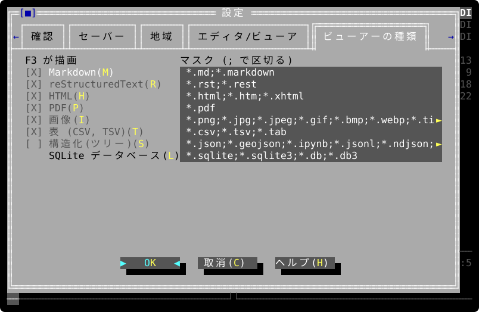

`F3` がテキスト以外の形で表示するファイルです：Markdown、reStructuredText、HTML はページとして、PDF はそのテキストとして、画像は画像として、CSV と TSV は表として、構造化ファイル (JSON、YAML、TOML、XML) はツリーとして表示します。それぞれに、オンにするボックスと、どのファイルに当てはめるかを指定する[ファイルマスク](panels.md#ファイルマスク)の行があります。*SQLite データベース* は、データベースとして開くファイルのマスクです。

## ファイルパネル

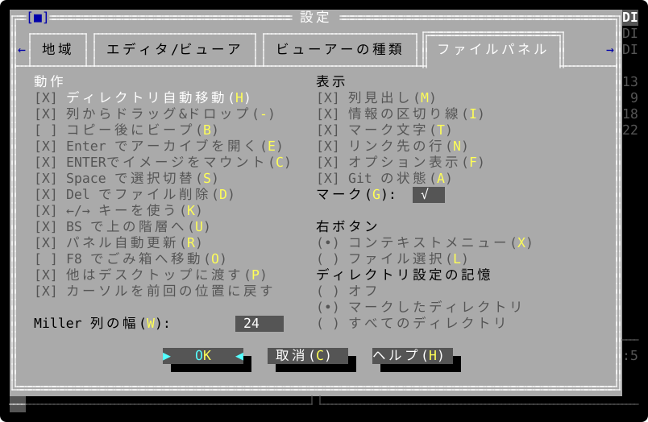

動作：

- *ディレクトリ自動移動*：パネルが、隣のツリーのカーソルに追従します。
- *列からドラッグ&ドロップ*：マウスでパネルからファイルをドラッグして出せます。
- *コピー後にビープ*：コピーが終わると端末のベルが鳴ります。
- *Enter でアーカイブを開く*：アーカイブの上で `Enter` を押すと、ディレクトリとしてその中に入ります。
- *ENTERでイメージをマウント*：`.iso` や `.img` ファイルの上で `Enter` を押すと、マウントして開きます。
- *Space で選択切替*、*Del でファイル削除*、*BS で上の階層へ*：コマンドラインが空の間、これらのキーがパネルに働きます。
- *←/→ キーを使う*：テキストのあるコマンドラインを、矢印キー、`Home`、`End` で編集します。オフにすると、`Shift` と組み合わせて編集します。
- *パネル自動更新*：ディスク上でディレクトリが変わると、パネルがそれを読み直します。
- *F8 でごみ箱へ移動*：`F8` でファイルを削除せず、ごみ箱へ移します。
- *他はデスクトップに渡す*：プログラムが設定されていないファイルの上で `Enter` を押すと、デスクトップのアプリケーションで開きます。
- *カーソルを前回の位置に戻す*：ディレクトリに戻ったとき、カーソルを離れたときの位置に置きます。
- *Miller 列の幅*：Miller 表示での列の幅です。

表示：

- *列見出し*：列の上に見出しの行を表示します。
- *情報の区切り線*：一覧の下の合計の上に線を引きます。
- *マーク文字* と *マーク*：マークしたファイルに記号を付けるかどうかと、その記号です。
- *リンク先の行*：パネルの下の行に、シンボリックリンクの指す先を表示します。
- *オプション表示*：下の枠にパネルのオプションを表示し、クリックで切り替えられます。
- *Git の状態*：git の作業ツリーの中で、各ファイルの状態と、タイトルにブランチを表示します。

*右ボタン* は、パネルでのマウスの右ボタンの働きを選びます：コンテキストメニューを開くか、ファイルをマークするかです。*ディレクトリ設定の記憶* は、どのディレクトリが独自の並び順、表示、列、ファイルマスクを持つかを選びます。

## 情報パネル

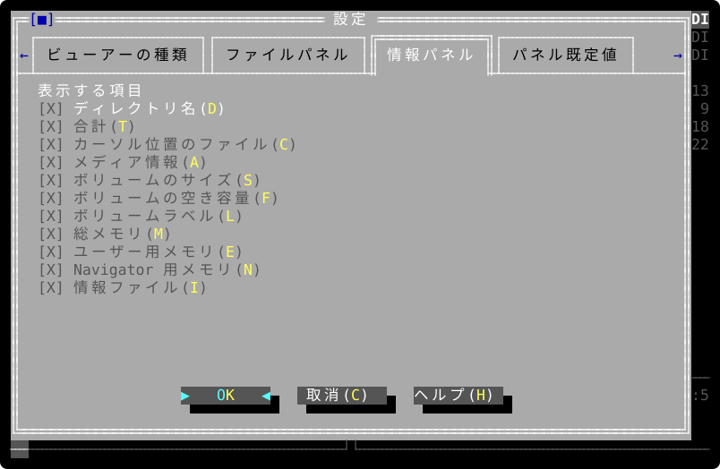

情報パネル (`Ctrl+L`) が表示する行です：ディレクトリの名前、その合計、カーソル位置のファイル、メディアの詳細、ボリュームのサイズ、空き容量、ラベル、マシンのメモリ、ディレクトリの情報ファイル。

## パネル既定値

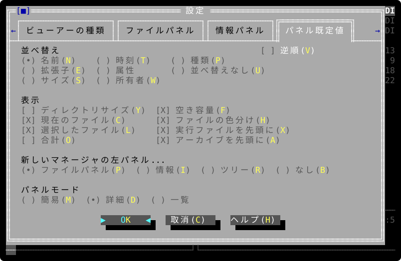

新しいファイルマネージャーのパネルの初期状態です。

- *並べ替え* と *逆順*：ファイルを並べる順序です。
- *ディレクトリサイズ*：各ディレクトリのサイズを集計して表示します。
- *現在のファイル*、*選択したファイル*、*合計*、*空き容量*：一覧の下の行です。
- *ファイルの色分け*：ファイルを種類ごとに色分けします。
- *実行ファイルを先頭に* と *アーカイブを先頭に*：それらのファイルを他より先に並べます。
- *新しいマネージャの左パネル*：ファイルパネル、情報パネル、ツリー、またはなし。
- *パネルモード*：簡易、詳細、一覧の表示です。

## 列

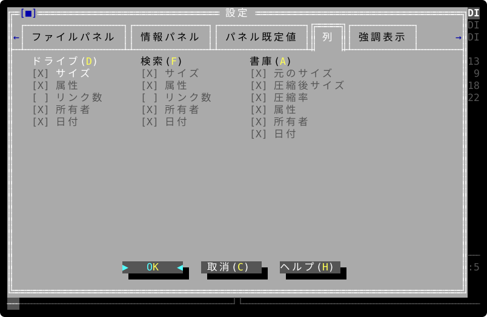

パネルが詳細表示で示す列で、三種類の一覧ごとに別々に設定します。`Alt+K` はパネル一つ分の列を変更します。[列の設定](panels.md#列の設定)を参照してください。

- *ドライブ*：ディスクまたはサーバー上のディレクトリです。列は *サイズ*、*属性*、*リンク数* (ファイルが持つ名前の数)、*所有者*、*日付* です。
- *検索*：[ファイル検索](panels.md#ファイル検索)がパネルに表示する一覧です。列は同じです。
- *書庫*：アーカイブの中です。*元のサイズ*、*圧縮後サイズ*、*圧縮率* (どれだけ圧縮されたか)、*属性*、*所有者*、*日付* です。

## 強調表示

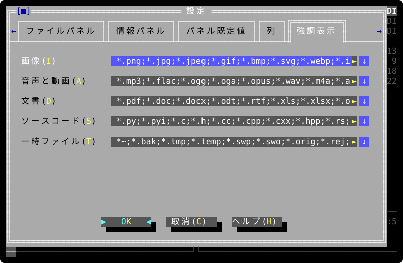

パネルが色分けする五つのグループの[ファイルマスク](panels.md#ファイルマスク)です：*画像*、*音声と動画*、*文書*、*ソースコード*、*一時ファイル*。グループのマスクに一致するファイルは、そのパネルで *ファイルの色分け* がチェックされている間、そのグループの色で表示されます。色そのものはテーマのもので、*設定 > 色* ([色](customizing.md#色)) で変更します。

これらのグループはパネルの名前を色分けします。ビューアーとエディターでファイルの中のテキストにどの色を付けるかは、`highlight.ini` で設定します ([構文の強調表示](editor.md#構文の強調表示))。

## 通信

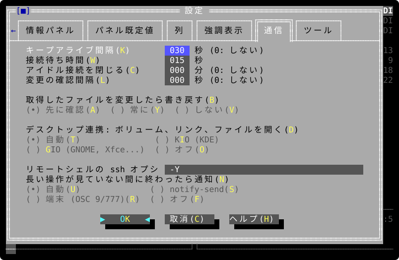

- *キープアライブ間隔*：サーバーへの接続を開いたままにするためにメッセージを送る間隔です。
- *接続待ち時間*：サーバーの応答を待つ時間です。
- *アイドル接続を閉じる*：使われていない接続を開いたままにしておく時間です。
- *変更の確認間隔*：サーバーのディレクトリに変更がないか確認する間隔です。
- *取得したファイルを変更したら書き戻す*：そのようなファイルを再びアップロードするかどうかです：確認してから、常に、またはしない。
- *デスクトップ連携*：ボリューム、リンク、ファイルを開くことに、どのデスクトップのサービスを使うかです。
- *リモートシェルの ssh オプション*：すべてのリモートシェルの `ssh` コマンドに加える語です。
- *長い操作が見ていない間に終わったら通知*：端末がバックグラウンドにある間に長い操作が終わったことを、デスクトップにどう知らせるかです。

## ツール

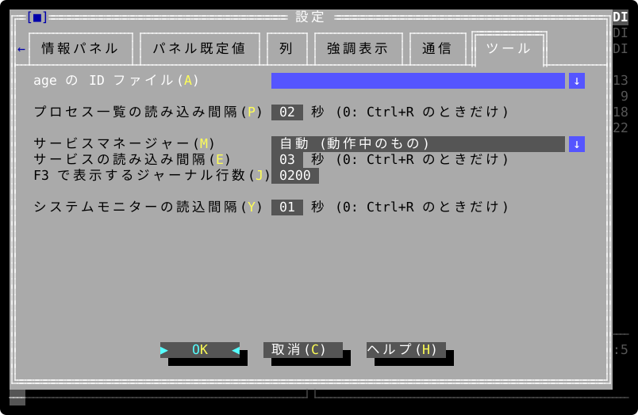

- *age の ID ファイル*：`age` が復号に使う鍵ファイルです。
- *プロセス一覧の読み込み間隔*、*サービスの読み込み間隔*、*システムモニターの読込間隔*：それらのウィンドウを更新する間隔です。
- *サービスマネージャー*：サービスウィンドウがやり取りするサービスマネージャーです。
- *F3 で表示するジャーナル行数*：`F3` がサービスのログをどれだけ開くかです。
