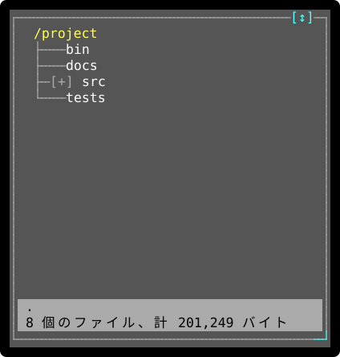
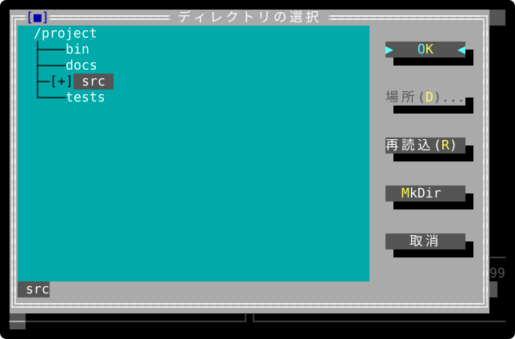
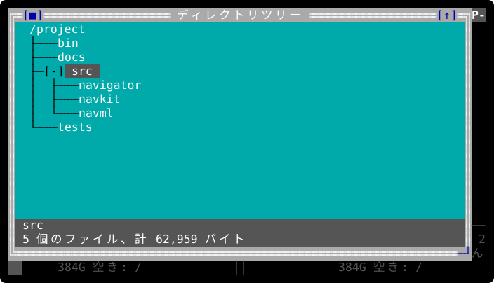
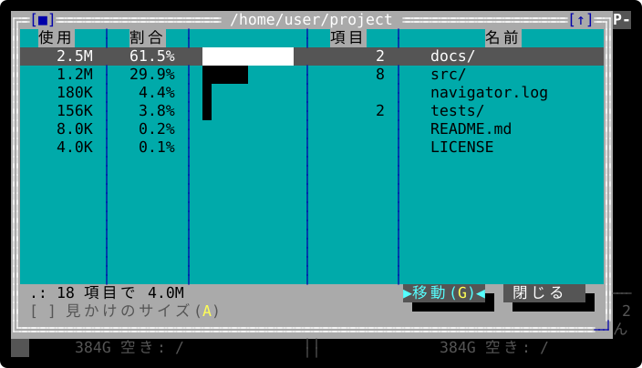

# ディレクトリツリー

ツリーは、ディレクトリとその中のディレクトリを字下げして表示します。

| キー | 動作 |
|---|---|
| `Up`, `Down` | カーソルを動かす |
| `Right` | ディレクトリを開いてその中へ入る |
| `Left` | そのディレクトリを含むディレクトリへ移る |
| `+`, `-` または `Space` | ディレクトリを開く、閉じる |
| `*` | すべてのディレクトリを開く |
| `Enter` | ディレクトリを選ぶ |
| `Ctrl+S` | 検索: 名前の先頭を入力する。`/` で見つけたディレクトリの中へ進む |

パネルが隠しディレクトリを表示しているとき (`Ctrl+H`)、ツリーも表示します。

## パネルの横のツリー

`Ctrl+T` で、アクティブでないパネルの場所にツリーを置きます。ツリーはアクティブなパネルを追いかけ、パネルもツリーを追いかけます。
ツリーでカーソルをディレクトリに置くと、そのディレクトリがパネルに表示されます。設定の[ファイルパネル](settings.md#ファイルパネル)ページで
*ディレクトリ自動移動* のチェックを外すと、`Enter` を押したときだけそうなります。

## ディレクトリの変更

`Alt+T` は、アクティブなパネルのディレクトリを選ぶためのツリーをボックスで開きます。*作成* はカーソル位置の下にディレクトリを作り、
*再読込* はツリーを読み直します。

## ツリーウィンドウ

*ディスク > ディレクトリツリー* は、ツリーをデスクトップ上の専用ウィンドウで開きます。このウィンドウは他の場所で作業しているあいだも
開いたままです。ディレクトリ上で `Enter` を押すと、アクティブなファイルマネージャのアクティブなパネルをそこへ移します。ウィンドウには
専用の *ツリー* メニューがあり、*再読込* (`Ctrl+R`)、*クイック検索* (`Ctrl+S`)、*閉じる* が入っています。`Esc` でも閉じます。

## ディレクトリサイズ

*ディスク > ディレクトリサイズ* は、アクティブなパネルのディレクトリを計測し、中身をサイズ順に一覧します。何が容量を占めているかが
わかります。

| キー | 動作 |
|---|---|
| `Enter`, `Right` | ディレクトリに入る |
| `Backspace`, `Left` | 外へ戻る |
| `Ctrl+N`, `Ctrl+S`, `Ctrl+E` | 名前、サイズ、項目数で並べ替える。もう一度押すと逆順 |
| `Ctrl+A` | 中身のサイズとディスク上で占める容量を切り替える |
| `F8`, `Del` | パネルと同じように削除する |
| `Ctrl+R` | 計測し直す |
