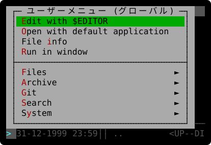

# ユーザーメニューとファイルの関連付け

## ユーザーメニュー

`F2` で自分用のコマンドのメニューを開きます。Navigator は、パネルのディレクトリとその上の各ディレクトリで `.navigator-menu.ini` という
ファイルを探します。これが *ローカル* メニューです。見つからなければ、Navigator の設定ディレクトリにある `menu.ini`、つまり
*グローバル* メニューを使います。



メニューの中では、`F2` でローカルメニューとグローバルメニューを切り替え、`F4` で表示中のメニューをエディタで開きます。
*設定 > グローバルメニュー定義* と *ローカルメニュー定義* でも編集できます。

### メニューの書き方

```ini
# A comment
~S~how the file = less !.!

[Archive]
~P~ack this file = tar czf !.tar.gz !.!
-
~L~ist = tar tf !.!
```

- `Caption = command` が 1 つの項目です。その下のインデントした行は、同じ項目のさらなるコマンドです。
- `[Name]` はサブメニューを始め、`[Name/Inner]` はその中のサブメニューを始めます。
- `-` だけの行は区切り線です。
- 文字の前の `~` は、その文字を項目のホットキーにします。`F1` から `F12` と空白で始まる表示名の項目は、そのキーで選ばれます。

次の記号は、アクティブなパネルのカーソル位置のファイルを表します。

| 書くもの | 置き換わるもの |
|---|---|
| `!` | 拡張子を除いた名前 |
| `.!` | ドット付きの拡張子 |
| `!.!` | 名前全体 |
| `!\` | ディレクトリ (末尾に `/` 付き) |
| `!/` | ディレクトリ (末尾の `/` なし) |
| `!!` | `!` そのもの |

`!` の代わりに `$` を使った同じ記号は、もう一方のパネルのファイルを表します。そのため、`$` そのものは `$$` と書きます。`%1` は
アクティブなパネルでタグ付けした名前を並べたファイル、`%2` はもう一方のパネルのものです。

`%3` から `%9` は、項目の実行時に尋ねられる語です。`<Title` の行は質問に題を付け、`<=text` は最初に入っている答えを指定します。

名前は必要に応じてシェル用に引用符で囲まれるので、自分で引用符を付けないでください。コマンドは、入力したのと同じように
コンソールのシェルで実行されます。

## ファイルの関連付け

設定ディレクトリにあるさらに 5 つのファイルが、ファイルの種類ごとの扱いを決めます。それぞれ、ファイルマスクごとにセクションがあります。

| ファイル | 決めること | 編集する場所 |
|---|---|---|
| `extensions.ini` | ファイルで `Enter` を押したときに実行するもの | *設定 > 拡張子ファイルの編集* |
| `viewers.ini` | ビューアの代わりに `F3` が実行するもの | *設定 > ビューア* |
| `editors.ini` | エディタの代わりに `F4` が実行するもの | *設定 > エディタ* |
| `quickrun.ini` | `Ctrl+Shift+F1` から `Ctrl+Shift+F10` が実行するもの | *設定 > クイック実行ファイルの編集* |
| `highlight.ini` | エディタとビューアがファイルをどう色分けするか、およびそのファイル用のエディタのオプション | *設定 > 強調表示ファイルの編集* |

`Alt+F3` は常に Navigator 自身のビューアを使います。`F4` が Navigator のエディタを使うときは `Alt+F4` が `editors.ini` のプログラムを使い、
その逆も同様です。[エディタ](editor.md#ファイルを開く)を参照してください。各ファイルは、Navigator の初回起動時に例を添えて書き出されます。
`highlight.ini` については[構文の強調表示](editor.md#構文の強調表示)で説明しています。
