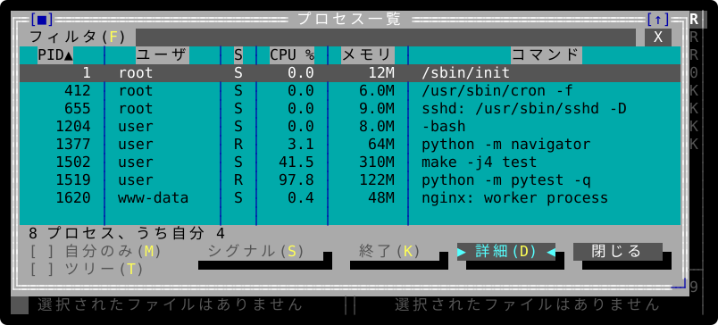
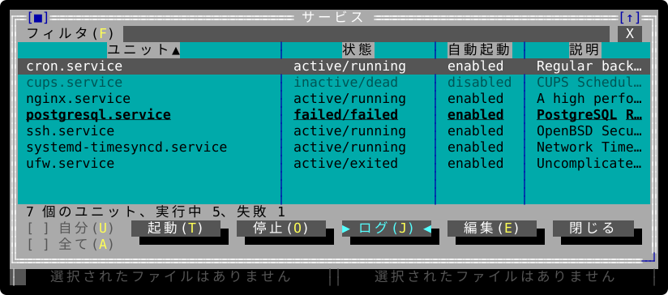
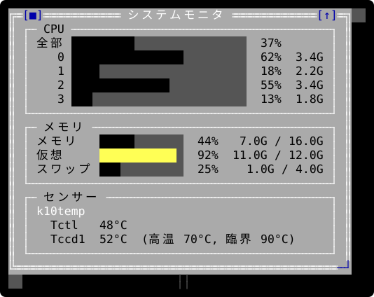
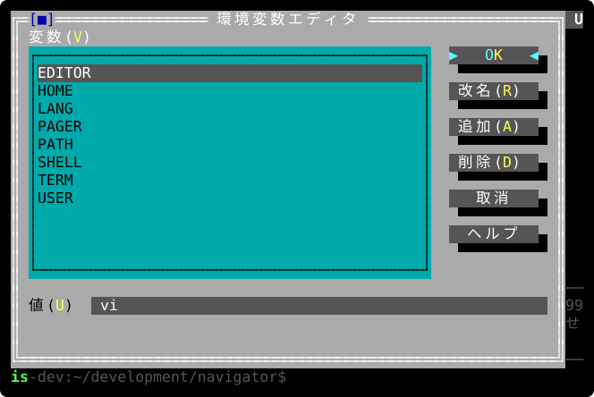
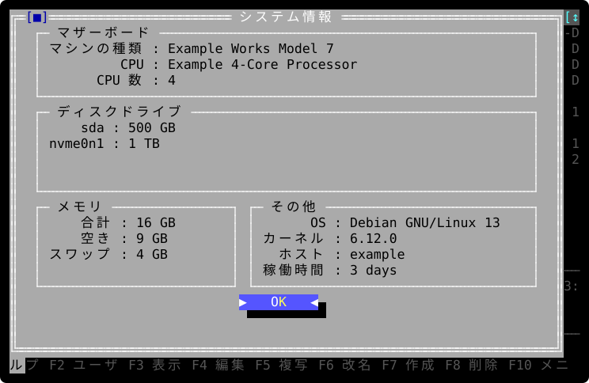
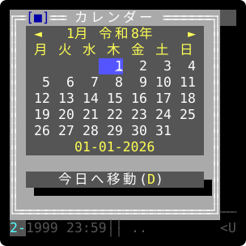
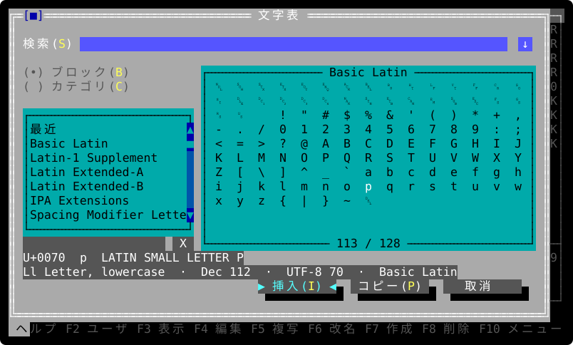

# ツール

## プロセス一覧

*ツール > プロセス一覧* は、実行中のプロセスを表示します。

| キー | 動作 |
|---|---|
| 文字の入力, `F4` | コマンド、名前、ユーザー、番号にその文字列を含むプロセスに一覧を絞り込む。`Esc` で解除する |
| `Ctrl+T` | プロセスを親子のツリーで表示する |
| `Ctrl+H` | 自分のプロセスだけを表示する |
| `Ctrl+P`, `Ctrl+U`, `Ctrl+E`, `Ctrl+L`, `Ctrl+Z`, `Ctrl+N` | 番号、ユーザー、状態、CPU 負荷、メモリ、コマンドで並べ替える |
| `Left`, `Right` | 長いコマンドをスクロールする |
| `F3` | プロセスの詳細を表示する |
| `F7` | 選んだシグナルを送る |
| `F8`, `Del` | 確認のうえプロセスを終了させる |
| `Ctrl+R` | 一覧を読み直す |

列の見出しをクリックすると、その列で並べ替えます。権限がなくてシグナルが拒否されたときは、root として送ることを提案します。

## サービス

*ツール > サービス* は、システムのサービスを一覧し、systemd、OpenRC、runit、SysVinit を通じて制御します。

| キー | 動作 |
|---|---|
| `Enter` | サービスの詳細を表示する |
| `F3` | ログを表示し、追跡する |
| `F4` | 設定を編集する |
| `F5`, `F6`, `F7` | 開始、再起動、再読み込み |
| `F8`, `Del` | 確認のうえ停止する |
| `Ctrl+E`, `Ctrl+D` | 起動時の開始を有効にする、無効にする |
| `Ctrl+U` | 自分のサービスを表示する |
| `Ctrl+A` | すべての種類のユニットを表示する |
| `Ctrl+S` | 一覧を絞り込む |
| `Ctrl+R` | 一覧を読み直す |

システムサービスの変更にはたいてい root が必要で、その場合は root での実行を提案します。

## システムモニタ

*ツール > システムモニタ* は、各プロセッサの負荷、使用中のメモリとスワップ、そしてマシンが報告する温度とファンの回転数を表示します。

## 環境変数の編集

*ツール > 環境変数の編集* は、Navigator から起動するプログラムに渡される環境変数を表示し、変更できるようにします。

- *変数* には名前が並びます。カーソル位置の変数の値は *値* の行にあり、そこで編集できます。
- *改名* は変数に別の名前を付けます。
- *追加* は新しい変数を加えます。
- *削除* はカーソル位置の変数を取り除きます。
- *OK* で変更を確定し、*取消* ですべての変更を破棄します。

変更は、それ以降に Navigator が起動するプログラムに反映されます。外部ビューアとエディタ、ユーザーメニューのコマンド、
コンソールのシェルです。変更は Navigator を終了するまで有効です。

## システム情報

*ツール > システム情報* は、マシンの構成を表示します。*マザーボード* とプロセッサ、*ディスクドライブ*、*メモリ*、
そして *その他* の下にシステム、カーネル、ホスト名、稼働時間です。

## カレンダー

*ツール > カレンダー* は、今日に印を付けて 1 か月を表示します。週の下には、カーソル位置の日付が[地域](settings.md#地域)の設定の
日付形式で書き出されます。

| キー | 動作 |
|---|---|
| 矢印 | 1 日ずつ移動する |
| `PgUp`, `PgDn` | 前の月、次の月 |
| `Ctrl+PgUp`, `Ctrl+PgDn` | 前の年、次の年 |
| `M`, `Y` | 月、または年を一覧から選ぶ |
| `T` | 今日へ移動する。*今日へ移動* ボタンも同じ |
| `C` | もう一方の暦とグレゴリオ暦を切り替える |
| `Esc` | カレンダーを閉じる |

*カレンダー* メニューには同じコマンドと、さらに 2 つのコマンドがあります。*暦法* は、ヘブライ暦、イスラム暦、ペルシア暦など
別の暦で月を表示します。*暦の表示* は、グレゴリオ暦の月の横にその暦の何を表示するかを決めます。その暦の月だけ、
グレゴリオ暦の月の下にその暦で書いた日付、その暦の月の下にグレゴリオ暦で書いた日付、2 つの月を左右に並べる、のいずれかです。

## 文字表

`Ctrl+B`、または *ツール > 文字表* で文字を探し、カーソル位置に入力します。

- *検索* は、`arrow` や `euro` のように名前で文字を探します。
- 左の一覧で文字のグループを選び、その下の行でグループを名前で絞り込みます。
- 右の格子はグループを表示します。カーソル位置の文字の説明が下に出ます。
- *挿入* はその文字を入力し、*コピー* はクリップボードに入れます。

プレーンな ASCII 文字に設定された端末では、文字表は DOS Navigator の *ASCII 表* になります。256 文字が並び、
カーソル位置の文字のコードが 10 進数と 16 進数で表示されます。

## SmartPad

`Alt+Q`、または `≡` メニューの *SmartPad* で、セッションをまたいで保存されるメモ帳を開きます。開くたびに末尾に日付と時刻の行を加え、
その下にカーソルを置くので、メモ帳はログのように読めます。これは[エディタ](editor.md)のウィンドウで、閉じると自動的に保存されます。

## システムメニュー

メニューバーの左端にある `≡` メニューには、Navigator 全体に関わるものが入っています。

| 項目 | 動作 |
|---|---|
| *バージョン情報* | バージョン、ライセンス、作者を表示する |
| *コマンドパレット* | 文字をいくつか入力して任意の[コマンド](windows.md#コマンドパレット)を探す |
| *画面の再描画* | 他のプログラムが画面に残したものの上から、画面全体を描き直す |
| *画面休止* | すぐにスクリーンセーバーを起動する |
| *画面キャプチャ*, `Shift+Alt+Ins` | 画面の矩形部分をクリップボードにコピーする |
| *ユーザー画面*, `Alt+F5` | キーが押されるまで[コンソール](console.md#コンソール)を表示する |
| *出力ウィンドウ*, `Ctrl+O` | ウィンドウをしまってコンソールで入力できるようにし、また戻す |
| *SmartPad*, `Alt+Q` | [メモ帳](#smartpad)を開く |
| *ごみ箱 オン/オフ* | ファイルをドロップして削除するごみ箱を表示する、隠す |
| *ゲーム*, `Alt+F9` | [ゲーム](game.md)を開く |

`Alt+X` で Navigator を終了します。先に確認します。確認の *今後は確認しない*、または[確認](settings.md#確認)ページの
*終了の確認* で、この確認をオフにできます。
