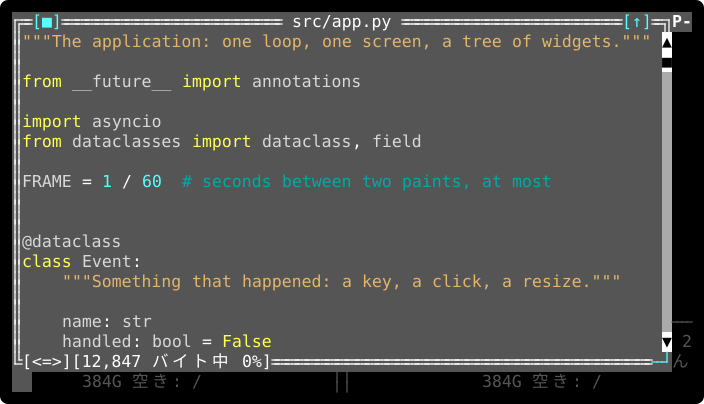
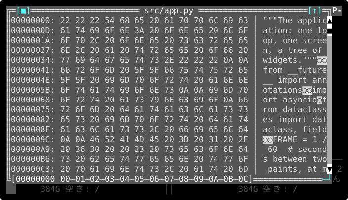
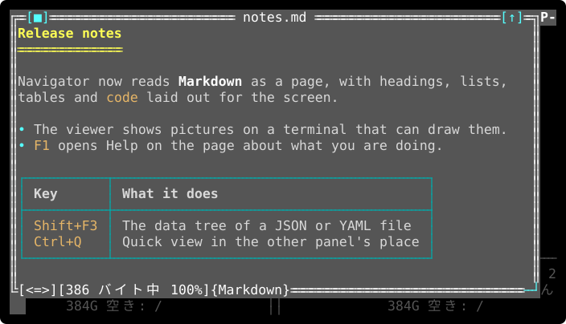
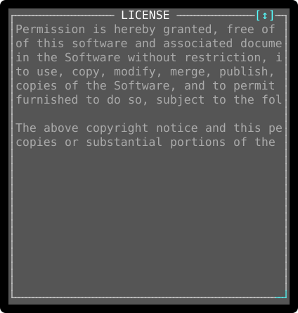
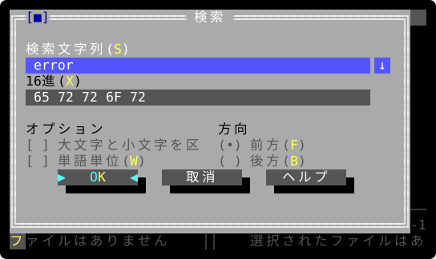
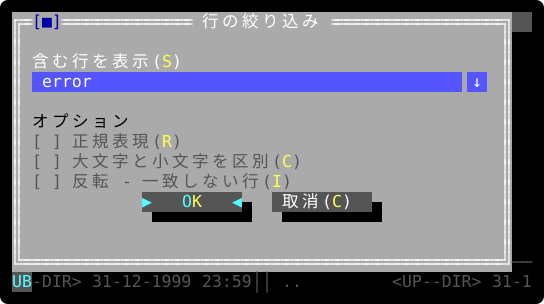
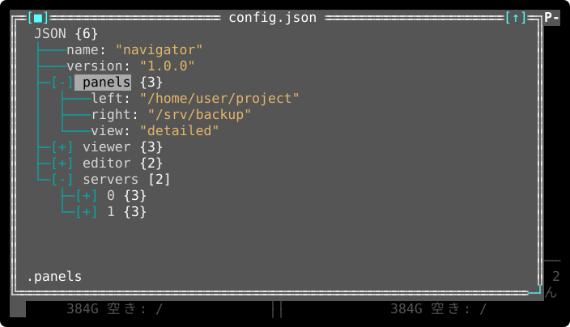
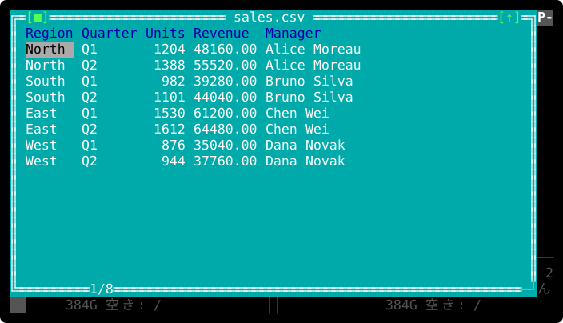

# ビューアー

`F3` は、カーソル位置のファイルを変更せずに表示します。ファイルがどれほど大きくても、すぐに開きます。

## キー

| キー | 動作 |
|---|---|
| `Up`、`Down`、`PgUp`、`PgDn` | スクロールする |
| `F2` | 長い行を折り返す、または折り返しをやめる |
| `F4` | テキスト、16進、ダンプを切り替える |
| `F5` | 番地へ移動する |
| `F6` | 文字フィルターを変更する |
| `F7` | 検索する。`Shift+F7` で再検索、`Ctrl+F7` で後方へ検索 |
| `Shift+F3` | Markdown や HTML などのファイルを、整形した表示またはソースで見る |
| `Shift+F4` | ファイルを編集する |
| `Shift+F5` | ファイルを別の名前で保存する |
| `Shift+F6` | テキストを読むエンコーディングを選ぶ |
| `Ctrl+T` | 増えていくファイルの末尾を追いかける |
| `Ctrl+G` | テキストに一致する行だけを表示する |
| `Alt+PgDn` | 以前に表示したファイルを一覧する |
| `Esc`、`F3` | ビューアーを閉じる |

同じコマンドは *表示* メニューにもあります。このメニューは、ビューアーが開いている間メニューバーに現れます。

16進モードではバイトを変更できます：その上に16進数字を入力するか、`Tab` を押して文字を入力します。`Shift+F2` で変更をファイルに書き込みます。

## ファイルを開く

| キーまたは項目 | 動作 |
|---|---|
| `F3`、*ファイル > 表示 > そのまま* | カーソル位置のファイルを、その種類に最も適した形で表示する (下記) |
| `Alt+F3`、*ファイル > 表示 > 別のビューア* | Navigator のビューアーで表示する。表や書庫として、また `viewers.ini` のプログラムで表示することはない |
| *ファイル > 表示 > テキストとして*、*16進として* | ビューアーをテキストモードまたは16進モードで開く |
| *ファイル > 表示 > データベースとして* | dBase または SQLite のファイルを、名前にかかわらず[表](#表)として開く |
| *ファイル > 表示 > スプレッドシートとして* | CSV または TSV のファイルを表として開く |
| *ファイル > 表示 > 開く...* | [ファイルボックス](dialogs.md#ファイルの選択)で選んだファイルを表示する。ファイルマネージャーは不要 |
| `Alt+PgDn` | 以前に表示したファイルの一覧からファイルを表示する |

`F3` は、dBase、SQLite、CSV のファイルを表として開き、書庫の中には `Enter` と同じように入ります。それ以外では、`viewers.ini` にそのファイル用のプログラムが指定されていればそのプログラムが表示し ([ファイルの関連付け](user-menu.md#ファイルの関連付け))、なければ Navigator のビューアーが表示します。設定の [システム](settings.md#システム) ページで *内蔵ビューア* のチェックを外すと、`F3` は `viewers.ini` のプログラムを、それもなければ `$PAGER` を実行します。

ディレクトリの上で `F3` を押すと、その中のすべてのサイズを集計します。

## 特別な表示

一部のファイルは、そのテキストとは別の形で表示されます。`Shift+F3`、または *表示 > マークアップ表示* で、その表示とファイル本来のテキストを切り替えます。下の枠の `{Markdown}` のような印は、テキストを見ている間は取り消し線付きで表示され、クリックしても切り替わります。

- **Markdown、reStructuredText、HTML** はページとして表示されます：見出し、箇条書き、表、引用、コードブロックがレイアウトされ、段落はウィンドウの幅に合わせて流し込まれます。ページ上のリンクは、端末によっては開けます。`F7` での検索はファイルそのもののテキストを検索し、ページ上の位置を示します。
- **PDF** はテキストとしてページごとに表示されます。中の画像は省かれます。また、PDF のテキストはファイルの中に圧縮されているので、`F7` では見つかりません。
- **画像** は、画像を描ける端末では kitty のグラフィックスプロトコルまたは sixel で画像として描かれます。たいていの種類の画像には Python パッケージ Pillow が必要です (`pip install navigator-fm[images]`)。Pillow がなければ、kitty 上の PNG だけが描かれます。それ以外の環境では画像のバイトが表示されます。端末への問い合わせがうまくいかないときは、[コマンドライン](command-line.md#色と文字)の `--graphics` で端末にできることを指定します。
- **JSON、YAML、TOML、XML、プロパティリスト** はテキストとして開き、`Shift+F3` で[データツリー](#データツリー)として表示されます。
- **dBase、SQLite、CSV のファイル** は、専用のウィンドウにレコードの[表](#表)として開きます。

4 MB を超えるファイル、また 64 MB を超える PDF や画像は、テキストとして表示されます。どの種類をどのファイルマスクで特別に表示するかは、[ビューアーの種類](settings.md#ビューアーの種類)の設定で決まります。

## クイックビュー

`Ctrl+Q` は、カーソル位置のファイルをもう一方のパネルの場所に表示し、カーソルの移動に追従します。`Tab` でキーボードをビューに移すと、そこではビューアーのキーが使えます。

## 検索

`F7` でファイルを検索します。`Shift+F7` で再検索し、`Ctrl+F7` で後方へ検索します。

- *検索文字列* は探すテキストです。*16進* は同じ検索をバイトの16進数字で書いたものです。探すものに合ったほうの行に入力します。
- *大文字と小文字を区別* は、大文字と小文字を区別します。
- *単語単位* は、より長い単語の一部になっている箇所を飛ばします。
- *方向*：*前方* はファイルの末尾へ、*後方* はファイルの先頭へ向かいます。

大きなファイルの検索では進行状況が表示され、*停止*、`Esc`、`Enter` で終了します。

## 番地へ移動

16進モードで `F5` を押すと *番地* (16進で書いたファイル内の位置) を尋ね、そこからファイルを表示します。

## 行の絞り込み

`Ctrl+G`、または *表示 > 行を絞り込む* で、テキストを含む行だけを表示します。

- *正規表現* は、テキストを正規表現として扱います。
- *大文字と小文字を区別* は、大文字と小文字を区別します。
- *反転 - 一致しない行* は、テキストを含まない行を表示します。

## データツリー

JSON、YAML、TOML、XML、プロパティリストのファイルで `Shift+F3` を押すとデータがツリーとして表示され、もう一度 `Shift+F3` を押すとテキストに戻ります。下端の行は、カーソル位置のノードのパスです。

| キー | 動作 |
|---|---|
| `F7` | キーと値を検索する。`Shift+F7` で再検索 |
| `Ctrl+S` | 入力しながらキーを探す |
| `Ctrl+Ins` | ノードのパスをクリップボードにコピーする |
| `Ctrl+Shift+C` | ノードの値をクリップボードにコピーする |
| `Shift+F4` | ファイルを編集する |
| `Esc` | ウィンドウを閉じる |

*データ* メニューには同じコマンドと、*すべて展開* があります。

## 表の検索

表の中で `F7` を押すと、レコードからテキストを検索します。`Shift+F7` で検索を繰り返します。

- *検索文字列* は探すテキストです。
- *大文字と小文字を区別* は、大文字と小文字を区別します。
- *範囲*：*カーソルのフィールド* はカーソルのある列だけを、*全フィールド* はすべての列を探します。
- *方向*：*前方* はカーソルから最後のレコードへ、*後方* は最初のレコードへ、*範囲全体* は最初のレコードから探します。

## 表

dBase、SQLite、CSV のファイルは、レコードの表として開きます。

- `F2` は表の構造 (フィールドとその型) を表示します。
- メモフィールドの上で `F3` を押すと、メモのテキストがボックスに表示され、そこではビューアーのキーが使えます。
- SQLite ファイルで `F6` を押すとクエリを尋ねます。実行されるのは読み取るだけのクエリで、ファイルが変更されることはありません。
- CSV または TSV ファイルで `Shift+F6` を押すと、セルへの区切り方を設定します：*区切り文字* (*カンマ*、*セミコロン*、*タブ*、*パイプ*、または横に文字を入力する *その他*)、*先頭行は見出し* かどうか、そして *エンコーディング* です。
