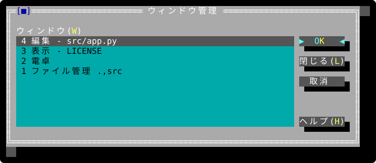
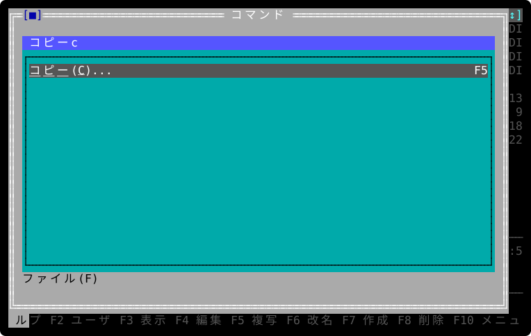

# ウィンドウ

ファイルマネージャ、ビューア、エディタ、ツールは、それぞれデスクトップ上の専用ウィンドウで開きます。*窓* メニューでそれらを配置します。

## ウィンドウの操作

| キー | 動作 |
|---|---|
| `F9` | 次のウィンドウへ移る |
| `Shift+F9` | 前のウィンドウへ移る |
| `Alt+0` | ウィンドウを一覧する |
| `Alt+Z` | ウィンドウをデスクトップ全体に広げる、元に戻す |
| `Ctrl+F5` | 矢印でウィンドウを動かし、`Shift` と矢印で大きさを変える。`Enter` で確定し、`Esc` で元に戻す |
| `Ctrl+F4` | ウィンドウを閉じる |

*窓 > 並べて表示* と *重ねて表示* はすべてのウィンドウを一度に配置し、*すべて閉じる* はすべてを閉じます。マウスでは、上端を
ドラッグしてウィンドウを動かし、右下隅で大きさを変え、ウィンドウをクリックして前面に出します。

各ウィンドウには番号があり、ウィンドウの一覧に表示されます。

## 1 つのテキストの 2 つのビュー

*窓 > 新しいビュー*、または *エディタ > ファイル > 新しいビュー* で、前面のエディタのテキストに対する 2 つ目のウィンドウを開きます。
どちらも同じテキストを表示し、一方で入力したものはもう一方にも現れ、元に戻す履歴と保存も共有します。カーソル、スクロール位置、
ブロックはそれぞれ別なので、長いファイルの 2 か所で同時に作業できます。

## バックグラウンドの処理

コピー、移動、削除は、進行状況ボックスの *裏処理* でバックグラウンドへ送れます。するとメニューバーに進み具合を示す
パーセンテージが表示され、応答待ちのときは `?` が表示されます。*窓 > バックグラウンド処理*、またはパーセンテージのクリックで
進行状況ボックスが再び現れます。複数の処理が実行中のときは、まずそれらを古い順に一覧し、応答待ちのものにカーソルを置きます。

## デスクトップの保存

*設定 > デスクトップを保存* は、開いているウィンドウを保存します。各ファイルマネージャとそのパネルのディレクトリ、表示形式、並べ替え、
各エディタのファイルと位置、各ビューアのファイルと位置、各テーブルのレコード、ツリーウィンドウ、ボリュームウィンドウ、電卓、
カレンダー、そしてすべてのウィンドウの位置です。*設定 > デスクトップを読み込み* は、今開いているウィンドウを閉じて、保存したものを
元に戻します。アクティブなパネルは今いるディレクトリに留まります。ただし、設定の[起動](settings.md#起動)ページで
*ディレクトリを保持* にチェックがある場合は除きます。同じページで *デスクトップ自動保存* にチェックを付けると、終了時にデスクトップを
保存し、次回の起動時に元に戻します。[コマンドライン](command-line.md)で指定したディレクトリは、保存したものより優先されます。

## ウィンドウ一覧

`Alt+0`、または *窓 > 一覧* で、開いているウィンドウを前面のものから順に一覧します。

- *OK*、または `Enter` で、カーソル位置のウィンドウへ移ります。
- 数字を押すと、その番号のウィンドウへ直接移ります。
- *閉じる* はカーソル位置のウィンドウを閉じます。一覧は開いたままなので、続けていくつも閉じられます。
- *取消* は何も変えずに閉じます。

## コマンドパレット

`Alt+Shift+P`、または `≡` メニューの *コマンドパレット* で、今いる場所で使えるすべてのコマンドを一覧します。アクティブなウィンドウ
自身のものも含むメニューの項目と、キーでしか実行できないコマンドです。それぞれキーと一緒に表示され、今は実行できないものは灰色になります。

コマンドの文字をいくつか順に入力すると、一覧が絞り込まれます。`Enter` でカーソル位置のコマンドを実行し、`Esc` で一覧を閉じます。
