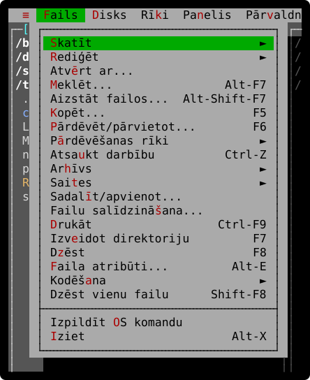

# Navigator palīdzība

Navigator ir DOS Navigator divu paneļu failu pārvaldnieka atveidojums mūsdienu termināļiem. Šīs lappuses ir tā
rokasgrāmata: tieši šos failus rāda `F1` Navigator iekšienē.

## Darba sākšana

Ekrāna augšā ir izvēlņu josla, divi failu [paneļi](panels.md), zem tiem [komandrinda](console.md), bet apakšējā
rindā taustiņu josla, kas nosauc, ko dara funkciju taustiņi. Terminālī, kas to ziņo, turot `Alt`, `Ctrl` vai
`Shift`, redzams, ko tie dara, kamēr šis taustiņš ir nospiests.

| Taustiņš | Ko tas dara |
|---|---|
| `Tab` | Pārslēdzas starp paneļiem |
| `Enter` | Ieiet direktorijā vai atver failu |
| `F3`, `F4` | [Skata](viewer.md) vai [rediģē](editor.md) failu |
| `F5`, `F6` | [Kopē vai pārdēvē un pārvieto](file-operations.md#kopēšana-un-pārvietošana) |
| `F7` | Izveido direktoriju |
| `F8` | Dzēš |
| `F10` | Atver izvēlni |
| `Ctrl+O` | Parāda [konsoli](console.md) aiz logiem |
| `Alt+X` | Iziet |
| `F1` | Palīdzība par to, ko darāt; skatiet [Palīdzība par palīdzību](help.md) |

Katra komanda ir izvēlnēs, blakus tai ir tās taustiņš. `Alt+Shift+P` atrod komandu, ierakstot daļu tās nosaukuma.

## Saturs

Faili un direktorijas:

- [Paneļi](panels.md): pārvietošanās, skati, kārtošana, atzīmēšana, informācijas panelis, kolonnas, filtrs, failu
  un dublikātu meklēšana, saraksta faili
- [Failu darbības](file-operations.md): kopēšana un pārvietošana, pārdēvēšana, dzēšana, atsaukšana, atribūti,
  saites, sadalīšana un apvienošana, UU, kontrolsummas, šifrēšana, teksta pārveidošana, atvēršana ar citu
  lietotni, drukāšana
- [Arhīvi](archives.md): formāti, atvēršana, pārbaude, arhīva izveide un izvilkšana no tā
- [Salīdzināšana](compare.md): direktorijas, sinhronizācijas logs, divi faili
- [Direktoriju koki](trees.md): koks blakus panelim, direktorijas maiņa, koka logs, direktoriju izmēri
- [Vietas ārpus diska](drives.md): arhīvi, serveri, konteineri, sējumi, diska attēli, atkritne
- [Darbs kā root](as-root.md): darīt to, kam jums trūkst atļaujas, un root piekļuve
- [Savienojumi](connections.md): savienojumu pārvaldnieks, paroles, servera atslēgas, portu pārsūtīšana,
  saglabātās saites
- [Grāmatzīmes](bookmarks.md): saraksts un tā taustiņi

Failu aplūkošana un mainīšana:

- [Skatītājs](viewer.md): tā taustiņi, faila atvēršana, lappuses, PDF un attēli, meklēšana, rindu filtrēšana,
  datu koks, tabulas
- [Redaktors](editor.md): tā taustiņi, faila atvēršana, bloki, meklēšana un aizstāšana, pāriešana uz rindu, malas,
  sintakses izcelšana
- [Makro](macros.md): ierakstīti taustiņi un redaktora makro

Darbs ar Navigator:

- [Komandrinda un konsole](console.md): komandu palaišana, komandu logi, vēstures
- [Navigator palaišana](command-line.md): komandas `nav` opcijas
- [Logi](windows.md): pārvietošanās starp logiem, divi viena teksta skati, darbības fonā, darbvirsmas
  saglabāšana, logu saraksts, komandu palete
- [Dialoglodziņi](dialogs.md): to taustiņi un faila izvēle
- [Kopēšana un ielīmēšana](clipboard.md): taustiņi, starpliktuves rīki un tas, ko ar tiem dara katrs terminālis
- [Iestatījumi](settings.md): katra izvēlnes Iestatījumi > Uzstādījumi lappuse
- [Taustiņi un krāsas](customizing.md): taustiņu piesaistes, tēmas krāsas
- [Lietotāja izvēlne un failu asociācijas](user-menu.md)

Rīki:

- [Kalkulators](calculator.md): tā četri izskati, izteiksmes un taustiņi
- [Rīki](utilities.md): procesu saraksts, pakalpojumi, sistēmas monitors, vide, sistēmas informācija, kalendārs,
  rakstzīmju tabula, SmartPad, sistēmas izvēlne
- [Spēle](game.md): tās taustiņi, labāko desmitnieks, tās iestatīšana

- [Palīdzība par palīdzību](help.md): palīdzība tur, kur esat, un šī loga taustiņi
