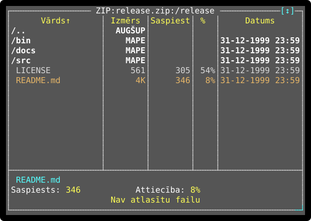
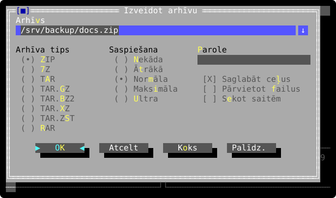
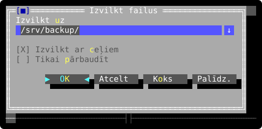

# Arhīvi

Navigator rāda arhīvu kā direktoriju: `Enter` uz zip vai tar faila ieiet tajā, un tā failus var skatīt un kopēt
ārā tāpat kā jebkurus citus. Šī lappuse ir par arhīvu atvēršanu, izveidi un atpakošanu.

## Arhīva atvēršana

`Enter` vai `Ctrl+PgDn` uz arhīva ieiet tajā; `..` tā augšā iznāk atpakaļ. `Enter` atpazīst arhīvu pēc nosaukuma:
`.zip`, `.tar.gz`, `.7z`, `.deb` un tamlīdzīgi. *Fails > Arhīvs > Atvērt arhīvu* jeb `Ctrl+PgDn` atver failu zem
kursora kā arhīvu neatkarīgi no nosaukuma — tā var ielūkoties statiskā bibliotēkā (`.a`) vai AppImage, ko `Enter`
palaistu. Ja iestatījumu lappusē [Failu paneļi](settings.md#failu-paneļi) noņemta atzīme *ENTER atver arhīvu*, to
dara tikai `Ctrl+PgDn`.

Iekšā `F5` kopē failus ārā. Ja formātu var mainīt, `F8` dzēš failus un failus var arī iekopēt. Detalizētais skats
rāda katra faila saspiesto izmēru un to, cik tas saspiests.

| Formāts | Kas tam vajadzīgs | Var mainīt |
|---|---|---|
| ZIP, TAR un TAR, saspiests ar gzip, bzip2 vai xz | Nekas | Jā |
| Viens fails, saspiests ar gzip, bzip2, xz vai lzma | Nekas | Tikai šo vienu failu |
| TAR vai viens fails, saspiests ar zstd | Programma `zstd`, pirms Python 3.14 | Jā; vienam failam — tikai šo failu |
| 7Z | 7-Zip (`7z`, `7zz` vai `7za`) | Jā |
| RAR | `unrar` vai 7-Zip `7z` vai `7zz` | Tikai ar RARLAB `rar` |
| Debian un RPM pakotnes, CPIO, statiskās bibliotēkas (`.a`) | Nekas | Nē |
| SquashFS attēli un AppImage | `unsquashfs` no squashfs-tools | Nē |

Ja programmas trūkst, `Enter` pasaka, kuru instalēt, nevis palaiž failu. Arhīvs ar paroli to pieprasa.

## Arhīva pārbaude

*Fails > Arhīvs > Pārbaudīt arhīvu* arhīvā izlasa atlasītos failus un pārbauda katru no tiem vai visu arhīvu, ja
kursors ir uz `..` un nekas nav atzīmēts. Fails, kas pārbaudi neiztur, tiek nosaukts. *Tikai pārbaudīt*
[izvilkšanas](#failu-izvilkšana) lodziņā dara to pašu no ārpuses.

## Arhīva izveide

`Shift+F1` jeb *Fails > Arhīvs > Izveidot arhīvu* sapako atlasi jaunā arhīvā.

- *Arhīvs* ir arhīva nosaukums. Rinda atveras ar otra paneļa direktoriju; nosaukums bez direktorijas izveido
  arhīvu pašreizējā direktorijā. *Koks* izvēlas direktoriju no koka. Ja arhīvs jau eksistē, tiek jautāts, vai to
  papildināt vai aizstāt.
- *Arhīva tips* izvēlas formātu. Nosaukuma galotne seko tipam, un galotnes ierakstīšana izvēlas tipu. Tips, kam
  vajadzīga neinstalēta programma, ir pelēks, un rinda virs pogām pasaka, kura.
- *Saspiešana* maina laiku pret izmēru, no *Nekāda* līdz *Ultra*. Līmeņi, kuru formātam nav, ir pelēki; vienkāršam
  TAR to nav vispār.
- *Parole* šifrē arhīvu. Tā pieejama ZIP un 7Z, ja instalēts 7-Zip, un RAR. Jums to lūgs ierakstīt otrreiz.

Opcijas:

- *Saglabāt ceļus* saglabā arhīvā katra faila direktorijas, nevis tikai nosaukumu.
- *Pārvietot failus* izdzēš failus, tiklīdz tie ir arhīvā.
- *Sekot saitēm* sapako to, uz ko norāda saite, nevis pašu saiti.

## Failu izvilkšana

`Shift+F2` uz arhīva jeb *Fails > Arhīvs > Atpakot arhīvu* atpako to jūsu nosauktajā direktorijā. Arhīva iekšienē
*Izvilkt uz* atpako atlasi.

- *Izvilkt ar ceļiem* izveido arhīva direktorijas. Bez tā katrs fails nonāk tieši mērķa direktorijā.
- *Tikai pārbaudīt* pārbauda arhīvu, vai tajā nav kļūdu, un neko neieraksta.

*Koks* izvēlas mērķa direktoriju no koka.
