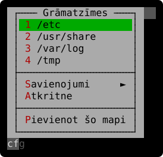

# Grāmatzīmes

Grāmatzīmes ir direktorijas, uz kurām bieži dodaties. `Alt+F1` atver sarakstu kreisajam panelim, `Alt+F2` labajam,
bet `Alt+C` aktīvajam; tās ir arī *Grāmatzīmes kreisajā* un *Grāmatzīmes labajā* izvēlnē *Pārvaldnieks*.

## Saraksts

Katrai grāmatzīmei ir taustiņš: `1` līdz `9`, `0`, tad burti. Nospiediet to vai pārvietojieties uz grāmatzīmi un
nospiediet `Enter`, un panelis dodas uz turieni. Grāmatzīme, kuras direktorijas pašlaik nav, ir pelēka.

| Taustiņš | Ko tas dara |
|---|---|
| `Enter` vai grāmatzīmes taustiņš | Dodas uz direktoriju |
| `F2` | Piešķir grāmatzīmei nosaukumu, ko rāda tās ceļa vietā. Tukšs nosaukums to noņem |
| `Ctrl+Up`, `Ctrl+Down` | Pārvieto grāmatzīmi sarakstā augšup vai lejup |
| `Del` | Dzēš grāmatzīmi |
| `Esc` | Aizver sarakstu |

Pēdējais ieraksts ir *Pievienot šo mapi*, kas pievieno grāmatzīmi paneļa direktorijai, vai *Noņemt šo mapi*, ja tai
grāmatzīme jau ir.

Zem līnijas ir diski, kas pašlaik ir piemontēti un nav grāmatzīmes, piemēram, USB zibatmiņa. Uz tiem var aiziet, bet
tie netiek paturēti. Sarakstā ir arī daļa *Savienojumi* ar jūsu [saglabātajiem savienojumiem](connections.md).

Dzēšana vispirms pajautā. *Vairs nejautāt* jautājumā vai *Dzēst grāmatzīmi* lapā
[Apstiprinājumi](settings.md#apstiprinājumi) izslēdz šo jautājumu.

## Bez saraksta

`Alt+1` līdz `Alt+9` aizved aktīvo paneli tieši uz pirmajām deviņām grāmatzīmēm. `Alt+Shift+1` līdz `Alt+Shift+9`
saglabā paneļa direktoriju kā grāmatzīmi attiecīgajā vietā.

## Pirmās grāmatzīmes

Pirmajā palaišanas reizē Navigator pievieno grāmatzīmes jūsu mājas direktorijai, tām darbvirsmas mapēm, kas
pastāv, piemēram, Dokumenti un Lejupielādes, un direktorijām, kur ir piemontēti diski. Pēc tam saraksts ir jūsu:
dzēstās grāmatzīmes neatgriežas.
