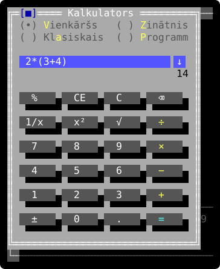
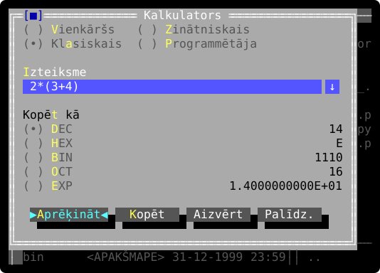
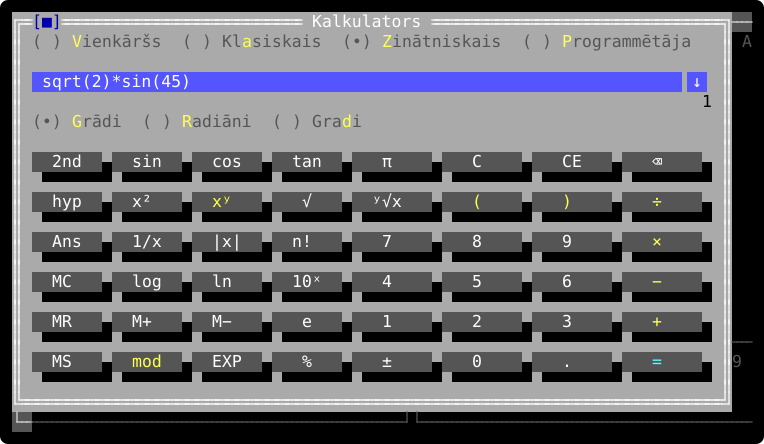
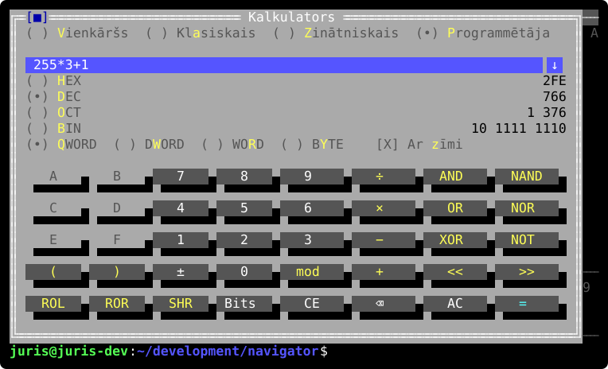

# Kalkulators

`Ctrl+F6` jeb *Rīki > Kalkulators* atver kalkulatoru. Izteiksmi rakstāt rindā, un tās vērtība tiek aprēķināta,
kamēr rakstāt. `Enter` to aprēķina: izteiksme nonāk rindas vēsturē un vērtība paliek iezīmēta, tāpēc cipars sāk
jaunu aprēķinu, bet operators turpina no vērtības.

## Četri izskati

Kalkulatoram ir četri izskati, kurus izvēlas joslā tā augšpusē, izvēlnē *Kalkulators* vai, vēlreiz nospiežot
`Ctrl+F6`, lai pārietu uz nākamo. Tas atceras pēdējo izmantoto izskatu.

- *Vienkāršs* ir kabatas kalkulators: cipari un četras darbības.
- *Klasiskais* rāda vērtību piecos veidos vienlaikus: decimālajā, sešpadsmitnieku, binārajā, astotnieku un
  zinātniskajā pierakstā.
- *Zinātniskais* pievieno funkcijas, leņķa mērvienības izvēli, atmiņu un pēdējo atbildi.
- *Programmētāja* strādā ar izvēlēta izmēra veseliem skaitļiem četrās skaitīšanas sistēmās.

Izskatos *Vienkāršs*, *Zinātniskais* un *Programmētāja* taustiņu bloks zem rindas raksta tajā tāpat kā tastatūra.
Funkcijas taustiņš ietin skaitli pirms kursora: `9` un tad `√` dod `SQRT(9)`.

## Izteiksmes

| Jūs rakstāt | Kas tas ir |
|---|---|
| `12`, `1.5`, `.5`, `1E+3` | Skaitļi |
| `$FF`, `0FFh`, `0x1F` | Sešpadsmitnieku skaitļi |
| `101b`, `0b101` | Binārie skaitļi |
| `17o` | Astotnieku skaitlis |
| `+`, `-`, `*`, `/` | Četras darbības |
| `^` | Kāpinājums: `2^10` |
| `%` | Divu veselu skaitļu dalīšanas atlikums |
| `&`, `\|`, `\`, `~` | Bitu „un”, „vai”, izslēdzošais „vai” un „nē” |
| `<<`, `>>` | Bīdes |
| `=`, `<>`, `<`, `>`, `<=`, `>=` | Salīdzinājumi, kas dod 1 vai 0 |
| `&&`, `\|\|` | Divu patiesumu „un”, „vai” |
| `(`, `)` | Iekavas |
| `PI` | Skaitlis π |

Lielie un mazie burti ir vienādi. Reizināšana un dalīšana notiek pirms saskaitīšanas un atņemšanas, bet kāpināšana
pirms tām visām.

Funkcijas ir `SIN`, `COS`, `TAN`, `CTAN`, `ARCTAN`, `SQR` (kvadrāts), `SQRT` (kvadrātsakne), `LN`, `LG`
(decimāllogaritms), `EXP`, `SIGN` un `IF(condition, a, b)`, kas ir `a`, ja nosacījums ir patiess, un `b` citādi.

## Klasiskais

Piecas rindas rāda vērtību katrā veidā; skaitlim, kas nav vesels, sešpadsmitnieku, binārajā un astotnieku veidā
tiek rādīta tā veselā daļa.

- *Aprēķināt* aprēķina izteiksmi, tāpat kā `Enter`.
- *Kopēt kā* izvēlas veidu, un *Kopēt* ievieto vērtību starpliktuvē šajā veidā.
- *Aizvērt* aizver kalkulatoru.

## Zinātniskais

- *Grādi*, *Radiāni* un *Gradi* izvēlas mērvienību, ko trigonometriskās funkcijas pieņem un dod.
- Vairāk funkciju: `ASIN`, `ACOS`, `ATAN`, `SINH`, `COSH`, `TANH`, `ABS`, `CBRT`, `ROOT(x, n)`, `LOG`, `LOG2`,
  `FACT` un `!` aiz skaitļa tā faktoriālam. `E` ir skaitlis e.
- `ANS` jeb taustiņš *Ans* ir pēdējā aprēķinātā vērtība.
- Atmiņas taustiņi: *MS* saglabā vērtību, *MR* to atsauc, *M+* un *M−* tai pieskaita un no tās atņem, un *MC* to
  notīra.
- *2nd* un *hyp* maina to, ko raksta funkciju taustiņi: apgrieztās funkcijas un hiperboliskās funkcijas.

## Programmētāja

- *HEX*, *DEC*, *OCT* un *BIN* izvēlas skaitīšanas sistēmu, kurā rakstāt skaitļus. Vērtība tiek rādīta visās
  četrās.
- *QWORD*, *DWORD*, *WORD* un *BYTE* izvēlas skaitļa izmēru: 64, 32, 16 vai 8 biti. Rezultāts, kas neietilpst, tiek
  apgriezts līdz šim izmēram.
- *Ar zīmi* lasa skaitli kā skaitli ar zīmi. Bez atzīmes tas nekad nav negatīvs.
- Dalīšana dod veselu skaitli.
- Darbības var rakstīt arī vārdiem: `AND`, `OR`, `XOR`, `NAND`, `NOR`, `NOT`, `MOD`, `SHL`, `SHR`, `SAR`, `ROL` un
  `ROR`.
- *Bitu tastatūra* izvēlnē *Kalkulators* taustiņu vietā rāda 64 bitus. Klikšķis vai `Space` pārslēdz bitu.

## Taustiņi

| Taustiņš | Ko tas dara |
|---|---|
| `Enter` | Aprēķina |
| `Ctrl+F6` | Nākamais izskats |
| `Ctrl+1` līdz `Ctrl+4` | Vienkāršs, Klasiskais, Zinātniskais, Programmētāja, ja terminālis sūta šos taustiņus |
| `Down` rindā | Izteiksmju vēsture |
| `Esc` | Aizver kalkulatoru |
