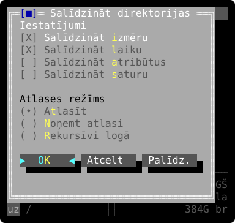
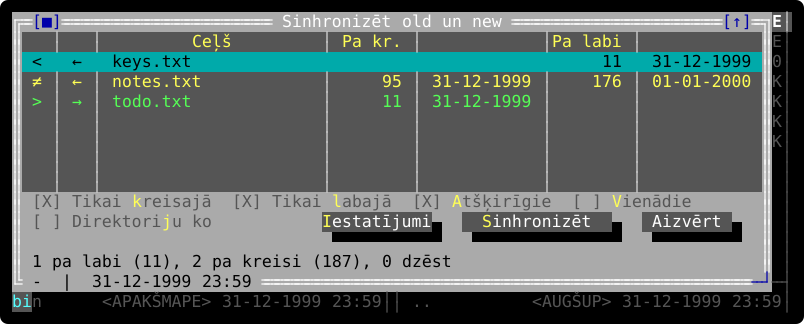
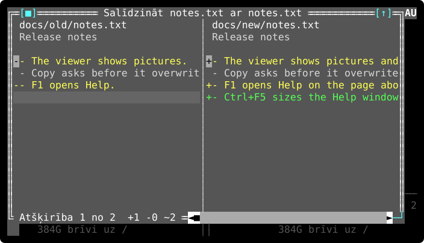

# Salīdzināšana

## Direktoriju salīdzināšana

*Panelis > Salīdzināt direktorijas* salīdzina abu paneļu failus pēc nosaukuma.

- *Salīdzināt izmēru*, *Salīdzināt laiku*, *Salīdzināt atribūtus* un *Salīdzināt saturu* izvēlas, kas liek diviem
  vienāda nosaukuma failiem skaitīties vienādiem. Tikai *Salīdzināt saturu* lasa failus un aizņem ilgāku laiku.
- *Atlasīt* katrā panelī atzīmē failus, kam otrā nav atbilsmes. Atzīmēto failu kopēšana uz otru pusi atjaunina otru
  direktoriju.
- *Noņemt atlasi* tā vietā noņem šiem failiem atzīmes.
- *Rekursīvi logā* salīdzina direktorijas ar visu, kas tajās ir, un atver sinhronizācijas logu.

## Sinhronizācija

Sinhronizācijas logs uzskaita katru failu, kas ir tikai vienā pusē vai atšķiras, kreisā paneļa direktoriju pa
kreisi. Katrai rindai ir darbība: kopēt pa labi, kopēt pa kreisi, dzēst vai izlaist. Logs piedāvā vienu, un izvēlne
*Sinhronizēt* to maina rindai zem kursora vai visām rindām uzreiz.

- *Sinhronizēt*, `F5`, izpilda darbības, vispirms pajautājot.
- *Salīdzināt failus*, `Enter` vai `F3`, rāda rindas abus failus blakus.
- *Salīdzināt atkārtoti*, `Ctrl+R`, nolasa abas direktorijas no jauna.
- *Rādīt tikai kreisajā pusē*, *Rādīt tikai labajā*, *Rādīt atšķirīgos* un *Rādīt vienādos* izvēlas, kuras rindas
  tiek uzskaitītas.
- *Direktoriju koks*, `Ctrl+T`, uzskaita rindas kā direktoriju koku.
- *Iestatījumi* nosaka, kā faili tiek salīdzināti, un [failu masku](panels.md#failu-maskas) tam, kuri faili tiek
  aplūkoti.

### Iestatījumi

*Iestatījumi* sinhronizācijas logā nosaka, kas tiek salīdzināts un kā. *OK* salīdzina abas direktorijas no jauna.

- *Faila maska* izvēlas aplūkojamos failus; tukša salīdzina visu. Šablonus atdala ar `;`. `-` pirms šablona izlaiž
  tā failus, un `/` aiz tā nosauc direktorijas: `*.py;-.git/`.
- *Laiki ir vienādi* nosaka, cik tuvu jābūt diviem laikiem: *Precīzi, līdz sekundei*, *2 sekunžu robežās (FAT)* vai
  *Minūtes robežās (FTP)*.
- *Vai tieši stundu atšķirīgi* uzskata par vienādiem arī laikus, kas atšķiras par vienu stundu, — to FAT diskam
  nodara vasaras laika maiņa.
- *Asimetriski: labā kļūst par kreisās kopiju* piedāvā izdzēst to, kas ir tikai labajā pusē, un kopēt pa labi katru
  atšķirīgo failu neatkarīgi no tā, kurš ir jaunāks.

## Failu salīdzināšana

*Fails > Salīdzināt failus* rāda divus failus blakus ar iezīmētām atšķirībām. Tas ņem divus aktīvā paneļa atzīmētos
failus. Ja neviens nav atzīmēts, tas ņem failu zem kursora un tāda paša nosaukuma failu otrā panelī vai, ja tāda
nosaukuma nav, failu zem otra paneļa kursora.

