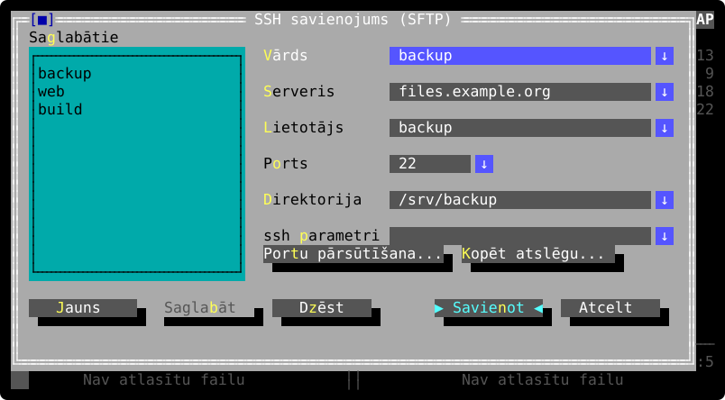
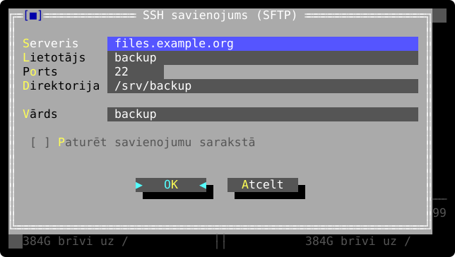
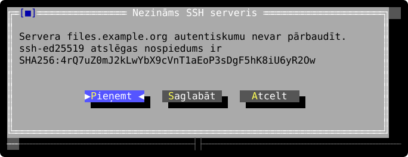
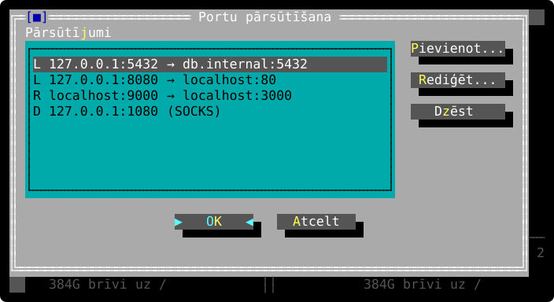
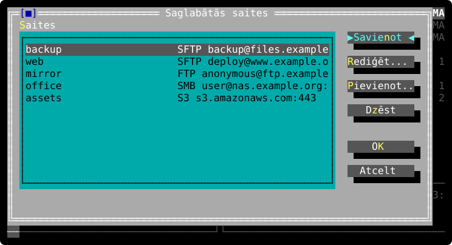

# Savienojumi

Kā paneli novietot serverī un kā tiek glabāti jūsu izmantotie savienojumi. Kas ir katrs vietas veids un citi veidi,
kā tai piekļūt, aprakstīts lappusē [Vietas ārpus diska](drives.md).

## Savienojumu pārvaldnieks

Katrs izvēlnes *Rīki > Savienojumi* ieraksts, piemēram, *SSH (SFTP)* (`Alt+F11`), atver kreisajā pusē šim
protokolam saglabātos savienojumus un labajā pusē viena savienojuma rindas.

- Lodziņš atveras ar tukšām rindām. Aizpildiet tās un nospiediet *Savienot*, lai izveidotu savienojumu, kas netiek
  saglabāts.
- Izvēlieties savienojumu sadaļā *Saglabātie*, lai to ieliktu rindās. Dubultklikšķis ar to savienojas.
- *Jauns* izveido saglabātu savienojumu ar nosaukumu, ko varat pārrakstīt. *Saglabāt* saglabā to, ko mainījāt;
  mainīts savienojums ir atzīmēts ar `*`, un, to pametot, tiek jautāts, vai saglabāt. *Dzēst* izņem savienojumu.
- *Savienot* aizved tur aktīvo paneli. No *Rīki > Attālā čaula* tas tā vietā atver čaulu logā.

Rindas ir tās pašas, kas [savienojumam](#savienojums). Katra atceras, kas tajā bijis iepriekš; `Down` rindā atver
tās vēsturi.

SSH pārvaldniekam ir vēl trīs:

- *ssh parametri* tiek nodoti `ssh`, kad tiek atvērta attālā čaula.
- *Pārsūtījumi* iestata savienojuma [portu pārsūtīšanu](#portu-pārsūtīšana).
- *Kopēt atslēgu* ievieto serverī vienu no jūsu publiskajām atslēgām, lai turpmākiem savienojumiem nebūtu vajadzīga
  parole.

rclone pārvaldnieka *Konfigurēt* palaiž `rclone config`, lai iestatītu attālās vietas.

## Savienojums

| Rinda | Kas tā ir |
|---|---|
| *Serveris* | Servera nosaukums vai adrese. SSH gadījumā der arī `Host` nosaukums no `~/.ssh/config`, un tas, ko saka fails, aizpilda tukšu lietotāju un portu |
| *Lietotājs* | Lietotājs, kā kuru pieslēgties |
| *Ports* | Ports, ja tas nav protokola parastais |
| *Direktorija* | Vieta serverī, kur panelis sāk |
| *Vārds* | Nosaukums, ar kādu savienojums tiek saglabāts |

Rindas starp protokoliem nedaudz atšķiras: FTP savienojumam ir *Šifrēt ar TLS*, kas to padara par FTPS, bet
GVfs/KIO vietai ir tikai *Vārds* un *URI*.

*Paturēt savienojumu sarakstā* saglabā savienojumu ar tā nosaukumu, lai atkal pieslēgtos vienā solī.

## Paroles un ieejas frāzes

Servera parole vai privātās atslēgas ieejas frāze tiek prasīta, kad savienojumam tā vajadzīga. *Saglabāt atslēgu
saišķī* to atceras darbvirsmas atslēgu saišķī, lai to vairs neprasītu. Tas tiek rādīts tikai tur, kur ir atslēgu
saišķis, kurā to glabāt.

## Nezināma servera atslēga

Pirmo reizi pieslēdzoties SSH serverim, tā servera atslēgas nav failā `~/.ssh/known_hosts`, un jums jautā, vai
turpināt, kā to jautā `ssh`.

- *Pieņemt* uzticas atslēgai tikai šim savienojumam.
- *Saglabāt* to arī ieraksta failā `~/.ssh/known_hosts`, lai jums vairs nejautātu.
- *Atcelt* nepieslēdzas.

Pirms pieņemšanas salīdziniet parādīto nospiedumu ar to, ko saņēmāt no servera administratora.

## Portu pārsūtīšana

*Pārsūtījumi* SSH pārvaldniekā uzskaita savienojuma portu pārsūtīšanas. *Pievienot*, *Rediģēt* un *Dzēst* maina
sarakstu, kas tiek saglabāts kopā ar savienojumu, kad to saglabājat.

| Veids | Ko tas dara |
|---|---|
| *Lokāla (-L)* | Ports šajā datorā ved uz mērķi, kas sasniegts no servera |
| *Attāla (-R)* | Ports serverī ved uz mērķi, kas sasniegts no šī datora |
| *Dinamiska, SOCKS (-D)* | Ports šajā datorā ir SOCKS starpniekserveris caur serveri |

*Klausīšanās adrese* un *Klausīšanās ports* ir gals, kas gaida savienojumus, bet *Mērķa serveris* un *Mērķa ports*
— kur tie tiek nosūtīti. Dinamiskai pārsūtīšanai mērķa nav.

## Saglabātās saites

*Rīki > Saglabātās saites* vienā lodziņā uzskaita visu protokolu saglabātos savienojumus. *Savienot* atver to, kas
ir zem kursora, *Rediģēt* to maina, *Pievienot* izveido jaunu un *Dzēst* to izņem. Izmaiņas tiek saglabātas, kad
izejat ar *OK*.

*Rīki > Atvienot*, `Alt+H`, aizver savienojumu; panelis, kas to rādīja, atgriežas uz disku.
