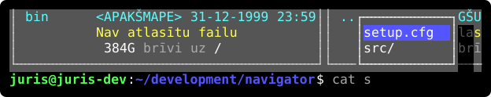
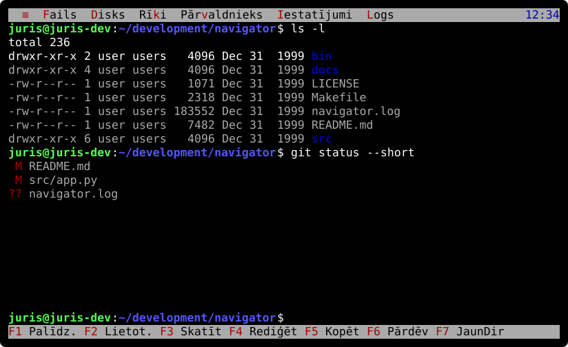
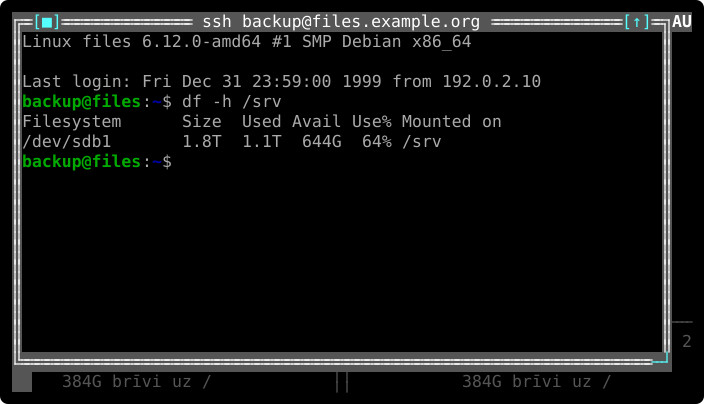
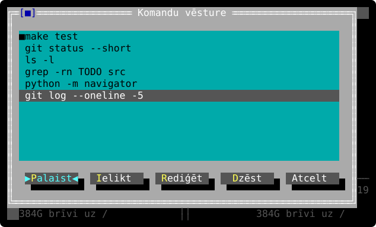

# Komandrinda un konsole

Zem paneļiem ir komandrinda, bet aiz logiem — konsole: terminālis, kurā darbojas jūsu čaula.

## Komandrinda

Viss, ko rakstāt, kamēr tastatūra ir panelim, nonāk komandrindā. `Enter` to palaiž čaulā aktīvā paneļa
direktorijā, un izvade parādās konsolē.

| Taustiņš | Ko tas dara |
|---|---|
| `Enter` | Palaiž komandu |
| `Ctrl+Enter` | Ieliek rindā faila zem kursora nosaukumu |
| `Ctrl+E`, `Ctrl+X` | Atsauc iepriekšējo un nākamo komandu |
| `Tab` | Papildina rakstāmo vārdu, ja rindā ir teksts |
| `Esc` | Notīra rindu |

Kamēr rindā ir teksts, `Left`, `Right`, `Home` un `End` to rediģē. `Enter` uz programmas panelī to palaiž.

Pēc komandas paneļi nolasa savas direktorijas no jauna, un aktīvais panelis seko čaulai, ja komanda mainīja
direktoriju.

## Konsole

`Ctrl+O` paslēpj logus un parāda konsoli; vēlreiz `Ctrl+O` tos atgriež. Kamēr logi paslēpti, taustiņi nonāk čaulā
vai programmā, kas tajā darbojas.

`Shift+PgUp` un `Shift+PgDn` ritina atpakaļ pa to, ko konsole ir rādījusi, bet `Shift+Up` un `Shift+Down` ritina pa
rindai.

Kamēr konsolē darbojas programma, tā saņem katru taustiņu, ieskaitot `F1` un `F10`; vispirms izejiet no programmas
tās pašas veidā.

## Komanda logā

Komanda var darboties pati savā logā blakus paneļiem, nevis konsolē. Sāciet komandrindu ar `&` vai nospiediet
`Shift+Enter` `Enter` vietā.

Programma logā saņem katru taustiņu, izņemot tos, kas izceļ priekšplānā citu logu. Kad tā beidzas, logs saglabā tās
izvadi, un tā virsraksts pasaka, kā tā beidzās; `Esc` vai `Enter` to aizver. Aizverot logu, kamēr programma
darbojas, programma tiek izbeigta.

*Rīki > Attālā čaula* šādā logā atver čaulu serverī, konteinerā vai ierīcē.

## Komandas izpilde

*Fails > Izpildīt OS komandu* pieprasa komandu rindā, kurai ar komandrindu ir kopīga vēsture.

- *Logā* palaiž to pašā savā logā, nevis konsolē.
- *Palielināts* atver šo logu pāri visai darbvirsmai.
- *Modāls* patur tastatūru šajā logā, līdz tas tiek aizvērts.

## Komandu vēsture

`Alt+F8` jeb *Rīki > Komandu vēsture* uzskaita jūsu ierakstītās komandas, jaunāko pēdējo.

- *Palaist* jeb `Enter` palaiž komandu zem kursora.
- *Ielikt* ieliek to komandrindā, nepalaižot.
- *Rediģēt* maina to lodziņā; mainītā komanda kļūst par jaunāko.
- *Dzēst* jeb `Del` izņem to no vēstures.

*Rīki > Vēstures meklēšana ar fzf*, `Alt+Shift+F8`, ar `fzf` meklē komandas, kas ierakstītas šeit un čaulā.

## Failu vēstures

`Alt+PgDn` uzskaita iepriekš skatītos failus, bet `Alt+PgUp` — iepriekš rediģētos; izvēlnē *Rīki* tie ir
*Skatīšanas vēsture* un *Rediģēšanas vēsture*. *Atvērt* vēlreiz atver failu zem kursora, un *Dzēst ierakstu* to
izņem no saraksta.
