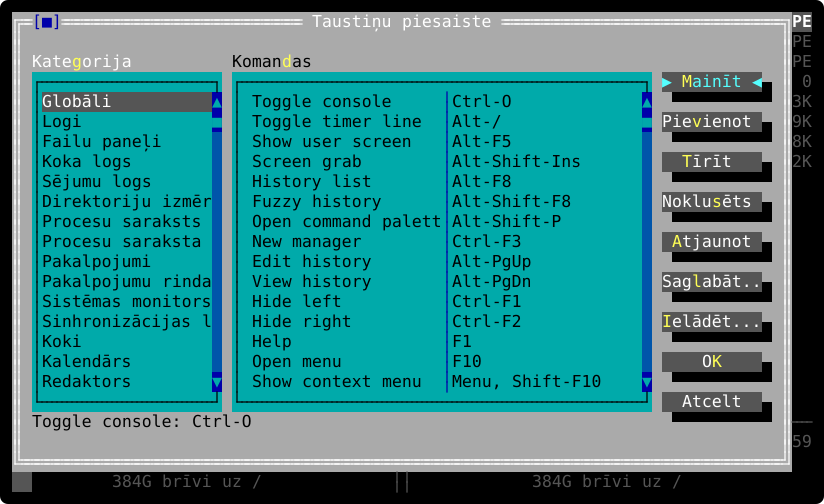
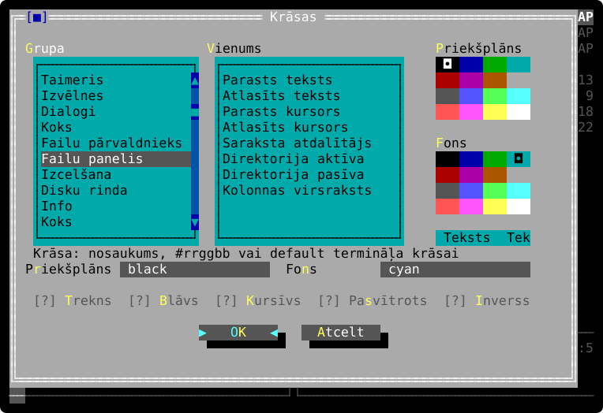

# Taustiņi un krāsas

## Taustiņu piesaiste

*Iestatījumi > Konfigurācija > Taustiņu piesaiste* maina, kurš taustiņš ko dara. Taustiņi ir sakārtoti sadaļās, pa
vienai katrai vietai, kur tie darbojas: visur, failu pārvaldniekā, redaktorā, skatītājā, dialogos un tā tālāk.

Izvēlieties komandu un nospiediet taustiņu, ko tai vēlaties.

*Saglabāt* ieraksta visu komplektu failā, bet *Ielādēt* to nolasa. Navigator nāk ar četriem komplektiem: noklusēto
un komplektiem WordStar, DOS Navigator 1.51 un Emacs garā.

Piesaistes glabājas failā `keybindings.ini` konfigurācijas direktorijā. Taustiņi, kas pārvieto kursoru sarakstos un
tekstā, ir nemaināmi.

## Krāsas

*Iestatījumi > Krāsas* maina lietotās tēmas krāsas.

- *Grupa* un *Vienums* izvēlas, ko krāsot.
- *Priekšplāns* un *Fons* izvēlas no sešpadsmit krāsām; rindas blakus tiem pieņem jebkuru krāsu, kā nosaukumu vai
  kā `#rrggbb`.
- Pieci lodziņi iestata treknrakstu, blāvumu, slīprakstu, pasvītrojumu un inversiju. Lodziņš ar `?` atstāj
  atribūtu tādu, kādu vienums to manto.

Ekrāns mainās līdzi jūsu izmaiņām. *OK* saglabā izmaiņas šai tēmai; *Atcelt* visu atjauno, kā bija.

*Saglabāt paleti* saglabā krāsas kā jūsu pašu tēmu, ko pēc tam atrod `--theme` un *Ielādēt paleti*. *Ielādēt
paleti* paņem citas tēmas krāsas.

Lai lietotu citu tēmu, palaidiet Navigator ar `--theme NAME`; `--list-themes` tās nosauc.
