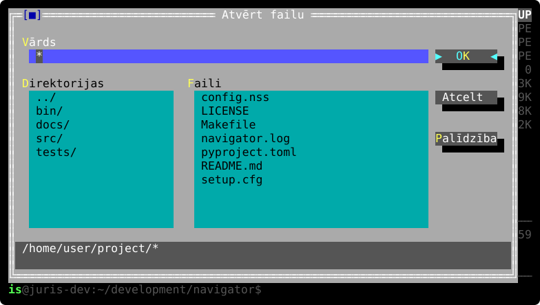

# Dialoglogi

Dialoglogs tur tastatūru sev, līdz to aizverat.

## Taustiņi dialoglogā

| Taustiņš | Ko tas dara |
|---|---|
| `Tab`, `Shift+Tab` | Pāriet uz nākamo vai iepriekšējo vadīklu |
| `Alt` un izceltais burts | Pāriet uz vadīklu ar šo burtu |
| `Enter` | Nospiež noklusēto pogu, to, kas iezīmēta ar bultiņām |
| `Esc` | Aizver logu, neko nedarot |
| `Space` | Atzīmē izvēles rūtiņu vai izvēlas radiopogu |
| `Down` rindā, kurai blakus ir `↓` | Atver rindas vēsturi |
| `F1` | Parāda šī loga palīdzību |

Vēstures sarakstā `Enter` paņem ierakstu, bet `Del` to aizmirst.

## Faila izvēle

Vairākas komandas prasa failu ar vienu un to pašu logu: nosaukums rindā, un zem tās aplūkojamās vietas faili un
direktorijas.

- *Vārds* ir faila nosaukums. Var ierakstīt veselu ceļu. Nosaukums ar `*` vai `?`, vai direktorijas nosaukums
  nevis izvēlas failu, bet parāda sarakstā šos failus.
- *Faili* rāda failus, kas atbilst. Rakstot tur burtus, tiek atrasts nosaukums, kas ar tiem sākas.
- *Direktorijas* rāda direktorijas; `Enter` uz kādas no tām ieiet tajā.
- Rūts apakšā rāda ceļu, kā arī zem kursora esošā faila izmēru un datumu.
- *OK* jeb `Enter` uz faila to izvēlas.

`Left` un `Right` pārvietojas starp sarakstiem un pogām.
