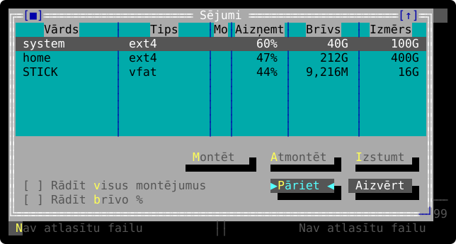
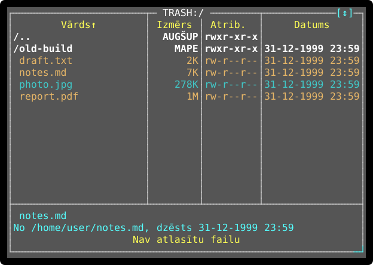

# Vietas ārpus diska

Panelis var rādīt vairāk nekā jūsu diska direktorijas. Lai kur tas būtu, failus skata, rediģē, kopē un dzēš tāpat.

## Arhīvi

`Enter` uz arhīva, piemēram, zip vai tar faila, ieiet tajā, it kā tā būtu direktorija. Kopējiet failus no tā ārā
vai tajā iekšā ar `F5`. [Arhīvi](archives.md) apraksta izveidi un izvilkšanu.

## Serveri, konteineri un ierīces

*Rīki > Savienojumi* atver paneli citā datorā vai pakalpojumā. Katrs ieraksts glabā jūsu izveidoto savienojumu
sarakstu, lai pieslēgtos atkal; [Savienojumi](connections.md) apraksta tā lodziņu.

| Ieraksts | Ko tas sasniedz |
|---|---|
| *SSH (SFTP)*, `Alt+F11` | Serveri pār SSH |
| *FTP* | FTP vai FTPS serveri |
| *SMB* | Windows koplietojumu |
| *S3* | Kausu S3 vai saderīgā pakalpojumā |
| *Docker konteiners*, *Podman konteiners* | Failus darbojošā konteinerā |
| *Android ierīce (adb)* | Tālruni vai planšetdatoru, izmantojot `adb` |
| *rclone krātuve* | Jebkuru `rclone` iestatītu attālo krātuvi, piemēram, Google Drive vai Dropbox |
| *GVfs/KIO savienojums* | Visu, ko var sasniegt darbvirsma, piemēram, tālruni pār MTP vai WebDAV serveri |

Ieraksts ir pelēks, ja tam vajadzīgā programma nav instalēta; tā rīka padoms nosauc programmu.

Adresi var ierakstīt arī tur, kur tiek prasīta direktorija, piemēram, `sftp://user@host/dir` vai
`smb://host/share`.

*Rīki > Attālā čaula* atver čaulu serverī, konteinerā vai ierīcē. *Rīki > Atvienot*, `Alt+H`, aizver savienojumu;
panelis, kas to rādīja, atgriežas uz disku.

## Sējumi

*Disks > Sējumi* uzskaita diskus un noņemamos datu nesējus un tos montē, atmontē un izstumj.

### Diska attēli

`Enter` uz diska attēla — `.iso` vai `.img` faila — jeb *Disks > Montēt attēlu*, kursoram esot uz tā, to montē tikai
lasīšanai un atver panelī. *Disks > Atmontēt attēlu* attēlā vai uz tā to atkal atmontē un paneļus, kas bija tajā,
atgriež uz attēla failu. Tam vajadzīgs udisks2, kas darbojas lielākajā daļā darbvirsmu; *ENTER montē diska
attēlus* iestatījumu lappusē [Failu paneļi](settings.md#failu-paneļi) izslēdz `Enter` daļu.

## Atkritne

`F8` pārvieto diska failus uz atkritni, nevis tos dzēš, ja iestatījumu lappusē [Failu paneļi](settings.md#failu-paneļi)
atzīmēts *F8 pārvieto uz atkritni*. Tad [dzēšanas](file-operations.md#dzēšana) lodziņā ir atzīmēts *Pārvietot uz
atkritni*; noņemiet atzīmi, lai failus izdzēstu pavisam. [Atsaukt](file-operations.md#atsaukšana), `Ctrl+Z`, atceļ pēdējo
pārvietošanu uz atkritni.

*Disks > Atkritne* vai dubultklikšķis uz atkritnes parāda atkritnē esošos failus aktīvajā panelī. Rinda zem paneļa
pasaka, no kurienes nāk fails zem kursora un kad tas izdzēsts.

- *Fails > Atjaunot no atkritnes* atliek atlasītos failus atpakaļ, no kurienes tie nāk.
- `F8` tur tos izdzēš pavisam.
- `F5` tos kopē ārā, tāpat kā no jebkuras direktorijas.

*Disks > Iztukšot atkritni* pēc jautājuma izdzēš pavisam visu atkritnē esošo.

## Grāmatzīmes

`Alt+F1` un `Alt+F2` atver grāmatzīmēm atzīmēto direktoriju sarakstu kreisajam un labajam panelim, bet `Alt+C` —
aktīvajam. [Grāmatzīmes](bookmarks.md) apraksta saraksta taustiņus.
