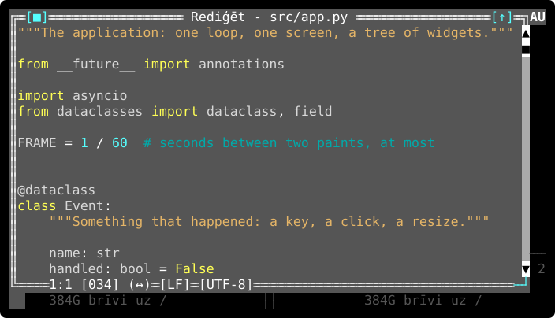
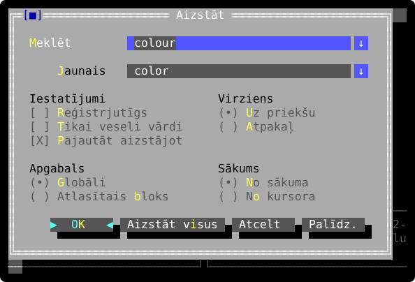
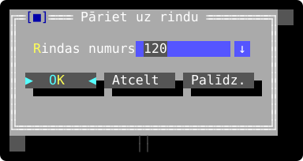
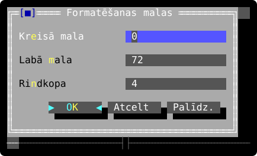

# Redaktors

`F4` atver redaktorā failu zem kursora. Katra komanda ir arī izvēlnē *Redaktors*, kas atrodas izvēlņu joslā, kamēr
redaktors ir atvērts.



## Taustiņi

| Taustiņš | Ko tas dara |
|---|---|
| `F2` | Saglabā |
| `Shift+F2` | Saglabā ar citu nosaukumu |
| `Ctrl+F4` | Aizver redaktoru; ja teksts mainīts, vispirms pajautā |
| `Alt+Backspace` | Atsauc |
| `Alt+Shift+Backspace` | Atkārto atsaukto |
| `Ctrl+Y` | Izdzēš rindu |
| `Ctrl+Backspace` | Izdzēš vārdu pa kreisi |
| `Ctrl+N` | Ievieto rindu |
| `F7`, `Ctrl+F7` | [Meklēšana un aizstāšana](#meklēšana-un-aizstāšana) |
| `Alt+G` | [Pāriet uz rindu](#pāriešana-uz-rindu) |
| `Alt+PgUp` | Parāda iepriekš rediģētos failus |

## Faila atvēršana

| Taustiņš vai ieraksts | Ko tas atver |
|---|---|
| `F4` | Failu zem kursora |
| `Alt+F4`, `Ctrl+K`, *Fails > Rediģēt > Alternatīvi rediģēt* | Failu zem kursora otrā redaktorā: skatiet zemāk |
| `Shift+F4`, *Fails > Rediģēt > Rediģēt jaunu failu* | Failu, ko nosaucat [faila lodziņā](dialogs.md#faila-izvēle). Vēl neesošs nosaukums tiek izveidots, kad saglabājat |
| *Fails > Rediģēt > Atvērt...* | Failu, ko izvēlaties faila lodziņā, bez failu pārvaldnieka. Vēl neesošs nosaukums tiek izveidots, kad saglabājat |
| `Alt+PgUp` | Failu no iepriekš rediģēto failu saraksta |

`F4` izmanto Navigator redaktoru, bet *Alternatīvi rediģēt* — citu programmu: to, ko failam norāda `editors.ini`
([failu asociācijas](user-menu.md#failu-asociācijas)), citādi terminālī instalēto redaktoru sarakstu, piemēram,
`vim` vai `nano`, un izvēlētais darbojas pats savā logā. Ja iestatījumu lappusē [Sistēma](settings.md#sistēma)
noņemta atzīme *Iekšējais redaktors*, abi taustiņi samainās vietām: `F4` palaiž `editors.ini` programmu, citādi
`$EDITOR`, bet *Alternatīvi rediģēt* izmanto Navigator redaktoru. `Ctrl+K` ir tāpēc, ka daudzi logu pārvaldnieki
ar `Alt+F4` aizver termināli.

`F4` uz direktorijas atver tās [failu atribūtus](file-operations.md#faila-atribūti).

Iepriekš rediģēts fails atveras vietā, kur to atstājāt.

## Bloki un starpliktuve

Turiet `Shift`, pārvietojot kursoru, vai velciet ar peli, lai iezīmētu bloku.

| Taustiņš | Ko tas dara |
|---|---|
| `Ctrl+Ins`, `Ctrl+C` | Kopē bloku |
| `Shift+Del`, `Ctrl+X` | Izgriež bloku |
| `Shift+Ins`, `Ctrl+V` | Ielīmē |
| `Ctrl+Del` | Izdzēš bloku |
| `Alt+Shift+I`, `Alt+Shift+O` | Palielina un samazina bloka atkāpi |
| `Alt+Shift+U`, `Alt+Shift+L` | Pārveido bloku lielajos, mazajos burtos |
| `Alt+T` | Sakārto bloka rindas |
| `Alt+H` | Paslēpj vai parāda bloku |

[Kopēšana un ielīmēšana](clipboard.md) paskaidro, kuri kopēšanas un ielīmēšanas taustiņi darbojas kurā terminālī.

Apakšizvēlne *Iestatījumi* pārslēdz šī loga uzvedību, piemēram, automātisko atkāpi, rindu numurus un sintakses
izcelšanu. Ar ko sāk jauns redaktors, iestata iestatījumu lappusē [Redaktors/Skatītājs](settings.md#redaktorsskatītājs).

## Meklēšana un aizstāšana

`F7` meklē tekstu un `Ctrl+F7` to aizstāj. `Shift+F7` atkārto pēdējo meklēšanu, ieskaitot aizstāšanu.

Lodziņš atveras ar minējumu par to, ko meklējat: iezīmēto tekstu, ja tas ir vienā rindā, citādi vārdu zem kursora.



- *Meklēt* ir meklējamais teksts. `Down` šajā rindā atver iepriekšējo meklējumu vēsturi.
- *Jaunais*, aizstājot, ir tas, ko likt tā vietā.

### Opcijas

- *Reģistrjutīgs* atšķir lielos burtus no mazajiem.
- *Tikai veseli vārdi* izlaiž atbilsmi, kas ir daļa no garāka vārda.
- *Pajautāt aizstājot* jautā pirms katras aizstāšanas: *Jā*, *Nē*, *Visus* šai un katrai nākamajai, vai *Atcelt*.

### Kur meklēt

- *Virziens*: *Uz priekšu* uz teksta beigām vai *Atpakaļ* uz tā sākumu.
- *Apgabals*: *Globāli* meklē visā tekstā, *Atlasītais bloks* — tikai iezīmētajā blokā.
- *Sākums*: *No sākuma* sāk apgabala sākumā, *No kursora* — pie kursora.

### Aizstāšana

*OK* aizstāj pirmo atbilsmi. *Aizstāt visus* aizstāj katru un pasaka, cik aizstāts. Katru aizstāšanu var atsaukt
atsevišķi.

### Meklēšanas josla

`Ctrl+F` un `Ctrl+R` lodziņa vietā atver joslu redaktora logā. Tā meklē, kamēr rakstāt, izgaismo katru atbilsmi
ekrānā un var meklēt pēc regulāras izteiksmes.

## Pāriešana uz rindu



`Alt+G` pajautā rindas numuru un novieto kursoru šajā rindā. Rindas skaita no 1. Lodziņš atveras ar pēdējo
ierakstīto numuru.

## Malas



*Redaktors > Rindkopa > Malas* iestata trīs skaitļus, starp kuriem darbojas rindkopu formatēšana. Tie attiecas tikai
uz šo redaktora logu; sākotnējās vērtības nāk no redaktora iestatījumiem.

- *Kreisā mala* ir kolonna, kurā sākas katra rinda.
- *Labā mala* ir pēdējā kolonna, līdz kurai rinda drīkst sniegties.
- *Rindkopa* ir kolonna, kurā sākas rindkopas pirmā rinda.

Lai formatētu rindkopu, iezīmējiet to kā bloku un nospiediet `Alt+J`, lai to izlīdzinātu abās malās, `Alt+L`, lai
to novietotu pie kreisās malas, `Alt+R` — pie labās, vai `Alt+C`, lai to centrētu. Viss bloks tiek uzskatīts par
vienu rindkopu.

## Sintakses izcelšana

Redaktors un skatītājs iekrāso programmas, tīmekļa lapas, konfigurācijas faila un daudzu citu tekstu atkarībā no
tā, kas ir katra daļa. To, kādu iekrāsojumu fails saņem, nosaka tā nosaukums failā `highlight.ini`, bet skriptam
bez zināmas galotnes — tā pirmā rinda, piemēram, `#!/bin/sh`: *Iestatījumi > Izcelšanas fails* atver šo failu
redaktorā.

```ini
[*.conf]
lexer = ini

[*.txt]
lexer = none
autowrap = on
right_margin = 72
```

- Katra sadaļa ir [failu maska](panels.md#failu-maskas). Valodu izvēlas pirmā sadaļa, kas atbilst failam un nosauc
  `lexer`; failu, ko neviena sadaļa nepaņem, atstāj Pygments uzminēšanai.
- `lexer` nosauc valodu tā, kā to sauc Pygments (`python3 -m pygments -L lexers` tās uzskaita). `none` neiekrāso
  neko; `auto` ļauj Pygments uzminēt pēc nosaukuma un satura.
- Sadaļa var arī iestatīt redaktora opcijas šiem failiem ar nosaukumiem, kādi tiem ir `navigator.ini` sadaļā
  `[editor]`: `auto_indent`, `insert_tabs`, `line_numbers`, `soft_wrap`, `autowrap`, `right_margin`, `line_ending`
  un citas. Katra nāk no pirmās atbilstošās sadaļas, kas to iestata. Paša faila komentāros tās visas uzskaitītas.
  Iepriekš rediģēts fails saglabā opcijas, ar kurām tas tika atstāts.

Vienam logam *Redaktors > Faila tips* (`Ctrl+Shift+H`) izvēlas citu valodu, un *Redaktors > Iestatījumi > Sintakses
izcelšana* izslēdz un ieslēdz iekrāsošanu. Krāsas ir tēmas krāsas.
