# Darbības ar failiem

Kopēšana, pārvietošana, saišu veidošana, sadalīšana un kodēšana darbojas ar atlasi: aktīvā paneļa atlasītajiem
failiem vai ar zem kursora esošo failu, ja nekas nav atlasīts. Lielākā daļa no tām kā vietu rezultātam piedāvā otra
paneļa direktoriju.

## Kopēšana un pārvietošana

`F5` kopē atlasi, bet `F6` to pārdēvē vai pārvieto. Abi atver vienu un to pašu logu: rindu, kas norāda, kurp,
kopēšanas režīmus un četras opcijas.

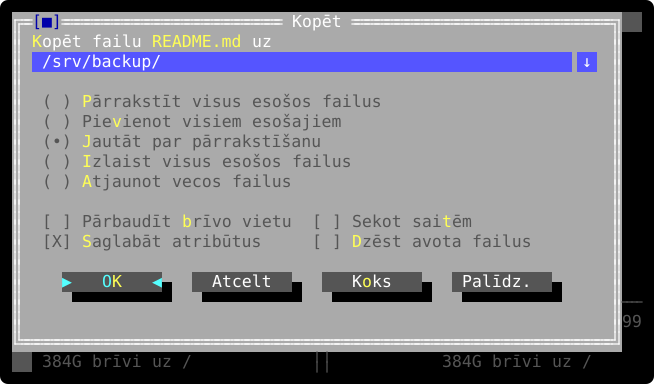

### Kurp

Tas, ko ierakstāt rindā, nosaka, kas notiek:

| Jūs ierakstāt | Ko tas nozīmē |
|---|---|
| Direktoriju, kas pastāv, vai nosaukumu, kas beidzas ar `/` | Faili nonāk šajā direktorijā |
| Nosaukumu ar `*` vai `?` | Katrs fails galamērķī tiek pārdēvēts pēc šīs maskas |
| Jebkuru citu nosaukumu, ja atlasīts viens fails | Faila jaunais nosaukums |
| Jebkuru citu nosaukumu, ja atlasīti vairāki faili | Direktorija, ko izveidot un kurā kopēt |

Maska tiek piemērota nosaukumam un paplašinājumam atsevišķi: `*.bak` piešķir katram failam paplašinājumu `bak`.
Maska bez punkta aptver visu nosaukumu, tāpēc `*` atstāj katru nosaukumu, kāds tas ir.

`F10` jeb poga *Koks* izvēlas direktoriju no koka. `Down` rindā atver vēsturi ar vietām, uz kurām kopējāt iepriekš.

### Ko darīt ar failiem, kas jau tur ir

| Režīms | Ko tas dara |
|---|---|
| *Pārrakstīt visus esošos failus* | Aizstāj tos, nejautājot |
| *Pievienot visiem esošajiem* | Pievieno katru failu tur jau esošā faila beigām |
| *Jautāt par pārrakstīšanu* | Jautā par katru. Atbildi var attiecināt uz visiem pārējiem |
| *Izlaist visus esošos failus* | Atstāj tos neskartus un kopē pārējos |
| *Atjaunot vecos failus* | Aizstāj failu tikai tad, ja kopējamais ir jaunāks |

Kad tiek jautāts, *Pārdēvēt* ļauj tā vietā piešķirt kopijai citu nosaukumu.

### Opcijas

- *Pārbaudīt brīvo vietu* aptur darbu pirms kopēšanas, ja mērķī ir par maz vietas.
- *Saglabāt atribūtus* patur kopijām atļaujas, īpašnieku un laikus. Par to, ko nevarēja saglabāt, tiek ziņots;
  pati kopēšana tomēr izdodas.
- *Sekot saitēm* kopē to, uz ko saite norāda, nevis pašu saiti.
- *Dzēst avota failus* izdzēš oriģinālus, tiklīdz tie ir nokopēti, kas kopēšanu padara par pārvietošanu.

Režīms un opcijas tiek atcerēti, līdz izejat no Navigator.

### Kamēr tā notiek

Gaitas logs rāda ātrumu un atlikušo laiku. *Fonā* aizsūta kopēšanu fonā, lai varētu turpināt darbu: izvēlņu joslā
parādās procenti, un klikšķis uz tiem logu atgriež. Ja kopēšanai, esot fonā, rodas jautājums, procentos parādās `?`,
un tā gaida jūs. *Apturēt* pajautā, pirms kopēšanu pamest.

Nokopētie faili zaudē atlasi; izlaistie to patur.

`Ctrl+Z` kopēšanu atsauc; skatiet [Atsaukšana](#atsaukšana).

## Direktorijas izveide

`F7` izveido direktoriju aktīvajā panelī. Ierakstiet ceļu, piemēram, `a/b/c`, lai izveidotu visas direktorijas pa
ceļam, vai vairākus nosaukumus, atdalītus ar `;`, lai izveidotu vairākas.

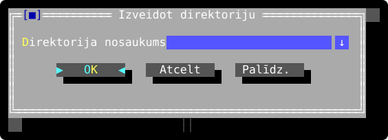

## Ātrā pārdēvēšana

`Shift+F6` jeb *Fails > Pārdēvēšanas rīki > Ātrā pārdēvēšana* nelielā logā prasa zem kursora esošā faila jauno
nosaukumu. Tā pārdēvē vienu failu turpat, kur tas ir; lai pārvietotu failu vai pārdēvētu vairākus pēc maskas,
lietojiet `F6`.

## Grupas pārdēvēšana

`Alt+A` jeb *Fails > Pārdēvēšanas rīki > Grupas pārdēvēšana* pārdēvē atlasītos failus pēc viena šablona. Saraksts
apakšējā pusē rāda katru jauno nosaukumu, pirms kaut kas tiek darīts, un rinda zem tā pasaka, kas nav kārtībā, ja
nosaukumu nevar lietot: tukšs nosaukums, nosaukums ar `/`, divi faili ar vienu nosaukumu vai nosaukums, kas jau ir
aizņemts.

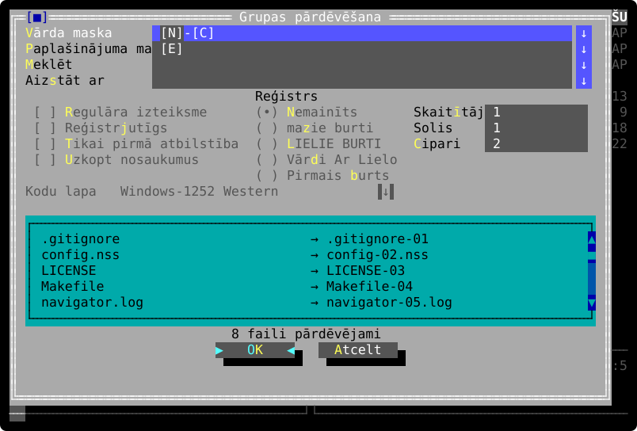

Jauns nosaukums top trīs soļos.

**Maskas.** *Vārda maska* veido nosaukumu, bet *Paplašinājuma maska* paplašinājumu. Teksts tiek ņemts, kāds tas ir,
bet vietturis kvadrātiekavās tiek aizstāts:

| Vietturis | Nozīmē |
|---|---|
| `[N]` | Veco nosaukumu bez paplašinājuma |
| `[N3]` | Tā trešo rakstzīmi |
| `[N2-5]` | Tā otro līdz piekto rakstzīmi |
| `[N2-]` | No otrās rakstzīmes līdz beigām |
| `[N2,4]` | Četras rakstzīmes, sākot no otrās |
| `[N-3-]` | Pēdējās trīs rakstzīmes |
| `[E]` | Veco paplašinājumu, apgrieztu tādos pašos veidos |
| `[P]` | Tās direktorijas nosaukumu, kurā fails atrodas, apgrieztu tādos pašos veidos |
| `[C]` | Skaitītāju no laukiem *Skaitītājs*, *Solis* un *Cipari* |
| `[C10+5:3]` | Skaitītāju, kas sākas ar 10, pieaug par 5 un ir trīsciparu: 010, 015, 020 |
| `[Y]` `[M]` `[D]` `[h]` `[m]` `[s]` | Faila modificēšanas datumu un laiku |
| `[[]` `[]]` | `[` un `]` |

Ja paplašinājuma maska ir tukša, nosaukums paliek bez punkta.

**Meklēšana un aizstāšana.** *Meklēt* un *Aizstāt ar* darbojas ar visu nosaukumu, ko izveidoja maskas.

- *Regulāra izteiksme* uztver meklējamo kā regulāro izteiksmi; aizstājējs tad var lietot `\1` grupai.
- *Reģistrjutīgs* atšķir lielos burtus no mazajiem.
- *Tikai pirmā atbilstība* aizstāj katrā nosaukumā vienu atbilstību, nevis visas.

**Reģistrs.** *Nemainīts*, *mazie burti*, *LIELIE BURTI*, *Vārdi Ar Lielo* vai *Pirmais burts liels*.

*Uzkopt nosaukumus* salabo nosaukumus pirms šiem trim soļiem: baiti, kas nav UTF-8, tiek nolasīti jūsu izvēlētajā
*Kodu lapa*, vadības rakstzīmes kļūst par `_`, un nosaukumi vienā direktorijā, kas atšķiras tikai ar reģistru, tiek
sanumurēti.

Fails, kura nosaukums iznāk tāds pats, tiek atstāts neskarts. Nosaukumi, kas failu starpā apmainās, `a` uz `b` un
`b` uz `a`, tiek pārdēvēti pareizi.

### Nosaukumi, kas jāuzkopj

*Fails > Pārdēvēšanas rīki > Atlasīt bojātos nosaukumus* atlasa panelī katru failu, kura nosaukumu mainītu *Uzkopt
nosaukumus*: nosaukumu, kas nav derīgs UTF-8, nosaukumu, kas uzrakstīts sadalītā Unicode formā, nosaukumu ar vadības
rakstzīmi un nosaukumus, kas no cita atšķiras tikai ar lielajiem burtiem. Pēc tam `Alt+A` ar atzīmētu *Uzkopt
nosaukumus* tos pārdēvē.

## Dzēšana

`F8` vai `Del` ar tukšu komandrindu pēc jautājuma izdzēš atlasi. `Shift+F8`, `Shift+Del` jeb *Fails > Dzēst vienu
failu* izdzēš zem kursora esošo failu neatkarīgi no tā, kas ir atlasīts.

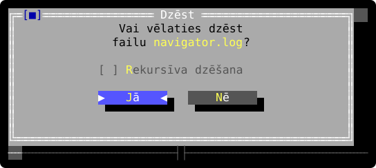

- *Rekursīva dzēšana* izdzēš direktorijas ar visu to saturu, nejautājot par katru.
- *Pārvietot uz atkritni* tiek rādīts, kad tiek lietota [Atkritne](drives.md#atkritne). Ja tas nav atzīmēts, faili
  tiek izdzēsti neatgriezeniski.

Bez *Rekursīva dzēšana* tiek jautāts par direktoriju, kas nav tukša, un par failiem, kuros nevarat rakstīt; katru
jautājumu var atbildēt arī visiem pārējiem. Kuri jautājumi vispār tiek uzdoti, nosaka iestatījumu lapa
[Apstiprinājumi](settings.md#apstiprinājumi).

Ilgu dzēšanu var aizsūtīt fonā, tāpat kā kopēšanu.

## Atsaukšana

`Ctrl+Z` jeb *Fails > Atsaukt darbību* atsauc pēdējo darbību ar failiem, bet atkārtota nospiešana iepriekšējo, līdz
pat piecdesmit. Tā pasaka, ko grasās darīt, un vispirms pajautā.

| Darbība | Ko dara atsaukšana |
|---|---|
| Kopēšana, `F5` vai ielīmēšana | Noņem to, ko kopēšana izveidoja, taču tikai failus, kas kopš tā laika nav mainīti: diskā uz atkritni, citur neatgriezeniski |
| Pārvietošana, `F6` vai izgriešana un ielīmēšana | Pārvieto failus atpakaļ |
| Pārdēvēšana, `F6`, `Alt+F6`, `Shift+F6` vai `Alt+A` | Atjauno vecos nosaukumus |
| Dzēšana uz [Atkritni](drives.md#atkritne) | Atjauno failus no atkritnes |
| Ar `F7` izveidota direktorija | Noņem to, ja tā joprojām ir tukša |

Fails, ko kopēšana vai pārvietošana aizstāja, ir zudis neatgriezeniski, un jautājums pasaka, cik tādu bija.
Neatgriezenisku dzēšanu, atribūtus un saites atsaukt nevar, tāpat kā kopēšanu vai pārvietošanu arhīvā vai no tā.
Darbību saraksts saglabājas, līdz Navigator aizveras, un tas ir kopīgs visiem failu pārvaldnieka logiem. Kamēr
komandrindā ir teksts, `Ctrl+Z` tiek atstāts komandrindai.

## Faila atribūti

`Alt+E` maina atlases atribūtus. Tiek piemērots tikai tas, ko maināt, tāpēc faili, kas atšķiras citādi, savas
atšķirības patur. *Rekursīvi* piemēro izmaiņas arī visam, kas atrodas direktorijās.

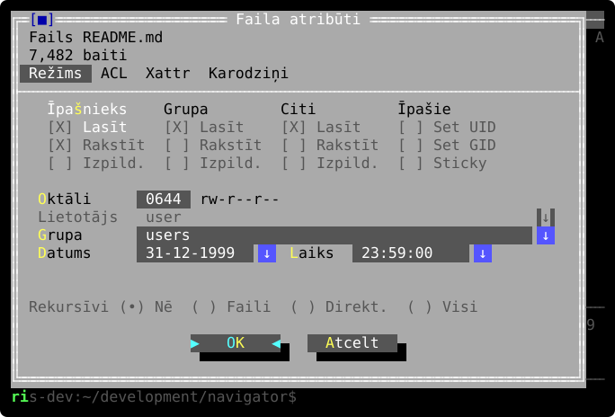

- *Režīms* satur atļaujas: lasīšanas, rakstīšanas un izpildes režģi īpašniekam, grupai un citiem, to pašu kā oktālu
  skaitli, īpašnieku un grupu, kā arī datumu un laiku. Režģī `R`, `W` un `X` atzīmē visu rindu.
- *ACL* uzskaita piekļuves kontroles ierakstus papildus režīmam un tos pievieno, rediģē un noņem.
- *Xattr* uzskaita paplašinātos atribūtus.
- *Karodziņi* satur failu sistēmas karodziņus, piemēram, nemaināms un tikai pievienošanai.

Lodziņš, kurā redzams `?`, nozīmē, ka faili tur atšķiras; atstājiet to neskartu, lai katrs fails paliktu, kāds tas
ir.

### ACL ieraksti

*Pievienot* un *Rediģēt* lapā *ACL* atver vienu ierakstu. *Tips* nosaka, vai tas apzīmē lietotāju vai grupu,
*Vārds* izvēlas, kuru, un *Atļaujas* ir *Lasīt*, *Rakstīt* un *Izpild.*. *Noklusētais, ko manto jauni faili* padara
to par direktorijas noklusēto ierakstu: tas, kas tiek izveidots direktorijā, to manto.

### Paplašinātie atribūti

*Pievienot* un *Rediģēt* lapā *Xattr* atver vienu atribūtu, tā *Vārds* un tā *Vērtība*. Vērtība ir teksts vai `0x`,
kam seko heksadecimāli cipari, vai `0s`, kam seko base64. Pēdiņas ap vērtību patur to kā tekstu.

## Saites

`Shift+F5` izveido saites uz atlasi jūsu norādītajā direktorijā.

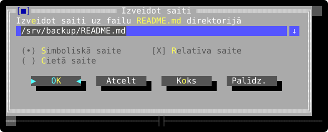

- *Simboliskā saite* izveido nelielu failu, kas satur oriģināla ceļu. Tā var norādīt uz direktoriju un uz citu
  disku.
- *Cietā saite* piešķir failam otru nosaukumu. Tā darbojas tikai failiem un tikai tajā pašā failu sistēmā.
- *Relatīva saite* ieraksta ceļu attiecībā pret saiti, lai saiti un oriģinālu varētu pārvietot kopā. Tas attiecas
  tikai uz simboliskajām saitēm.

*Fails > Saites* piedāvā vairāk: saites mērķa rediģēšanu, saišu padarīšanu par relatīvām vai absolūtām, bojāto saišu
atlasīšanu un visu cieti saistīta faila nosaukumu parādīšanu.

### Saišu mērķa maiņa

*Fails > Saites > Mainīt saites mērķi* maina atlasītās simboliskās saites.

- Ja atlasīta viena saite, rindā ir tās mērķis, ko varat rediģēt. *Relatīva saite* ieraksta jauno mērķi attiecībā
  pret saiti.
- Ja atlasītas vairākas, *Meklēt* un *Aizstāt ar* maina vienu un to pašu daļu katrā mērķī, kas ir tieši tas, kas
  vajadzīgs pēc koka pārvietošanas.

*Padarīt relatīvu* un *Padarīt absolūtu* pārraksta katras atlasītās saites mērķi otrā veidā, norādot uz to pašu
failu. *Atlasīt bojātās saites* atlasa panelī katru saiti, kas nekur nenorāda: tās, kas sarakstā apzīmētas ar `!`,
ja tas nerāda ikonas.

### Visi faila nosaukumi

Failam ar cietajām saitēm ir vairāki nosaukumi, iespējams, dažādās direktorijās. *Fails > Saites > Rādīt cietās
saites* atrod katru nosaukumu, kas zem kursora esošajam failam ir tā failu sistēmā, un uzskaita tos panelī, tāpat kā
[Meklēt failu](panels.md#failu-meklēšana) uzskaita atrasto; `Enter` uz `..` atgriežas. Direktorijas, kuras jums nav
atļauts lasīt, tiek izlaistas, tāpēc var tikt atrasts mazāk nosaukumu, nekā failam ir. Detalizētā skata kolonna
*Saites* rāda, cik nosaukumu failam ir.

## Sadalīšana un apvienošana

*Fails > Sadalīt/apvienot* darbojas ar zem kursora esošo failu, un faila nosaukums nosaka, kuru no abām darbībām tā
veic.

### Sadalīšana

Jebkurš parasts fails tiek sadalīts daļās ar nosaukumiem `NAME.001`, `NAME.002` un tā tālāk jūsu norādītajā
direktorijā.

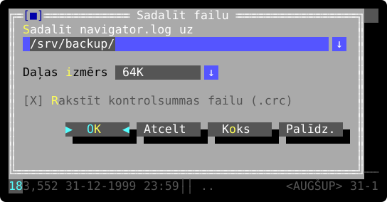

- *Daļas izmērs* ir katras daļas izmērs: baitu skaits vai skaitlis, kam seko `K`, `M` vai `G`, piemēram, `100M` vai
  `1.44M`.
- *Rakstīt kontrolsummas failu (.crc)* ieraksta arī `NAME.crc`, kas satur faila nosaukumu, izmēru un kontrolsummu. Ar
  to apvienoto failu var pārbaudīt.

Fails, kas nav lielāks par vienu daļu, netiek sadalīts. Total Commander, Double Commander un 7-Zip var šīs daļas
apvienot.

### Apvienošana

Uz daļas (`NAME.001`) vai uz komplekta `NAME.crc` komanda saliek failu atpakaļ jūsu norādītajā direktorijā. Tā lasa
daļas pēc kārtas, līdz kādas pietrūkst. Ar `.crc` failu tā arī pārbauda rezultātu; ja kontrolsumma nesakrīt, fails
tiek paturēts un jums tiek paziņots.

## UU kodēšana un atkodēšana

UU kodēšana pārvērš jebkuru failu vienkāršā tekstā, ko var nosūtīt tur, kur atļauts tikai teksts.

### Kodēšana

`Ctrl+F7` kodē zem kursora esošo failu failā `NAME.uue`. Liels fails tiek ierakstīts sadaļās, katra savā failā.

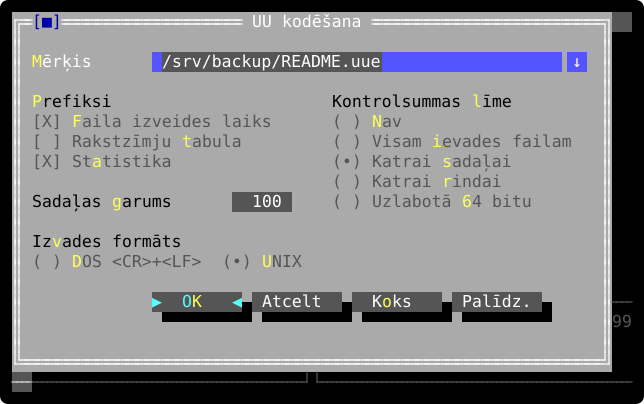

- *Prefiksi* pievieno rindas pirms datiem: faila datumu un laiku, lietoto rakstzīmju tabulu un statistiku.
- *Kontrolsummas līmenis* pievieno kontrolsummas, lai atkodējot varētu atrast bojājumus: nevienu, visam failam,
  katrai sadaļai, katrai rindai vai 64 bitu kontrolsummu.
- *Sadaļas garums* ir tas, cik datu rindu nonāk vienā sadaļā.
- *Izvades formāts* izvēlas, kā beidzas rindas: kā DOS vai kā UNIX.

### Atkodēšana

`Ctrl+F8` atkodē zem kursora esošo failu jūsu norādītajā direktorijā. Vienā failā var būt vairāki kodēti faili un to
sadaļas jebkurā secībā.

- *Pārbaudīt esošos failus* pajautā, pirms aizstāt failu, kas tur jau ir.
- *Rādīt kļūdu ziņojumus* parāda katru datos atrasto kļūdu.
- *Saglabāt bojātos failus* ieraksta failu arī tad, ja tā dati bija bojāti.

## Kontrolsummas

Kontrolsummu saraksts satur katra faila kontrolsummu, lai failus vēlāk varētu pārbaudīt, vai tie nav bojāti vai
mainīti.

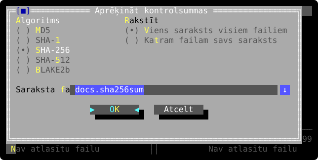

*Fails > Kodēšana > Jaucējsummas > Aprēķināt* aprēķina atlasīto failu un visa atlasītajās direktorijās esošā
jaucējsummas.

- *Algoritms* ir *MD5*, *SHA-1*, *SHA-256*, *SHA-512* vai *BLAKE2b*.
- *Viens saraksts visiem failiem* ieraksta vienu sarakstu ar nosaukumu, kas norādīts rindā *Saraksta fails*.
  *Katram failam savs saraksts* ieraksta sarakstu blakus katram failam.

*Pārbaudīt* nolasa atlasītos sarakstus vai zem kursora esošo sarakstu, vēlreiz aprēķina tajos minēto failu
jaucējsummas un paziņo, cik sakrita. Faili, kas nesakrita vai trūkst, tiek uzskaitīti zem *Problēmas*.

Saraksti ir tādi paši, kādus raksta un pārbauda `md5sum`, `sha256sum` un to radinieki, tāpēc katra puse var pārbaudīt
otras sarakstus. Saraksta algoritmu nosaka tā nosaukums, piemēram, `.sha256sum`, `.sha256` vai `SHA256SUMS`, bet
citādi tā kontrolsummu garums.

## Šifrēšana

*Fails > Kodēšana > Kriptogrāfija* šifrē un atšifrē failus ar GnuPG (`gpg`) vai `age`. Programma, kas nav
instalēta, ir pelēka.

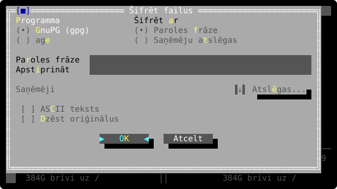

*Šifrēt* darbojas ar atlasītajiem failiem un visu atlasītajās direktorijās esošo. Katrs fails tiek ierakstīts blakus
sev kā `NAME.gpg` vai `NAME.age`.

- *Programma* ir *GnuPG (gpg)* vai *age*.
- *Šifrēt ar*: *Paroles frāze*, kas ierakstīta divreiz, vai *Saņēmēju atslēgas*. Saņēmēji tiek atdalīti ar
  atstarpēm: gpg gadījumā atslēgu ID vai pirkstu nospiedumi, age gadījumā atslēgas vai atslēgu faili. *Atslēgas...*
  izvēlas no gpg atslēgām.
- *ASCII teksts* ieraksta šifrētos failus kā tekstu; gpg tos nosauc par `NAME.asc`.
- *Dzēst oriģinālus* izdzēš katru failu, tiklīdz tā šifrētā kopija ir ierakstīta.

*Atšifrēt* darbojas ar atlasītajiem šifrētajiem failiem vai zem kursora esošo un ieraksta katru atpakaļ blakus sev ar
nosaukumu bez galotnes. Paroles frāze tiek prasīta tikai tad, ja failam tā vajadzīga, un vienreiz visiem.

## Teksta pārveidošana

*Fails > Kodēšana > Pārveidot tekstu* pārraksta atlasītos teksta failus vai zem kursora esošo citā kodējumā vai ar
citām rindu beigām. Katrs fails tiek mainīts turpat.

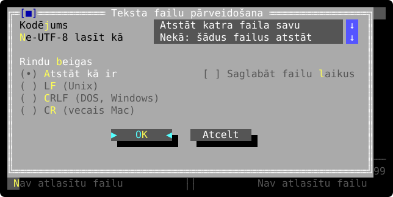

- *Kodējums* ir kodējums, kādā faili tiek ierakstīti.
- *Ne-UTF-8 lasīt kā* ir kodējums, ko pieņem failam, kas nav UTF-8 un kam nav baitu secības zīmes. Ja nekas nav
  izvēlēts, šāds fails tiek atstāts neskarts.
- *Rindu beigas*: *Atstāt kā ir*, *LF (Unix)*, *CRLF (DOS, Windows)* vai *CR (vecais Mac)*.
- *Saglabāt failu laikus* katram pārrakstītajam failam atstāj laiku, kāds tam bija.

Fails, kas izskatās binārs, fails, kura tekstu izvēlētais kodējums nevar ierakstīt, un ļoti liels fails tiek atstāti
neskarti, un jums tiek paziņots, kāpēc. Fails, kas iznāktu nemainīts, netiek ierakstīts.

## Atvērt ar

*Fails > Atvērt ar* atver zem kursora esošo failu kādā no darbvirsmas lietotnēm, kas izvēlēta no to lietotņu
saraksta, kuras apstrādā tā tipu; parastā ir pirmā.

- *Citas lietotnes* uzskaita visas pārējās instalētās lietotnes.
- *Iestatīt noklusēto* izvēlas lietotni, kurā šis tips turpmāk atvērsies, un neko neatver.
- *Komanda...* prasa jūsu pašu komandrindu. `!.!` tajā apzīmē failu; bez tā faila nosaukums tiek pievienots beigās.
  Komanda darbojas konsolē, un katram paplašinājumam ir sava lietoto komandu vēsture.

Tam vajadzīgs darbvirsmas `gio` vai KDE rīki; skatiet *Darbvirsma* iestatījumu lapā
[Sakari](settings.md#sakari). Fails serverī vispirms tiek lejupielādēts. Tas, ko maina lietotne, netiek sūtīts
atpakaļ; tas, ko maina *Komanda...*, tiek, tiklīdz komanda beidzas.

`Enter` uz faila, ko neņem neviens `extensions.ini` ieraksts, arī atver to darbvirsmas lietotnē, ja lapā [Failu
paneļi](settings.md#failu-paneļi) ir atzīmēts *Citus failus vērt darbvirsmā*.

## Drukāšana

`Ctrl+F9` jeb *Fails > Drukāt* pēc jautājuma izdrukā atlasītos failus. Tie nonāk sistēmas printerī caur `lp` vai
`lpr`, ja `lp` nav, kas drukā uz `$PRINTER` vai noklusēto printeri. Direktorijas tiek izlaistas, un katram failam
atlase tiek noņemta, tiklīdz tas nosūtīts printerim. Redaktors savu tekstu drukā ar `F8`.
