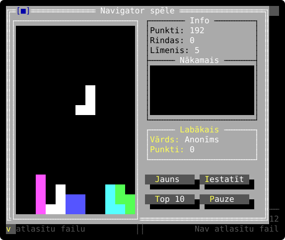

# Spēle

`Alt+F9` jeb *Spēle* izvēlnē `≡` atver spēli: figūras krīt glāzē, un rinda, kas piepildās, pazūd. Tai ir divi
veidi: Tetris ar septiņām figūrām un Pentix ar divdesmit septiņām.

## Taustiņi

| Taustiņš | Ko tas dara |
|---|---|
| `Left` vai `Home` | Pārvieto figūru pa kreisi |
| `Right` vai `PgUp` | Pārvieto figūru pa labi |
| `Up` | Pagriež figūru |
| `Down` vai `Space` | Nomet figūru |
| `F2` | Sāk jaunu spēli |
| `F3` | Aptur spēli un turpina to |
| `F4` | Parāda Top 10 |
| `F5` | Iestata spēli: sākuma līmeni, veidu un nākamās figūras rādīšanu |
| `Gray +` | Paaugstina līmeni |
| `Gray *` | Parāda vai paslēpj nākamo figūru |
| `Esc` | Aizver spēli |

Spēle pati apstājas, kad pārslēdzaties uz citu logu.

## Labāko desmitnieks

Kad spēle beidzas ar rezultātu, kas iekļūst labāko desmitniekā, tiek prasīts vārds, ar kādu to ierakstīt. Bez vārda
vai ar *Atcelt* tas tiek ierakstīts kā *Anonīms*. Katram veidam ir savs saraksts.

## Iestatīšana

`F5` jeb poga *Iestatīt* iestata spēli.

- *Līmenis* ir līmenis, ar kuru spēle sākas, no *1 - Mazulis* līdz *10 - Trakomāja*. Ar katru figūras krīt ātrāk.
- *Spēles veids* ir *Klasiskais tetris* vai *Pentix*.
- *Nākamā figūra* rāda nākamo figūru blakus glāzei.
