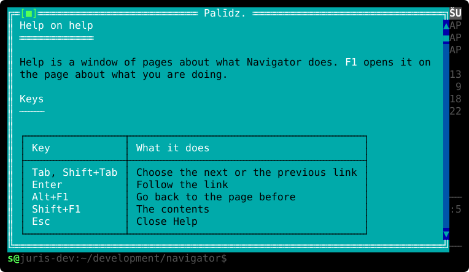

# Palīdzība par palīdzību

`F1` atver šo rokasgrāmatu lappusē par to, ko darāt. Lappuses ir savstarpēji saistītas: saite tiek rādīta savā
krāsā, un viena no tām vienmēr ir izvēlētā.

## Palīdzība tur, kur esat

`F1` darbojas visur un atver lappusi par to, kam ir tastatūra:

- dialoglodziņā — sadaļu par šo lodziņu. Daudziem lodziņiem ir arī poga *Palīdzība*, kas dara to pašu;
- atvērtā izvēlnē — lappusi par izgaismoto ierakstu vai par tā izvēlni;
- logā, piemēram, skatītājā, redaktorā vai kalkulatorā, — šī loga lappusi;
- paneļos — lappusi par paneļiem.

Ja par to, ko darāt, lappuses nav, atveras [saturs](README.md). `Esc` aizver palīdzību un atstāj jūs tur, kur bijāt,
ar joprojām atvērtu izvēlni, ja tāda bija. Kamēr konsolē darbojas programma, `F1` pieder šai programmai.

## Taustiņi

| Taustiņš | Ko tas dara |
|---|---|
| `Tab` | Izvēlas nākamo saiti |
| `Shift+Tab` | Izvēlas iepriekšējo saiti |
| `Enter` | Pāriet uz izvēlēto saiti |
| `Alt+F1` | Atgriežas tur, no kurienes nācāt |
| `Shift+F1` | Atver [saturu](README.md) |
| `F1` | Atver šo lappusi |
| `Up`, `Down`, `PgUp`, `PgDn`, `Home`, `End` | Ritina lappusi |
| `Left`, `Right` | Ritina uz sāniem, ja koda rinda ir platāka par logu |
| `Alt+Z` | Palielina logu līdz visam ekrānam un atpakaļ |
| `Ctrl+F5` | Pārvieto loga un maina tā izmēru: bultiņas to pārvieto, `Shift` un bultiņas maina izmēru, `Enter` to patur, `Esc` atliek atpakaļ |
| `Esc` | Aizver palīdzību |

Šos taustiņus var mainīt: Iestatījumi > Konfigurācija > Taustiņu piesaiste, sadaļā *Palīdzības logs*.

## Pele

Noklikšķiniet uz saites, lai pārietu uz to. Ritenis ritina lappusi, un to dara arī josla loga labajā malā, ja
lappuse ir garāka par logu. Lappusei ar koda rindu, kas platāka par logu, ir josla arī gar apakšējo malu; `Shift` un
ritenis to ritina uz sāniem.

## Saites uz citām vietnēm

Saiti, kas ved ārpus šīs rokasgrāmatas uz tīmekļa vietni, Navigator neatver. To var atvērt jūsu terminālis:
lielākajā daļā termināļu turiet `Ctrl` un noklikšķiniet uz tās.
