# Paneļi

Failu pārvaldnieks rāda divus paneļus blakus, katrā vienas direktorijas failu sarakstu. Viens no tiem ir aktīvs:
tajā ir kursora josla, komandas darbojas ar tā failiem un rezultāta novietošanai parasti piedāvā otra paneļa
direktoriju.

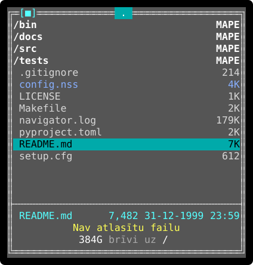

## Pārvietošanās

| Taustiņš | Ko tas dara |
|---|---|
| `Tab` | Pārslēdzas uz otru paneli |
| `Up`, `Down`, `PgUp`, `PgDn`, `Home`, `End` | Pārvieto kursoru |
| `Enter` | Ieiet direktorijā vai arhīvā, palaiž programmu vai atver failu |
| `Backspace`, `Ctrl+PgUp` | Pāriet uz vecākdirektoriju |
| `Ctrl+\` | Pāriet uz saknes direktoriju |
| `Ctrl+R` | Nolasa direktoriju vēlreiz |
| `Alt+Backspace` | Parāda direktorijas, kurās esat bijis |
| `Alt+=` | Parāda to pašu direktoriju otrā panelī |
| `Ctrl+U` | Samaina abus paneļus vietām |

Burtu rakstīšana ievada tekstu komandrindā zem paneļiem; skatiet [komandrindu](console.md).

Panelis pats nolasa savu direktoriju no jauna, kad tajā kaut kas mainās.

## Skati

`Ctrl+Y` pārslēdz trīs paneļa skatus:

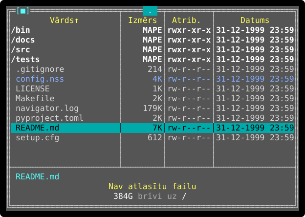

- *Vienkāršs*: nosaukumi un izmēri.
- *Detalizēts*: nosaukumi ar izmēru, atribūtiem, īpašnieku un datumu kolonnās. `Alt+K` izvēlas kolonnas.
- *Saraksts*: tikai nosaukumi, vairākās kolonnās.

Vienkāršajā un detalizētajā skatā `Left` un `Right` ritina garus nosaukumus. Detalizētajā skatā klikšķis uz
kolonnas virsraksta kārto pēc šīs kolonnas, bet otrs klikšķis apgriež secību.

`Ctrl+H` parāda vai paslēpj slēptos failus, un `Alt+I` parāda vai paslēpj rindas zem saraksta.

## Kārtošana

`Alt+B` izvēlas paneļa secību: pēc nosaukuma, paplašinājuma, izmēra, laika, atribūtiem, īpašnieka vai veida, katru
jebkurā virzienā, vai bez kārtošanas. Direktorijas tiek rādītas pirms failiem.

## Failu atzīmēšana

Komandas darbojas ar atzīmētajiem failiem vai, ja neviens nav atzīmēts, ar failu zem kursora.

| Taustiņš | Ko tas dara |
|---|---|
| `Ins` vai `Space`, ja komandrinda ir tukša | Atzīmē failu vai noņem atzīmi un pārvietojas uz leju |
| `Gray +` | Atzīmē failus, kas atbilst maskai |
| `Gray -` | Noņem atzīmi failiem, kas atbilst maskai |
| `Gray *` | Apgriež atzīmes |
| `Ctrl+A` | Atzīmē visu |

Ar peli vidējā poga atzīmē failu, un vilkšana ar to atzīmē katru failu, kam pāriet pāri. `Shift` vai `Ctrl` kopā ar
kreiso klikšķi atzīmē failus no kursora līdz noklikšķinātajam failam.

Rindas zem saraksta norāda, cik failu ir atzīmēts un kāds ir to kopējais izmērs.

## Ātrā meklēšana

`Ctrl+S` sāk meklēšanu pēc nosaukuma: ierakstiet pirmos burtus, un kursors pāriet uz pirmo nosaukumu, kas ar tiem
sākas. Vēlreiz `Ctrl+S` pāriet uz nākamo. `Esc` beidz meklēšanu; jebkurš cits taustiņš to beidz un dara to, ko
parasti, tāpēc `Enter` uzreiz ieiet atrastajā direktorijā.

## Kopēšana caur starpliktuvi

`Ctrl+C` kopē atlasi un `Ctrl+X` to izgriež; `Ctrl+V` citā direktorijā ielīmē failus tur, uzdodot tos pašus
jautājumus kā [kopēšana un pārvietošana](file-operations.md#kopēšana-un-pārvietošana). `Esc` aizmirst failus. Šie taustiņi
darbojas panelī, kamēr komandrinda ir tukša.

## Otra puse

Neaktīvā puse paneļa vietā var rādīt ko citu:

| Taustiņš | Ko tā rāda |
|---|---|
| `Ctrl+T` | Direktoriju koku |
| `Ctrl+Q` | Faila zem kursora ātro skatu |
| `Ctrl+L` | [Informāciju](#informācijas-panelis) par direktoriju, disku un failu zem kursora |

Tas pats taustiņš atliek paneli atpakaļ. `Ctrl+F1` un `Ctrl+F2` paslēpj kreiso un labo pusi, `Ctrl+P` paslēpj
neaktīvo pusi, bet `Alt+Left` un `Alt+Right` pārvieto atdalītāju starp pusēm.

`Alt+F12` pārslēdz uz Millera kolonnām: šauru kolonnu rindu, pa vienai katrai direktorijai ceļā, ar priekšskatu
tam, kas ir zem kursora.

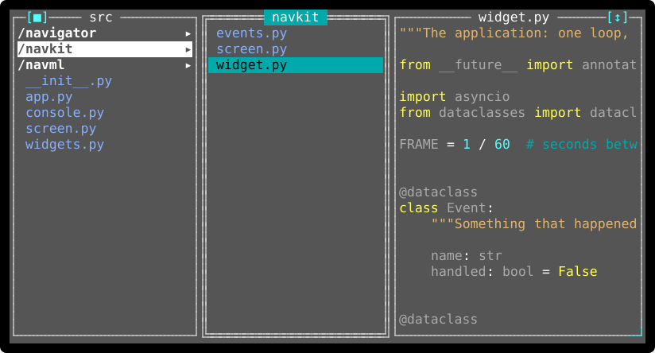

## Informācijas panelis

`Ctrl+L` otra paneļa vietā parāda informāciju par aktīvo paneli, un vēlreiz `Ctrl+L` atliek paneli atpakaļ. Tas
seko aktīvajam panelim, jums pārvietojoties:

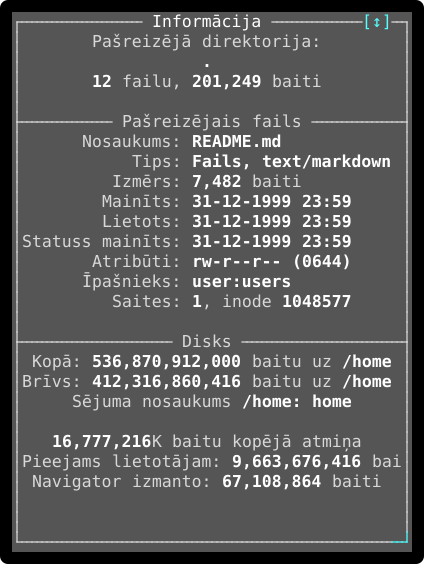

- direktorijas nosaukums un cik failu tajā ir un kāds ir to izmērs;
- fails zem kursora: tā veids, izmērs, laiki, atribūti, īpašnieks, saišu skaits un inode. Attēls, skaņa, video,
  PDF un programma saņem vairāk: izmēru pikseļos, garumu, plūsmas, lappuses vai bibliotēkas, kas programmai
  vajadzīgas. Tam, ko saņem skaņa vai video, vajadzīgs FFmpeg `ffprobe`;
- failu sistēma, kurā atrodas direktorija: tās izmērs, brīvā vieta un ierīce vai etiķete. Serverī — serveris un
  tas, kā izveidots savienojums; arhīvā — arhīvs;
- datora atmiņa, cik vēl var izmantot programmas un cik aizņem pats Navigator;
- direktorijas informācijas fails `DirInfo` vai `File_ID.DIZ`, ja tāds ir.

Ja saturs neietilpst, `Tab` pārvieto tastatūru tajā, lai to ritinātu ar bultiņām, `PgUp` un `PgDn`; to ritina arī
peles ritenis. Iestatījumu lappuse [Info panelis](settings.md#info-panelis) izvēlas, kuras rindas tiek rādītas.

## Vairāki failu pārvaldnieki

`Ctrl+F3` atver vēl vienu failu pārvaldnieka logu. Par pārvietošanos starp logiem skatiet [Logi](windows.md).

## Failu maskas

Vairāki lodziņi pieņem failu masku. Maska ir viens vai vairāki šabloni, atdalīti ar `;`, kur `*` apzīmē jebkuru
tekstu un `?` jebkuru vienu rakstzīmi. Šablons, kas sākas ar `-`, izslēdz to, kam atbilst, un izšķir pēdējais
šablons, kas atbilst nosaukumam: `*;-*.bak` ir visi faili, izņemot rezerves kopijas.

## Paneļa opcijas

`Alt+S` jeb *Panelis > Paneļa iestatīšana* nosaka, kā aktīvais panelis rāda savus failus. Tās pašas izvēles katram
jaunam panelim ir [iestatījumu](settings.md#paneļu-noklusējumi) lappusē *Paneļu noklusējumi*.

- *Kārtot pēc* izvēlas secību: pēc nosaukuma, paplašinājuma, izmēra, laika, atribūtiem, īpašnieka vai veida, vai
  bez kārtošanas. *Apgriezta secība* to apgriež.
- *Direktorijas garums* saskaita katras direktorijas izmēru un to parāda.
- *Aktīvais fails*, *Atlasītie faili*, *Kopsumma* un *Brīvā vieta* izvēlas rindas, kas tiek rādītas zem saraksta.
- *Failu izcelšana* iekrāso failus pēc to veida.
- *Izpildāmie vispirms* un *Arhīvi vispirms* rāda šos failus pirms pārējiem.
- *Faila maska* ierobežo paneli ar failiem, kas atbilst [maskai](#failu-maskas).

## Filtrs

`Alt+Del` jeb *Panelis > Atlase > Paplašināts filtrs* izvēlas, kurus failus panelis rāda, pēc to paplašinājumiem.
Lodziņā ir `*` un pa vienai maskai katram direktorijā atrastajam paplašinājumam.

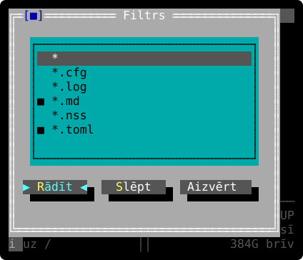

- `Space` vai `Ins` atzīmē masku un pārvietojas uz nākamo. `+` atzīmē visas, `-` nevienu, un `*` apgriež atzīmes.
- *Rādīt* liek panelim rādīt atzīmētās maskas vai, ja neviena nav atzīmēta, to, kas ir zem kursora.
- *Slēpt* liek panelim tās izlaist.
- *Aizvērt* aizver lodziņu. Pēc *Rādīt* un *Slēpt* tas paliek atvērts, lai varētu turpināt izvēlēties.

Izvēloties `*`, atkal tiek rādīts viss.

## Failu meklēšana

`Alt+F7` jeb *Fails > Meklēt* meklē failus pēc nosaukuma un pēc tā, ko tie satur.

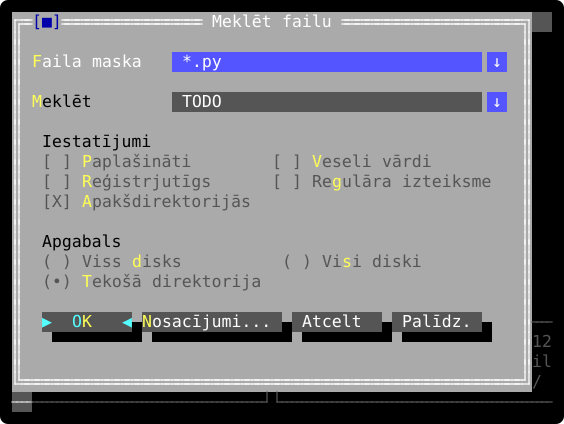

- *Faila maska* nosaka, kādus nosaukumus meklēt. Vienkāršs vārds bez `*` un bez punkta atrod katru nosaukumu, kas
  ar to sākas.
- *Meklēt* ierobežo meklēšanu ar failiem, kas satur šo tekstu. Atstājiet tukšu, lai meklētu tikai pēc nosaukuma.

### Opcijas

- *Paplašinātā meklēšana* piemēro arī ierobežojumus, kas iestatīti ar pogu *Nosacījumi*.
- *Reģistrjutīgs* tekstā atšķir lielos burtus no mazajiem.
- *Apakšdirektorijās* meklē arī apakšdirektorijās.
- *Veseli vārdi* izlaiž tekstu, kas ir daļa no garāka vārda.
- *Regulāra izteiksme* lasa tekstu kā regulāru izteiksmi, kas tiek salīdzināta pāri rindām.

### Apjoms

- *Viss disks* meklē visā diskā, kurā atrodas panelis.
- *Tekošā direktorija* meklē paneļa direktorijā.
- *Visi diski* meklē katrā diskā.

### Rezultāti

Atrastie faili tiek parādīti panelī ar virsrakstu *Meklēt:* un masku. Tur tos var skatīt, rediģēt, kopēt un dzēst
kā jebkurus citus failus; rinda zem paneļa norāda, kurā direktorijā katrs atrodas. `Enter` uz `..` atgriež
direktorijā, no kuras meklējāt.

### Paplašinātā meklēšana

Poga *Nosacījumi* iestata ierobežojumus, kas darbojas, kamēr ir atzīmēta *Paplašinātā meklēšana*:

- *Datums pēc* un *Datums pirms* ierobežo failus pēc tā, kad tie mainīti. Datumus raksta formā
  gads-mēnesis-diena, piemēram, `2026-01-31`.
- *Izmērs vairāk par* un *Izmērs mazāk par* ierobežo tos pēc izmēra.
- *Veids* ierobežo tos ar izpildāmajiem failiem, simboliskajām saitēm, slēptajiem failiem, tikai lasāmiem failiem
  vai bojātām saitēm.

*Notīrīt visu* noņem visus ierobežojumus.

### Aizstāšana failos

`Alt+Shift+F7` atver to pašu lodziņu ar vienu papildu rindu *Aizstāt ar*. Tas atrod failus tāpat un katrā no tiem
aizstāj tekstu.

## Saraksta faila izveide

`Alt+L` jeb *Panelis > Izveidot saraksta failu* ieraksta atzīmēto failu nosaukumus teksta failā.

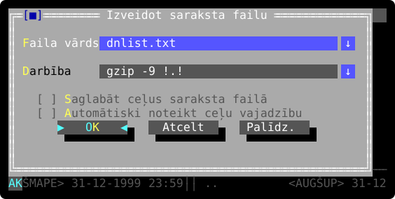

- *Faila nosaukums* ir rakstāmais fails. Ja tas jau eksistē, tiek jautāts, vai to aizstāt vai papildināt tā beigās.
- *Darbība*, ja aizpildīta, pārvērš sarakstu par skriptu: pa rindai katram failam, ar faila nosaukumu ievietotu
  jūsu dotajā tekstā. Vairākas rindas vienam failam atdala ar `;`.
- *Saglabāt ceļus saraksta failā* ieraksta katra faila pilno ceļu, nevis tikai nosaukumu.
- *Automātiski noteikt ceļu vajadzību* ieraksta ceļu tikai failam, kas neatrodas paša saraksta faila direktorijā.

Darbībā šie apzīmē katra faila nosaukuma daļas:

| Jūs rakstāt | Tas kļūst par |
|---|---|
| `!` | Nosaukumu bez paplašinājuma |
| `.!` | Paplašinājumu ar punktu |
| `!\` | Faila direktoriju, kas beidzas ar `/` |
| `!/` | Faila direktoriju bez noslēdzošā `/` |
| `!!` | `!` |

Darbībai bez neviena no tiem faila nosaukums tiek pievienots beigās: `cp` kļūst par `cp name`.

## Grupas atlase

`Gray +` atzīmē paneļa failus, kas atbilst [failu maskai](#failu-maskas), un `Gray -` noņem tiem atzīmi. Tie ir arī
*Atlasīt grupu* un *Noņemt grupas atlasi* izvēlnē *Panelis*.

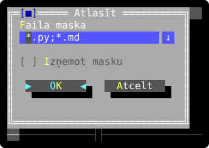

*Izņemot masku* apgriež masku: tiek atzīmēti vai atzīme noņemta failiem, kam tā neatbilst.

## Kolonnu iestatīšana

`Alt+K` jeb *Panelis > Kolonnu iestatīšana* izvēlas, ko detalizētais skats rāda blakus katram nosaukumam:
*Izmērs*, *Atribūti*, *Saites*, *Īpašnieks* un *Datums*.

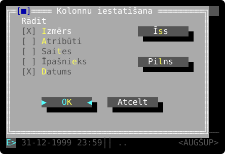

- *OK* parāda atzīmētās kolonnas.
- *Īss* parāda tikai nosaukumus.
- *Pilns* parāda visas kolonnas, izņemot *Saites*.

Kolonnas, ar kurām sāk jauns panelis, ir iestatījumu lappusē [Kolonnas](settings.md#kolonnas).

## Dublikātu meklēšana

*Panelis > Meklēt dublikātus* meklē zem paneļa direktorijas failus ar vienādu saturu un parāda tos panelī, kā to
dara meklēšana.

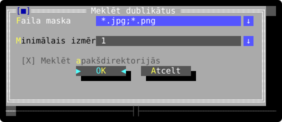

- *Faila maska* izvēlas, kurus failus salīdzināt.
- *Minimālais izmērs* izlaiž mazākus failus.
- *Meklēt apakšdirektorijās* meklē arī zemākajās direktorijās.

Vispirms ir grupas, kas izšķiež visvairāk vietas, un vienas grupas faili paliek kopā neatkarīgi no tā, pēc kā
panelis kārtots. Nekas netiek atzīmēts: atzīmējiet nevajadzīgās kopijas un izdzēsiet tās ar `F8`. Simboliskās
saites tiek izlaistas, un divi viena faila cietās saites nosaukumi netiek uzskatīti par dublikātiem.

## Komandas izvade panelī

`Alt+Y` jeb *Panelis > Komandas izvade panelī* palaiž čaulas komandu paneļa direktorijā un parāda failus, ko tā
izvada, pa vienam faila nosaukumam rindā, kā paneļa sarakstu. Tas paredzēts komandām, kas atbild uz jautājumu
"kuri faili?":

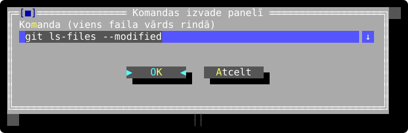

```sh
git ls-files -m
grep -l TODO *.py
```

Komandrinda, kas sākas ar `|`, dara to pašu bez lodziņa.

## Direktoriju vēsture

`Alt+BkSp` jeb *Panelis > Direktoriju vēsture* parāda direktorijas, kurās paneļi ir bijuši, pēdējo vispirms.
*Pāriet* atver aktīvajā panelī to, kas ir zem kursora, un *Dzēst ierakstu* to izņem no saraksta.

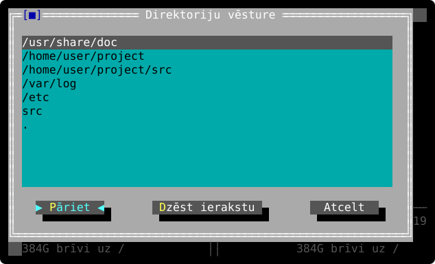

## Direktorijas atcerēšanās

*Panelis > Atcerēties šai direktorijai* saglabā kārtošanas secību, skatu un failu masku, ko panelis rāda tagad, un
izmanto tos ikreiz, kad panelis ir šajā direktorijā. *Arī tās apakšdirektorijām* tāpat rāda katru zemāko
direktoriju, ja vien kāda nav atcerēta atsevišķi.

*Atcerēto direktoriju saraksts* parāda atcerētās direktorijas. `Enter` pāriet uz kādu no tām, un `Del` to aizmirst.
