# Uzstādījumi

*Iestatījumi > Uzstādījumi* satur visus iestatījumus piecpadsmit lapās. `Ctrl+PgUp` un `Ctrl+PgDn` pārslēdz lapas;
vienumi zem *Iestatījumi > Konfigurācija* un *Iestatījumi > Failu pārvaldnieks* atver logu uzreiz savā lapā. Ja
peles rādītājs kavējas uz opcijas, tiek parādīts, ko tā dara.

*OK* uzreiz piemēro izmaiņas un ieraksta tās failā `navigator.ini`. *Atcelt* tās atmet.

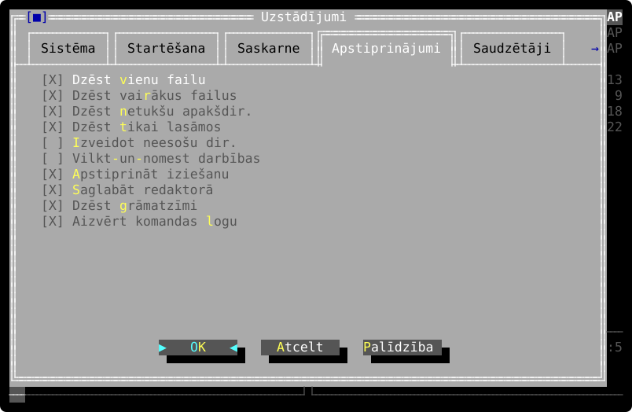

## Sistēma

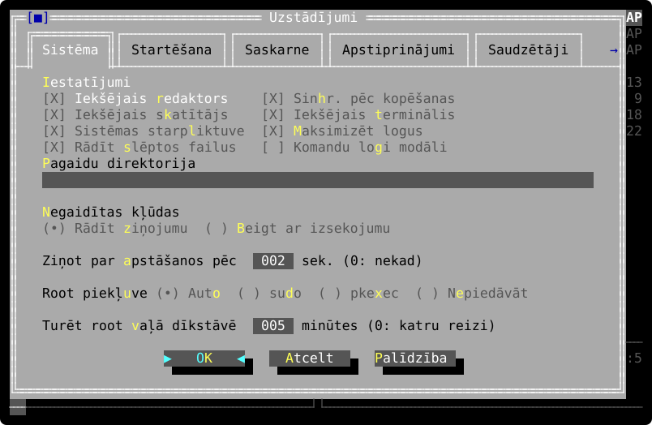

- *Iekšējais redaktors* un *Iekšējais skatītājs*: `F4` un `F3` lieto Navigator paša redaktoru un skatītāju.
  Izslēgti tie palaiž programmu, kas norādīta `$EDITOR` un `$PAGER`.
- *Sistēmas starpliktuve*: kopēt uz darbvirsmas starpliktuvi un ielīmēt no tās. Izslēgtu, Navigator tur pats savu
  starpliktuvi.
- *Rādīt slēptos failus*: jauns panelis rāda slēptos failus. `Ctrl+H` to pārslēdz vienam panelim.
- *Sinhr. pēc kopēšanas*: katrs nokopētais fails tiek ierakstīts līdz pat diskam, pirms tas skaitās pabeigts.
- *Iekšējais terminālis*: `Ctrl+O` parāda konsoli Navigator iekšienē. Izslēgts, tas atdod visu termināli čaulai.
- *Maksimizēt logus* un *Komandu logi modāli*: kā atveras komanda, kas tiek palaista savā logā.
- *Pagaidu direktorija*: kur nonāk pagaidu faili. Tukšs nozīmē `$TMPDIR`.
- *Negaidītas kļūdas*: negaidīta kļūda vai nu parāda ziņojumu ar sīkāku informāciju, vai aizver Navigator un to
  izdrukā.
- *Ziņot par apstāšanos pēc*: cik sekundes Navigator drīkst nereaģēt, pirms iemesls tiek ierakstīts `errors.log`.
- *Root piekļuve*: kā soli, kuram tika atteikta atļauja, var izpildīt vēlreiz kā root: ar `sudo`, ar `pkexec` vai
  nekad.
- *Turēt root vaļā dīkstāvē*: cik minūtes root piekļuve paliek atvērta pēc pēdējās lietošanas. Skatiet
  [Darbs root tiesībās](as-root.md).

## Startēšana

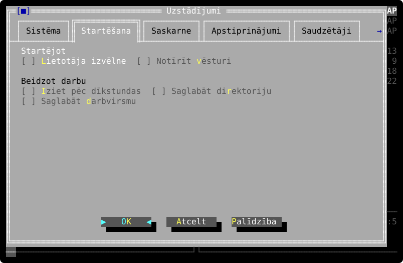

- *Lietotāja izvēlne*: lietotāja izvēlne (`F2`) atveras, kad Navigator startē.
- *Notīrīt vēsturi*: vēstures ieraksti, kas nav piesprausti, tiek izdzēsti katrā startēšanas reizē.
- *Iziet pēc dīkstundas*: Navigator aizveras pēc stundas bez neviena taustiņa vai klikšķa.
- *Saglabāt darbvirsmu*: logi tiek saglabāti, kad izejat, un atjaunoti nākamajā startēšanā.
- *Saglabāt direktoriju*: aktīvais panelis patur savu direktoriju pēc komandas un atjaunotā darbvirsmā.

## Saskarne

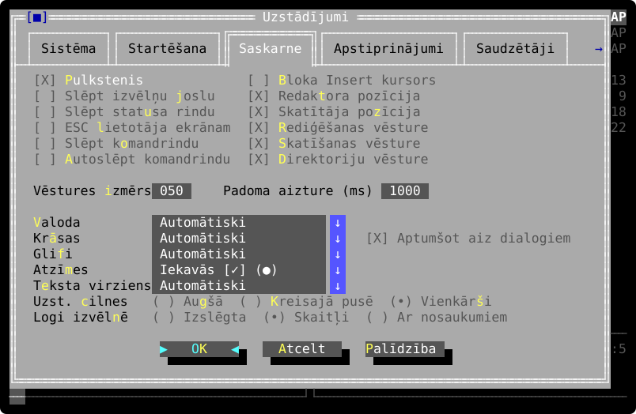

- *Pulkstenis*, *Slēpt izvēlņu joslu*, *Slēpt statusa rindu*: pulkstenis izvēlņu joslā, pati izvēlņu josla līdz
  `F10` un taustiņu josla apakšējā rindā.
- *ESC lietotāja ekrānam*: `Esc` tukšā komandrindā parāda konsoli līdz nākamajam taustiņam.
- *Slēpt komandrindu* un *Autoslēpt komandrindu*: slēpt komandrindu vienmēr vai tikmēr, kamēr tā ir tukša.
- *Bloka Insert kursors*: bloka kursors komandrindā.
- *Redaktora pozīcija* un *Skatītāja pozīcija*: fails atkal atveras tajā logā un tajā vietā, kur tas tika atstāts.
- *Rediģēšanas vēsture*, *Skatīšanas vēsture*, *Direktoriju vēsture*: uzturēt sarakstus, ko rāda `Alt+PgUp`,
  `Alt+PgDn` un `Alt+Backspace`.
- *Vēstures izmērs*: cik ierakstu glabā katrs vēstures saraksts.
- *Padoma aizture (ms)*: cik ilgi pelei jāpakavējas, pirms parādās padoms; 0, lai to nebūtu vispār.
- *Valoda*: virsrakstu un ziņojumu valoda.
- *Krāsas*: cik krāsu sūtīt terminālim.
- *Glifi*: kādas rakstzīmes pieņem esam termināļa fontā: vienkāršu ASCII, Unicode vai Nerd Font ikonas.
- *Aptumšot aiz dialogiem*: tas, kas atrodas aiz dialoga, tiek zīmēts blāvi.
- *Atzīmes*: kā tiek zīmētas izvēles rūtiņas un radiopogas.
- *Teksta virziens*: no kreisās uz labo, no labās uz kreiso vai tā, kā lasa valodā.
- *Uzst. cilnes*: kur šis logs rāda savas cilnes.
- *Logi izvēlnē*: vai atvērtie logi tiek uzskaitīti izvēlņu joslā, ar numuru vai ar virsrakstiem.

## Apstiprinājumi

Katra rūtiņa liek Navigator pajautāt pirms darbības: viena faila dzēšanas, vairāku failu dzēšanas, netukšas
direktorijas dzēšanas, tikai lasāmu failu dzēšanas, kopēšanā norādītas direktorijas izveides, vilkšanas un
nomešanas, iziešanas, saglabāšanas redaktorā, grāmatzīmes dzēšanas un komandu loga aizvēršanas, kamēr tā komanda vēl
darbojas.

## Saudzētāji

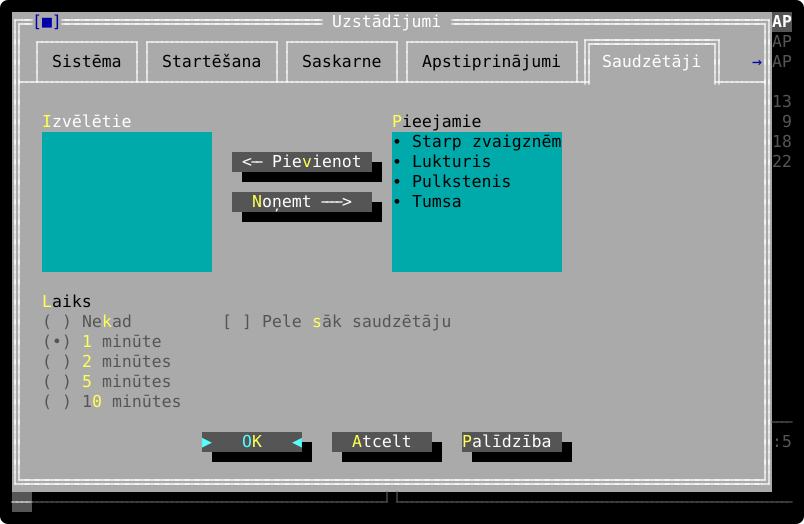

Ekrānsaudzētājs pārņem ekrānu pēc kāda laika bez neviena taustiņa vai klikšķa.

- *Izvēlētie* saudzētāji mainās pēc kārtas. *Pievienot* pārvieto vienu no *Pieejamie*, bet *Noņemt* to izņem.
- *Laiks* ir tas, cik ilgi gaidīt, vai *Nekad*.
- *Pele sāk saudzētāju*: peles rādītāja pārvietošana augšējā labajā stūrī uzreiz palaiž saudzētāju; kamēr tas ir
  apakšējā labajā stūrī, neviens nesākas.

## Valsts

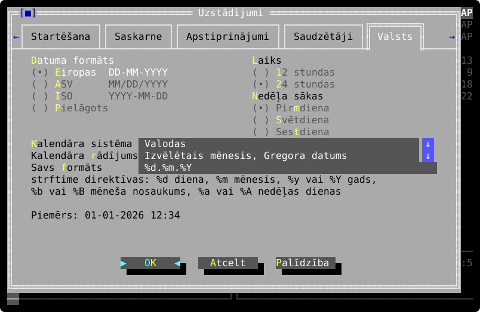

- *Datuma formāts*: secība, kādā raksta datumus, vai *Pielāgots* ar formātu, kas izrakstīts rindā *Savs formāts*.
- *Laiks*: 12 stundu vai 24 stundu pulkstenis.
- *Nedēļa sākas*: nedēļas pirmā diena kalendāros.
- *Kalendāra sistēma* un *Kalendāra rādījums*: kuru kalendāru rāda logs Kalendārs un vai tas stāv blakus Gregora
  kalendāram.

*Piemērs* parāda datumu un laiku, kas uzrakstīti, kā izvēlēts.

## Redaktors/Skatītājs

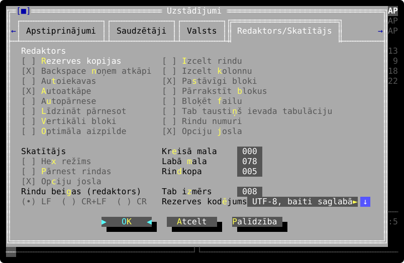

Ar ko sākas jauns redaktora vai skatītāja logs. Lielāko daļu redaktora opciju var pārslēgt vienam logam tā izvēlnē
*Iestatījumi*.

Redaktora opcijas:

- *Rezerves kopijas*: saglabājot ar `F2`, vecais fails tiek paturēts kā `NAME.bak`.
- *Backspace noņem atkāpi*: `Backspace` sākuma atstarpēs atgriežas līdz kādas augstākas rindas atkāpei.
- *Autoiekavas*: rakstot `(`, `{` vai `[`, tiek ierakstīts arī tās pāris.
- *Autoatkāpe*: `Enter` atkāpj jauno rindu tāpat kā rindu virs tās.
- *Autopārnese* un *Līdzināt pārnesot*: rinda, kas ierakstīta pāri labajai malai, tiek pārnesta, un atstātā rinda
  tiek izplesta līdz malai.
- *Vertikāli bloki*: bloki tiek iezīmēti kā kolonnas.
- *Optimāla aizpilde*: atstarpes, kas sniedzas līdz tabulācijas pozīcijai, tiek ierakstītas kā tabulācija.
- *Izcelt rindu* un *Izcelt kolonnu*: kursora rinda un kolonna tiek izceltas.
- *Pastāvīgi bloki*: bloks paliek iezīmēts, kad kursors pārvietojas. *Pārrakstīt blokus*, kad tas ir izslēgts:
  rakstīšana un ielīmēšana aizstāj bloku.
- *Bloķēt failu*: redaktors tur failam slēdzeni, ko var redzēt citas programmas.
- *Tab taustiņš ievada tabulāciju*: `Tab` ievada tabulācijas rakstzīmi, nevis atstarpes.
- *Rindu numuri*: rindas tiek numurētas gar kreiso malu.
- *Opciju josla*: apakšējais rāmis rāda loga opcijas, un klikšķis kādu pārslēdz.

Skatītāja opcijas: *Hex režīms* atver failus hex režīmā, *Pārnest rindas* aplauž garas rindas, un *Opciju josla* ir
tāda pati kā redaktoram.

- *Kreisā mala*, *Labā mala*, *Rindkopa*: malas [rindkopu formatēšanai](editor.md#malas).
- *Tabulācijas izmērs*: tabulācijas platums.
- *Rindu beigas (redaktors)*: rindas beigas, ko saņem jauns fails.
- *Rezerves kodējums*: kā redaktors lasa failu, kas nav UTF-8.

## Skatītāja tipi

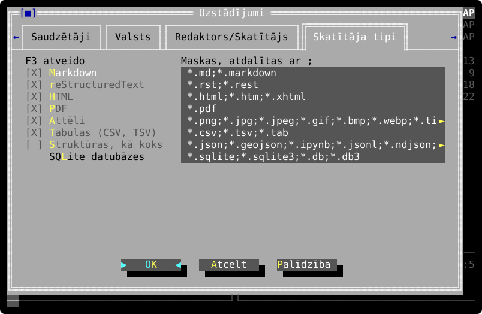

Kurus failus `F3` rāda citādi, nevis kā to tekstu: Markdown, reStructuredText un HTML kā lapu, PDF kā tā tekstu,
attēlus kā attēlus, CSV un TSV kā tabulu, un strukturētus failus (JSON, YAML, TOML, XML) kā koku. Katram ir rūtiņa
tā ieslēgšanai un [failu masku](panels.md#failu-maskas) rinda, kas nosaka, uz kuriem failiem tas attiecas. *SQLite
datubāzes* ir maska failiem, ko atvērt kā datubāzi.

## Failu paneļi

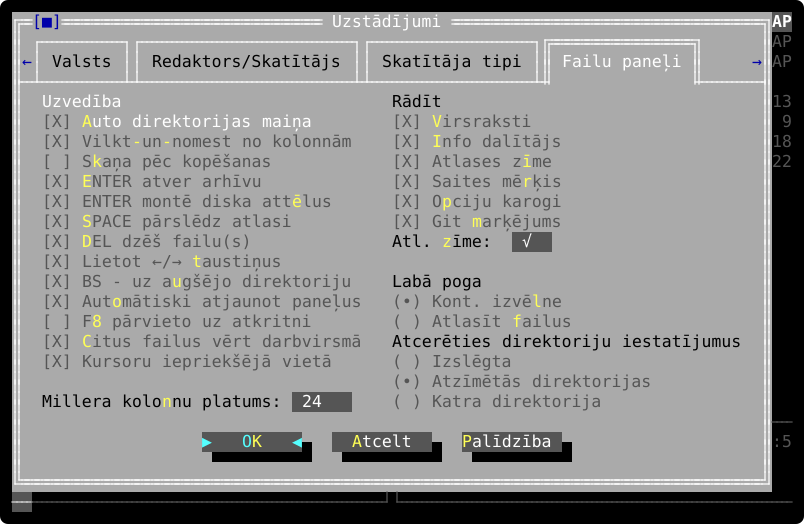

Uzvedība:

- *Auto direktorijas maiņa*: panelis seko kursoram blakus esošajā kokā.
- *Vilkt-un-nomest no kolonnām*: failus var izvilkt no paneļa ar peli.
- *Skaņa pēc kopēšanas*: kad kopēšana beidzas, iezvanās termināļa zvans.
- *ENTER atver arhīvu*: `Enter` uz arhīva ieiet tajā kā direktorijā.
- *ENTER montē diska attēlus*: `Enter` uz `.iso` vai `.img` faila to piemontē un atver.
- *SPACE pārslēdz atlasi*, *DEL dzēš failu(s)*, *BS - uz augšējo direktoriju*: šie taustiņi darbojas panelī,
  kamēr komandrinda ir tukša.
- *Lietot ←/→ taustiņus*: bultiņas, `Home` un `End` rediģē komandrindu, kurā ir teksts. Izslēgtu, tās to dara ar
  `Shift`.
- *Automātiski atjaunot paneļus*: panelis no jauna nolasa savu direktoriju, kad tā mainās diskā.
- *F8 pārvieto uz atkritni*: `F8` pārvieto failus uz atkritni, nevis tos dzēš.
- *Citus failus vērt darbvirsmā*: `Enter` uz faila, kuram nav iestatīta programma, atver to darbvirsmas
  lietotnē.
- *Kursoru iepriekšējā vietā*: atgriežoties direktorijā, kursors tiek novietots tur, kur tas tika atstāts.
- *Millera kolonnu platums*: kolonnas platums Millera skatā.

Rādīšana:

- *Virsraksti*: virsrakstu rinda virs kolonnām.
- *Info dalītājs*: līnija virs kopsummām zem saraksta.
- *Atlases zīme* un *Atl. zīme*: atlasīts fails tiek apzīmēts ar zīmi, un kura zīme tā ir.
- *Saites mērķis*: rinda zem paneļa rāda, uz kurieni norāda simboliskā saite.
- *Opciju karogi*: apakšējais rāmis rāda paneļa opcijas, un klikšķis kādu pārslēdz.
- *Git marķējums*: git darba kokā katra faila statuss un virsrakstā zars.

*Labā poga* izvēlas, ko panelī dara labā peles poga: atver konteksta izvēlni vai atlasa failus.
*Atcerēties direktoriju iestatījumus* izvēlas, kuras direktorijas patur savu kārtošanas secību, skatu, kolonnas un
failu masku.

## Info panelis

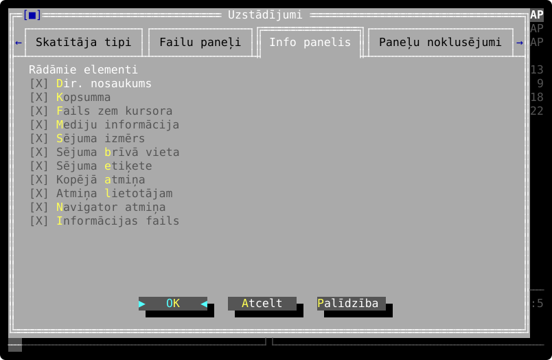

Kuras rindas rāda informācijas panelis (`Ctrl+L`): direktorijas nosaukumu, tās kopsummas, zem kursora esošo failu,
multivides informāciju, sējuma izmēru, brīvo vietu un nosaukumu, datora atmiņu un direktorijas informācijas failu.

## Paneļu noklusējumi

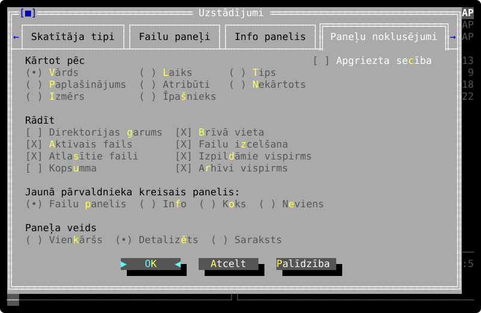

Kā sākas jauna failu pārvaldnieka paneļi.

- *Kārtot pēc* un *Apgriezta secība*: secība, kādā faili tiek uzskaitīti.
- *Direktorijas garums*: katras direktorijas izmērs tiek saskaitīts un parādīts.
- *Pašreizējais fails*, *Atlasītie faili*, *Kopsumma*, *Brīvā vieta*: rindas zem saraksta.
- *Failu izcelšana*: faili tiek iekrāsoti pēc to veida.
- *Izpildāmie vispirms* un *Arhīvi vispirms*: šie faili tiek uzskaitīti pirms pārējiem.
- *Jaunā pārvaldnieka kreisais panelis*: failu panelis, informācijas panelis, koks vai nekas.
- *Paneļa veids*: vienkāršais, detalizētais vai saraksta skats.

## Kolonnas

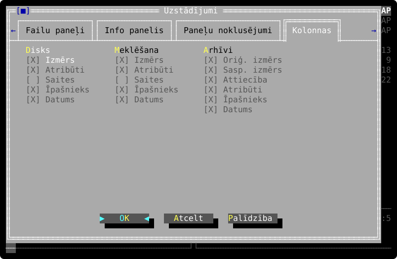

Kuras kolonnas panelis rāda savā detalizētajā skatā, atsevišķi trim sarakstu veidiem. `Alt+K` tās maina vienam
panelim; skatiet [Kolonnu iestatīšana](panels.md#kolonnu-iestatīšana).

- *Disks*: direktorija diskā vai serverī. Kolonnas ir *Izmērs*, *Atribūti*, *Saites* (cik nosaukumu failam ir),
  *Īpašnieks* un *Datums*.
- *Meklēšana*: saraksts, ar ko [Meklēt failu](panels.md#failu-meklēšana) aizpilda paneli. Tās pašas kolonnas.
- *Arhīvi*: arhīva iekšienē. *Oriģ. izmērs*, *Sasp. izmērs*, *Attiecība* (cik stipri tas saspiests), *Atribūti*,
  *Īpašnieks* un *Datums*.

## Izcelšana

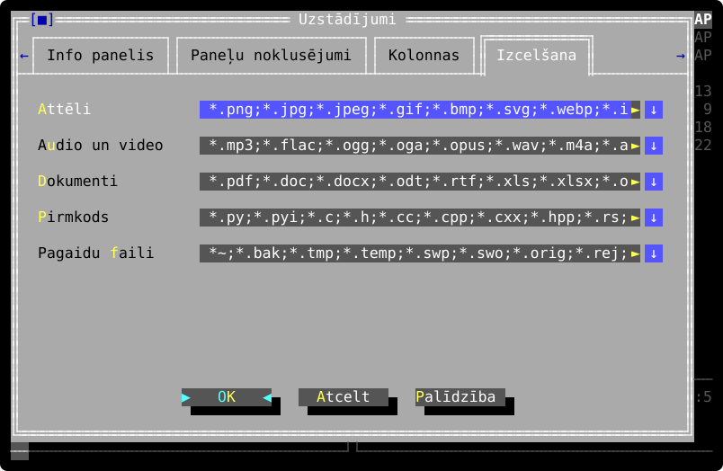

To piecu grupu [failu maskas](panels.md#failu-maskas), ko paneļi iekrāso: *Attēli*, *Audio un video*, *Dokumenti*,
*Pirmkods* un *Pagaidu faili*. Fails, kas atbilst grupas maskai, tiek uzskaitīts šīs grupas krāsā, kamēr panelim ir
atzīmēta *Failu izcelšana*. Pašas krāsas ir tēmas krāsas, ko maina *Iestatījumi > Krāsas*
([Krāsas](customizing.md#krāsas)).

Šīs grupas iekrāso nosaukumus paneļos; kādas krāsas skatītājā un redaktorā saņem teksts faila iekšienē, nosaka
`highlight.ini` ([Sintakses izcelšana](editor.md#sintakses-izcelšana)).

## Sakari

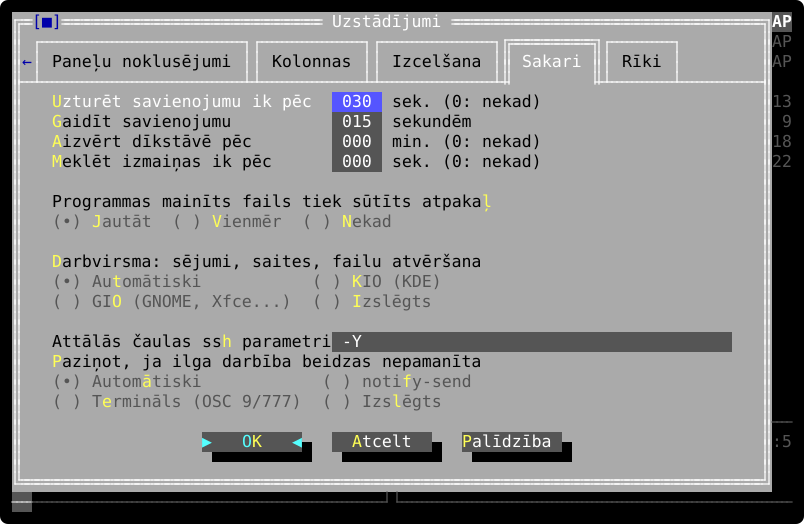

- *Uzturēt savienojumu ik pēc*: cik bieži tiek sūtīts ziņojums, lai savienojums ar serveri paliktu atvērts.
- *Gaidīt savienojumu*: cik ilgi gaidīt servera atbildi.
- *Aizvērt dīkstāvē pēc*: cik ilgi neizmantots savienojums paliek atvērts.
- *Meklēt izmaiņas ik pēc*: cik bieži servera direktorija tiek pārbaudīta, vai tajā nav izmaiņu.
- *Programmas mainīts fails tiek sūtīts atpakaļ*: vai šāds fails tiek augšupielādēts no jauna: pēc jautājuma,
  vienmēr vai nekad.
- *Darbvirsma*: kuras darbvirsmas pakalpojumi tiek lietoti sējumiem, saitēm un failu atvēršanai.
- *Attālās čaulas ssh parametri*: vārdi, ko pievieno katras attālās čaulas `ssh` komandai.
- *Paziņot, ja ilga darbība beidzas nepamanīta*: kā darbvirsmai paziņo, ka ilga darbība ir beigusies, kamēr
  terminālis bija fonā.

## Rīki

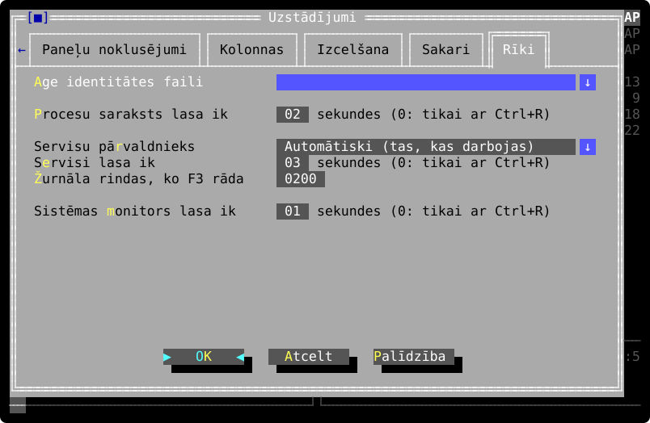

- *Age identitātes faili*: atslēgu faili, ar kuriem `age` atšifrē.
- *Procesu saraksts lasa ik*, *Servisi lasa ik*, *Sistēmas monitors lasa ik*: cik bieži šie logi atsvaidzinās.
- *Servisu pārvaldnieks*: ar kuru servisu pārvaldnieku runā logs Servisi.
- *Žurnāla rindas, ko F3 rāda*: cik daudz no servisa žurnāla `F3` atver.
