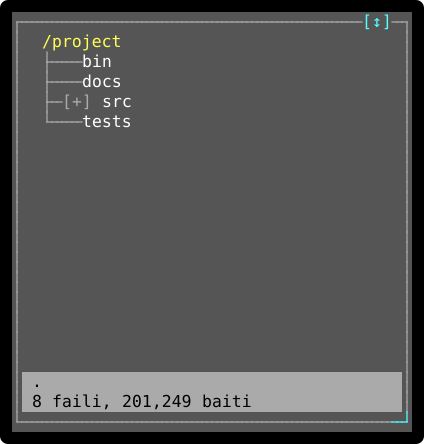
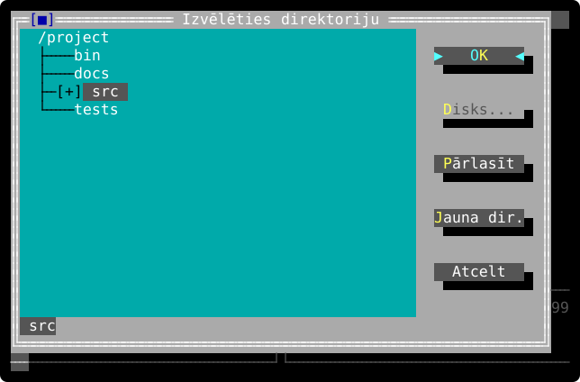
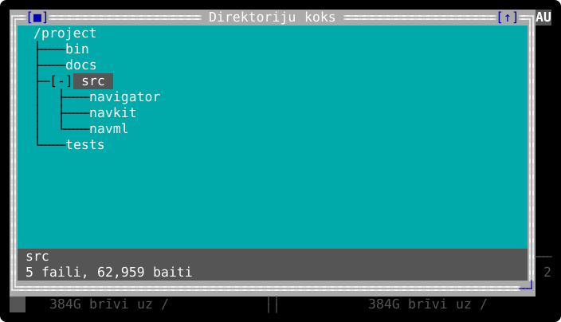
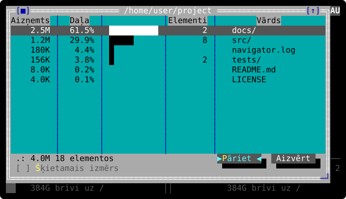

# Direktoriju koki

Koks rāda direktorijas ar to iekšējām direktorijām atkāpē zem tām.

| Taustiņš | Ko tas dara |
|---|---|
| `Up`, `Down` | Pārvieto kursoru |
| `Right` | Atver direktoriju un ieiet tajā |
| `Left` | Pāriet uz direktoriju, kurā tā atrodas |
| `+`, `-` vai `Space` | Atver vai aizver direktoriju |
| `*` | Atver katru direktoriju |
| `Enter` | Izvēlas direktoriju |
| `Ctrl+S` | Meklēšana: ierakstiet nosaukuma sākumu; `/` turpina atrastās direktorijas iekšienē |

Koks rāda slēptās direktorijas, ja tās rāda panelis (`Ctrl+H`).

## Koks blakus panelim

`Ctrl+T` novieto koku neaktīvā paneļa vietā. Tas seko aktīvajam panelim, un panelis seko tam: kursoram apstājoties
uz direktorijas kokā, panelis rāda šo direktoriju. Ja iestatījumu lappusē [Failu paneļi](settings.md#failu-paneļi)
noņemta atzīme *Auto direktorijas maiņa*, to dara tikai `Enter`.

## Direktorijas maiņa

`Alt+T` atver lodziņā koku, no kura izvēlēties aktīvā paneļa direktoriju. *Jauna dir.* izveido direktoriju zem
kursora, un *Pārlasīt* nolasa koku no jauna.

## Koka logs

*Disks > Direktoriju koks* atver koku pašam savā logā uz darbvirsmas, kas paliek atvērts, kamēr strādājat citur.
`Enter` uz direktorijas aizved tur aktīvā failu pārvaldnieka aktīvo paneli. Logam ir sava izvēlne *Koks* ar
*Pārlasīt* (`Ctrl+R`), *Ātrā meklēšana* (`Ctrl+S`) un *Aizvērt*; to aizver arī `Esc`.

## Direktoriju izmēri

*Disks > Direktoriju izmēri* izmēra aktīvā paneļa direktoriju un uzskaita tās saturu pēc izmēra, lai varētu redzēt,
kas aizņem vietu.

| Taustiņš | Ko tas dara |
|---|---|
| `Enter`, `Right` | Ieiet direktorijā |
| `Backspace`, `Left` | Iziet atpakaļ |
| `Ctrl+N`, `Ctrl+S`, `Ctrl+E` | Kārto pēc nosaukuma, izmēra, ierakstu skaita; atkārtoti apgriež secību |
| `Ctrl+A` | Pārslēdz starp satura izmēru un diskā aizņemto vietu |
| `F8`, `Del` | Dzēš, tāpat kā panelī |
| `Ctrl+R` | Izmēra no jauna |
