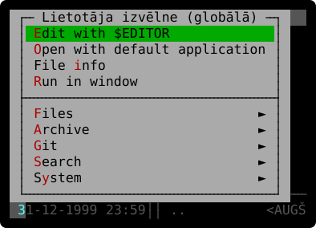

# Lietotāja izvēlne un failu asociācijas

## Lietotāja izvēlne

`F2` atver jūsu pašu komandu izvēlni. Navigator meklē failu ar nosaukumu `.navigator-menu.ini` paneļa direktorijā
un katrā direktorijā virs tās; tā ir *lokālā* izvēlne. Ja tādas nav, tiek izmantota *globālā* — `menu.ini`
Navigator konfigurācijas direktorijā.



Izvēlnē `F2` pārslēdz starp lokālo un globālo izvēlni, un `F4` atver redaktorā to, kas tiek rādīta. Tās rediģē arī
*Iestatījumi > Globālā izvēlne* un *Lokālā izvēlne*.

### Izvēlnes rakstīšana

```ini
# A comment
~S~how the file = less !.!

[Archive]
~P~ack this file = tar czf !.tar.gz !.!
-
~L~ist = tar tf !.!
```

- `Caption = command` ir vienums. Atkāpinātas rindas zem tā ir papildu komandas tam pašam vienumam.
- `[Name]` sāk apakšizvēlni, un `[Name/Inner]` — apakšizvēlni tajā.
- Rinda ar tikai `-` ir atdalītājs.
- `~` pirms burta padara to par vienuma karsto taustiņu. Uzrakstu, kas sākas ar `F1` līdz `F12` un atstarpi, izvēlas
  ar šo taustiņu.

Šie apzīmē failu zem kursora aktīvajā panelī:

| Jūs rakstāt | Tas kļūst par |
|---|---|
| `!` | Nosaukumu bez paplašinājuma |
| `.!` | Paplašinājumu ar punktu |
| `!.!` | Visu nosaukumu |
| `!\` | Direktoriju, kas beidzas ar `/` |
| `!/` | Direktoriju bez noslēdzošā `/` |
| `!!` | `!` |

Tie paši ar `$` `!` vietā apzīmē failu otrā panelī, tāpēc savam `$` rakstiet `$$`. `%1` ir fails, kurā uzskaitīti
aktīvā paneļa atzīmētie nosaukumi, bet `%2` — otra paneļa.

`%3` līdz `%9` ir vārdi, kas tiek pajautāti, kad vienums tiek palaists. Rinda `<Title` dod jautājumam virsrakstu,
un `<=text` aizpilda atbildi, no kuras sākt.

Nosaukumi čaulai tiek likti pēdiņās, kur tas vajadzīgs, tāpēc nelieciet tos pēdiņās paši. Komandas darbojas
konsoles čaulā, it kā jūs tās būtu ierakstījis.

## Failu asociācijas

Vēl pieci faili konfigurācijas direktorijā nosaka, kā apstrādāt katru failu veidu. Katrā ir sadaļa katrai failu
maskai.

| Fails | Ko tas nosaka | Rediģē no |
|---|---|---|
| `extensions.ini` | Ko `Enter` palaiž failam | *Iestatījumi > Paplašinājumu fails* |
| `viewers.ini` | Ko `F3` palaiž skatītāja vietā | *Iestatījumi > Skatītāji* |
| `editors.ini` | Ko `F4` palaiž redaktora vietā | *Iestatījumi > Redaktori* |
| `quickrun.ini` | Ko palaiž `Ctrl+Shift+F1` līdz `Ctrl+Shift+F10` | *Iestatījumi > Ātrās palaišanas fails* |
| `highlight.ini` | Kā redaktors un skatītājs iekrāso failu, un redaktora opcijas tam | *Iestatījumi > Izcelšanas fails* |

`Alt+F3` vienmēr izmanto paša Navigator skatītāju. `Alt+F4` izmanto `editors.ini` programmu, kamēr `F4` izmanto
Navigator redaktoru, un otrādi; skatiet [redaktoru](editor.md#faila-atvēršana). Katrs fails tiek ierakstīts ar
piemēriem, kad Navigator startē pirmo reizi. `highlight.ini` aprakstīts sadaļā [Sintakses
izcelšana](editor.md#sintakses-izcelšana).
