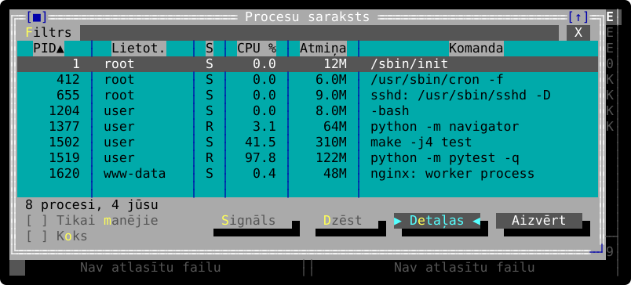
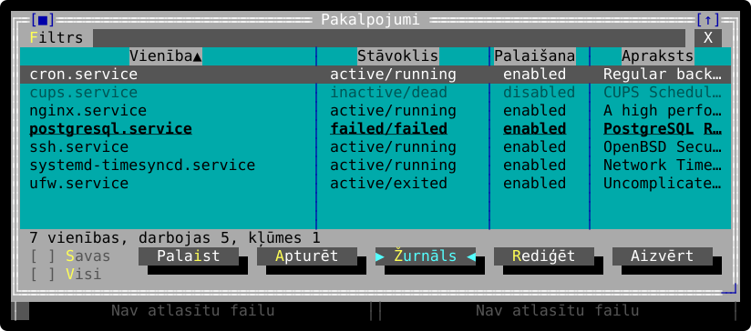
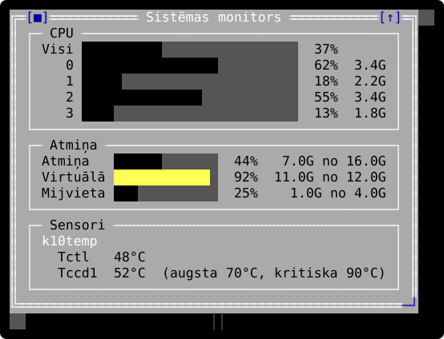
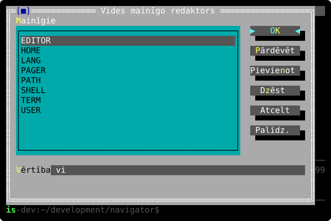
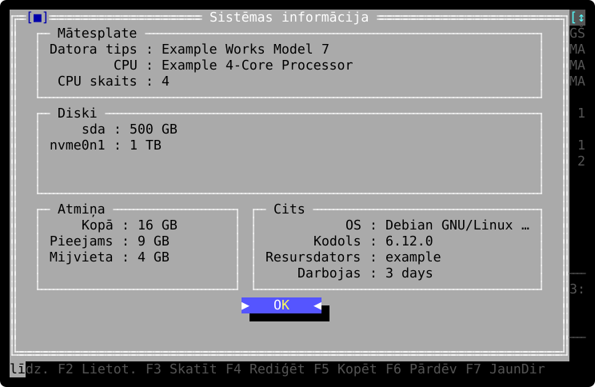
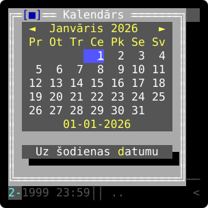
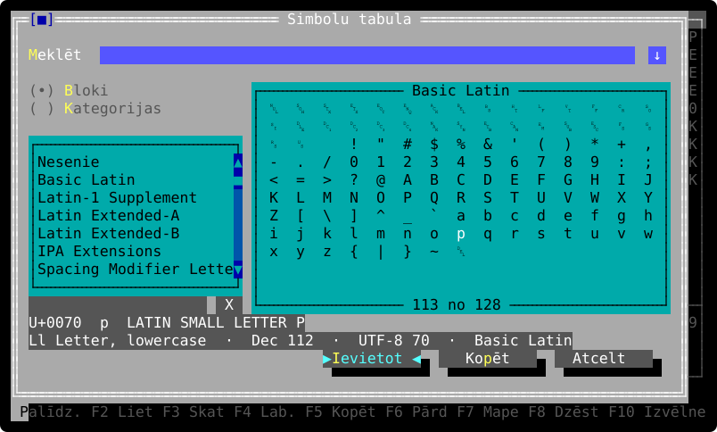

# Rīki

## Procesu saraksts

*Rīki > Procesu saraksts* parāda darbojošos procesus.

| Taustiņš | Ko tas dara |
|---|---|
| Rakstīšana, `F4` | Atstāj sarakstā procesus, kuru komanda, nosaukums, lietotājs vai numurs satur tekstu; `Esc` to notīra |
| `Ctrl+T` | Parāda procesus kā vecāku un bērnu koku |
| `Ctrl+H` | Parāda tikai jūsu procesus |
| `Ctrl+P`, `Ctrl+U`, `Ctrl+E`, `Ctrl+L`, `Ctrl+Z`, `Ctrl+N` | Kārto pēc numura, lietotāja, stāvokļa, CPU slodzes, atmiņas, komandas |
| `Left`, `Right` | Ritina garas komandas |
| `F3` | Parāda procesa informāciju |
| `F7` | Nosūta jūsu izvēlētu signālu |
| `F8`, `Del` | Pēc jautājuma izbeidz procesu |
| `Ctrl+R` | Nolasa sarakstu vēlreiz |

Klikšķis uz kolonnas virsraksta kārto pēc tās. Ja signāls atteikts atļauju trūkuma dēļ, tiek piedāvāts to nosūtīt
kā root.

## Pakalpojumi

*Rīki > Pakalpojumi* parāda sistēmas pakalpojumus un tos vada ar systemd, OpenRC, runit vai SysVinit palīdzību.

| Taustiņš | Ko tas dara |
|---|---|
| `Enter` | Parāda pakalpojuma informāciju |
| `F3` | Parāda tā žurnālu un seko tam |
| `F4` | Rediģē tā konfigurāciju |
| `F5`, `F6`, `F7` | Startē, restartē, pārlādē |
| `F8`, `Del` | Pēc jautājuma aptur |
| `Ctrl+E`, `Ctrl+D` | Ieslēdz un izslēdz startēšanu, sāknējot sistēmu |
| `Ctrl+U` | Parāda jūsu pakalpojumus |
| `Ctrl+A` | Parāda visu veidu vienības |
| `Ctrl+S` | Filtrē sarakstu |
| `Ctrl+R` | Nolasa sarakstu vēlreiz |

Sistēmas pakalpojuma mainīšanai parasti vajadzīgas root tiesības, kas jums tiek piedāvātas.

## Sistēmas monitors

*Rīki > Sistēmas monitors* parāda katra procesora slodzi, izmantoto atmiņu un mijvietu, kā arī temperatūras un
ventilatoru ātrumus, ko ziņo dators.

## Vides rediģēšana

*Rīki > Vides mainīgie* parāda vides mainīgos, kas tiek doti no Navigator palaistajām programmām, un ļauj tos
mainīt.

- *Mainīgie* uzskaita nosaukumus. Mainīgā zem kursora vērtība ir rindā *Vērtība*, kur to var rediģēt.
- *Pārdēvēt* dod mainīgajam citu nosaukumu.
- *Pievienot* pievieno jaunu mainīgo.
- *Dzēst* izņem mainīgo zem kursora.
- *OK* saglabā izmaiņas; *Atcelt* tās visas atmet.

Izmaiņas sasniedz programmas, ko Navigator palaiž no šī brīža: ārējo skatītāju un redaktoru, lietotāja izvēlnes
komandas un čaulu konsolē. Tās ir spēkā, līdz izejat no Navigator.

## Sistēmas informācija

*Rīki > Sistēmas informācija* parāda, kas ir šis dators: *Mātesplate* un procesors, *Diski*, *Atmiņa*, bet zem
*Cits* — sistēma, tās kodols, datora nosaukums un cik ilgi tas darbojas.

## Kalendārs

*Rīki > Kalendārs* parāda mēnesi ar atzīmētu šodienu. Zem nedēļām diena zem kursora ir izrakstīta
[Valsts](settings.md#valsts) iestatījumu datuma formātā.

| Taustiņš | Ko tas dara |
|---|---|
| Bultiņas | Pārvietojas no dienas uz dienu |
| `PgUp`, `PgDn` | Iepriekšējais un nākamais mēnesis |
| `Ctrl+PgUp`, `Ctrl+PgDn` | Iepriekšējais un nākamais gads |
| `M`, `Y` | Izvēlas mēnesi vai gadu no saraksta |
| `T` | Pāriet uz šodienu; arī poga *Uz šodienas datumu* |
| `C` | Pārslēdz starp otru kalendāru un Gregora kalendāru |
| `Esc` | Aizver kalendāru |

Izvēlnē *Kalendārs* ir tās pašas komandas un vēl divas. *Kalendāra sistēma* parāda mēnesi citā kalendārā,
piemēram, ebreju, islāma vai persiešu. *Kalendāra rādījums* nosaka, kas no tā tiek rādīts blakus Gregora mēnesim:
tikai tā mēnesis, tajā izrakstītā diena zem Gregora mēneša, tā mēnesis ar Gregora dienu izrakstītu zem tā, vai abi
mēneši blakus.

## Rakstzīmju tabula

`Ctrl+B` jeb *Rīki > Rakstzīmju tabula* atrod rakstzīmi un ieraksta to kursora vietā.

- *Meklēt* atrod rakstzīmes pēc nosaukuma, piemēram, `arrow` vai `euro`.
- Saraksts pa kreisi izvēlas rakstzīmju grupu, un rinda zem tā sašaurina grupas pēc nosaukuma.
- Režģis pa labi parāda grupu. Rakstzīme zem kursora ir aprakstīta apakšā.
- *Ievietot* ieraksta rakstzīmi, un *Kopēt* to ievieto starpliktuvē.

Terminālī, kas iestatīts uz vienkāršām ASCII rakstzīmēm, tabula ir DOS Navigator *ASCII tabula*: 256 rakstzīmes ar
rakstzīmes zem kursora kodu decimālajā un sešpadsmitnieku sistēmā.

## SmartPad

`Alt+Q` jeb *SmartPad* izvēlnē `≡` atver piezīmju bloku, kas saglabājas no vienas sesijas uz nākamo. Ikreiz, kad
tas atveras, tas beigās pievieno rindu ar datumu un laiku un novieto kursoru zem tās, tāpēc bloks lasās kā žurnāls.
Tas ir [redaktora](editor.md) logs, un tas pats sevi saglabā, kad to aizverat.

## Sistēmas izvēlne

Izvēlnē `≡` izvēlņu joslas kreisajā galā ir tas, kas attiecas uz Navigator kopumā.

| Ieraksts | Ko tas dara |
|---|---|
| *Par* | Parāda versiju, licenci un autoru |
| *Komandu palete* | Atrod jebkuru [komandu](windows.md#komandu-palete) pēc dažiem tās burtiem |
| *Atsvaidzināt ekrānu* | Pārzīmē visu ekrānu pāri tam, ko uz tā atstājusi cita programma |
| *Ekrāna atpūta* | Tūlīt palaiž ekrānsaudzētāju |
| *Ekrāna tvērējs*, `Shift+Alt+Ins` | Kopē ekrāna taisnstūri starpliktuvē |
| *Lietotāja ekrāns*, `Alt+F5` | Parāda [konsoli](console.md#konsole), līdz tiek nospiests taustiņš |
| *Izvades logs*, `Ctrl+O` | Novāc logus, lai rakstītu konsolē, un atgriež tos |
| *SmartPad*, `Alt+Q` | Atver [piezīmju bloku](#smartpad) |
| *Atkritne iesl./izsl.* | Parāda vai paslēpj atkritni, uz kuras nomet failus, lai tos dzēstu |
| *Spēle*, `Alt+F9` | Atver [spēli](game.md) |

`Alt+X` iziet no Navigator. Vispirms tas pajautā; *Vairs nejautāt* jautājumā vai *Apstiprināt iziešanu* lappusē
[Apstiprinājumi](settings.md#apstiprinājumi) izslēdz jautājumu.
