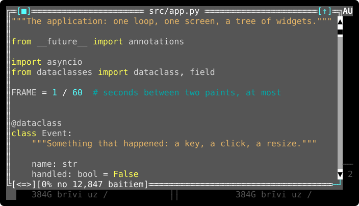
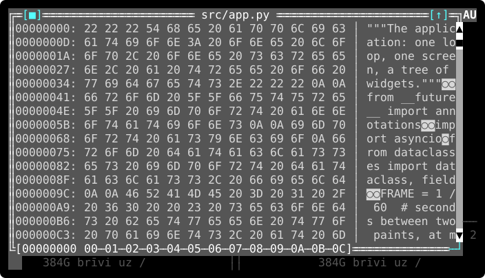
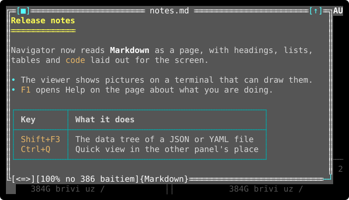
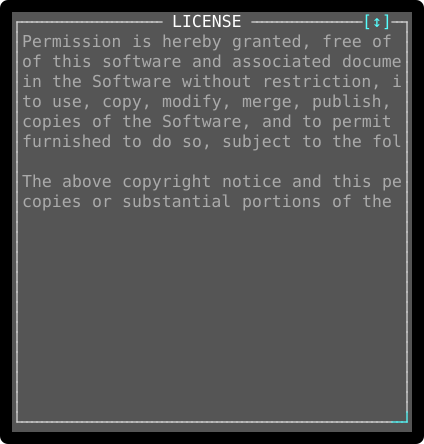
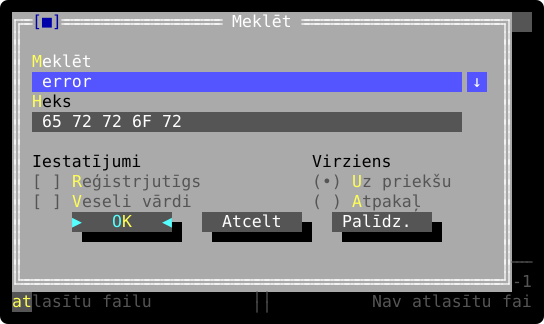
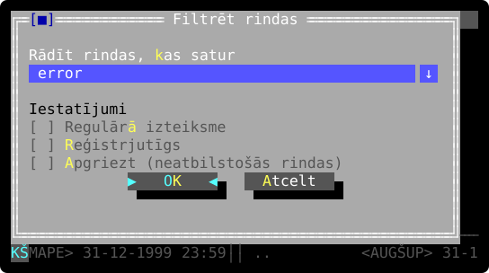
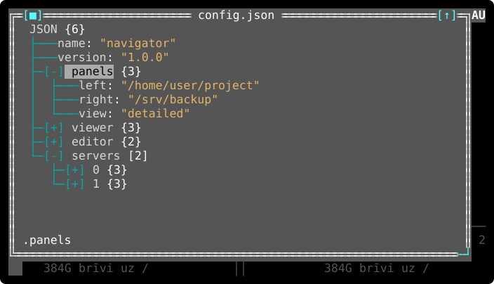
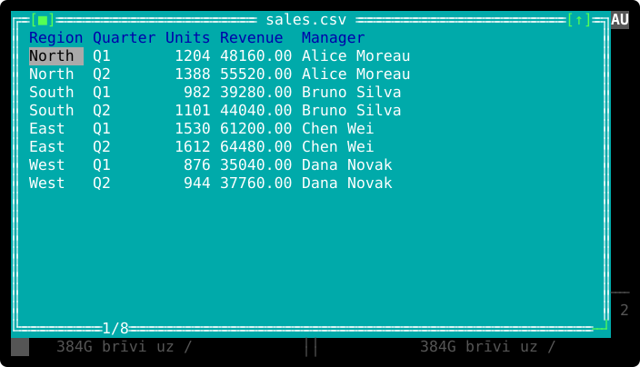

# Skatītājs

`F3` parāda zem kursora esošo failu, to nemainot. Tas atveras uzreiz, lai cik liels būtu fails.

## Taustiņi

| Taustiņš | Ko tas dara |
|---|---|
| `Up`, `Down`, `PgUp`, `PgDn` | Ritina |
| `F2` | Aplauž garas rindas vai pārstāj tās aplauzt |
| `F4` | Pārslēdz starp tekstu, hex un dump |
| `F5` | Pāriet uz adresi |
| `F6` | Maina rakstzīmju filtru |
| `F7` | Meklē; `Shift+F7` meklē vēlreiz, `Ctrl+F7` atpakaļ |
| `Shift+F3` | Parāda Markdown, HTML vai līdzīgu failu atveidotu vai kā pirmtekstu |
| `Shift+F4` | Rediģē failu |
| `Shift+F5` | Saglabā failu ar citu nosaukumu |
| `Shift+F6` | Izvēlas kodējumu, kādā teksts tiek lasīts |
| `Ctrl+T` | Seko augoša faila beigām |
| `Ctrl+G` | Rāda tikai rindas, kas atbilst tekstam |
| `Alt+PgDn` | Parāda iepriekš skatīto failu sarakstu |
| `Esc`, `F3` | Aizver skatītāju |

Tās pašas komandas ir izvēlnē *Skatīt*, kas ir izvēlņu joslā, kamēr skatītājs ir atvērts.

Hex režīmā var mainīt baitus: rakstiet pāri tiem heksadecimālus ciparus vai nospiediet `Tab` un rakstiet rakstzīmes.
`Shift+F2` ieraksta izmaiņas failā.

## Faila atvēršana

| Taustiņš vai vienums | Ko tas dara |
|---|---|
| `F3`, *Fails > Skatīt > Kā ir* | Parāda zem kursora esošo failu tā, kā tā veids parādāms vislabāk, skatīt zemāk |
| `Alt+F3`, *Fails > Skatīt > Alternatīvi skatīt* | Parāda to Navigator skatītājā, nekad ne kā tabulu, arhīvu vai ar `viewers.ini` programmu |
| *Fails > Skatīt > Kā tekstu*, *Kā Hex* | Atver skatītāju teksta vai hex režīmā |
| *Fails > Skatīt > Kā datubāzi* | Atver dBase vai SQLite failu kā [tabulu](#tabulas), lai kāds būtu tā nosaukums |
| *Fails > Skatīt > Kā izklājlapu* | Atver CSV vai TSV failu kā tabulu |
| *Fails > Skatīt > Atvērt...* | Parāda failu, ko izvēlaties [faila logā](dialogs.md#faila-izvēle), bez failu pārvaldnieka |
| `Alt+PgDn` | Parāda failu no iepriekš skatīto failu saraksta |

`F3` atver dBase, SQLite vai CSV failu kā tabulu un ieiet arhīvā, tāpat kā `Enter`. Citādi, ja `viewers.ini` failam
nosaka programmu, to parāda šī programma ([failu asociācijas](user-menu.md#failu-asociācijas)); ja ne, to dara
Navigator skatītājs. Ja iestatījumu lapā [Sistēma](settings.md#sistēma) nav atzīmēts *Iekšējais skatītājs*, `F3`
palaiž `viewers.ini` programmu, citādi `$PAGER`.

`F3` uz direktorijas saskaita visa tajā esošā izmēru.

## Ko tas rāda īpaši

Daži faili tiek rādīti nevis kā to teksts, bet citādi. `Shift+F3` jeb *Skatīt > Atveidot marķējumu* pārslēdz starp
šo attēlojumu un paša faila tekstu; zīme apakšējā rāmī, piemēram, `{Markdown}`, ir pārsvītrota, kamēr redzat
tekstu, un arī klikšķis uz tās pārslēdz.

- **Markdown, reStructuredText un HTML** tiek rādīti kā lapa: virsraksti, saraksti, tabulas, citāti un koda bloki
  izkārtoti, un rindkopas pielāgotas loga platumam. Jūsu terminālis var atvērt lapā esošu saiti.
  Meklēšana ar `F7` meklē paša faila tekstā un parāda atrasto vietu lapā.
- **PDF** tiek rādīts kā tā teksts, lapu pa lapai. Attēli tajā tiek izlaisti, un `F7` neatrod PDF tekstu, kas faila
  iekšienē ir saspiests.
- **Attēls** tiek uzzīmēts kā attēls terminālī, kas to prot, ar kitty grafikas protokolu vai sixel. Vairumam attēlu
  veidu vajag Python pakotni Pillow (`pip install navigator-fm[images]`); bez tās tiek zīmēts tikai PNG kitty
  terminālī. Citur tiek rādīti attēla baiti. `--graphics` [komandrindā](command-line.md#krāsas-un-rakstzīmes)
  pasaka, ko terminālis prot, ja tā vaicāšana neizdodas.
- **JSON, YAML, TOML, XML un property list** faili atveras kā teksts, un `Shift+F3` tos parāda kā [datu
  koku](#datu-koks).
- **dBase, SQLite un CSV faili** atveras kā ierakstu [tabula](#tabulas) savā logā.

Fails, kas lielāks par 4 MB, vai PDF vai attēls, kas lielāks par 64 MB, tiek rādīts kā teksts. Iestatījumi
[Skatītāja tipi](settings.md#skatītāja-tipi) nosaka, kurus veidus rādīt īpaši un pēc kādām failu maskām.

## Ātrā apskate

`Ctrl+Q` parāda zem kursora esošo failu otra paneļa vietā un seko kursoram, tam pārvietojoties. `Tab` pārvieto
tastatūru uz skatu, kur darbojas skatītāja taustiņi.

## Meklēšana

`F7` meklē failā. `Shift+F7` meklē vēlreiz, bet `Ctrl+F7` meklē atpakaļ.

- *Meklēt* ir meklējamais teksts. *Heks* ir tā pati meklēšana, uzrakstīta kā baiti heksadecimālos ciparos; rakstiet
  tajā rindā, kura labāk der meklējamajam.
- *Reģistrjutīgs* atšķir lielos burtus no mazajiem.
- *Veseli vārdi* izlaiž tekstu, kur tas ir garāka vārda daļa.
- *Virziens*: *Uz priekšu* uz faila beigām vai *Atpakaļ* uz tā sākumu.

Liela faila meklēšana rāda savu gaitu, un *Apturēt*, `Esc` vai `Enter` to pārtrauc.

## Pāriet uz adresi

`F5` hex režīmā prasa *Adresi*, vietu failā, kas uzrakstīta heksadecimāli, un parāda failu no turienes.

## Rindu filtrēšana

`Ctrl+G` jeb *Skatīt > Filtrēt rindas* rāda tikai rindas, kas satur tekstu.

- *Regulāra izteiksme* uztver tekstu kā regulāro izteiksmi.
- *Reģistrjutīgs* atšķir lielos burtus no mazajiem.
- *Apgriezt (neatbilstošās rindas)* rāda rindas, kas to nesatur.

## Datu koks

`Shift+F3` uz JSON, YAML, TOML, XML vai property list faila parāda tā datus kā koku, un vēlreiz `Shift+F3` atgriežas
pie teksta. Apakšējā rinda ir zem kursora esošā mezgla ceļš.

| Taustiņš | Ko tas dara |
|---|---|
| `F7` | Meklē atslēgās un vērtībās; `Shift+F7` meklē vēlreiz |
| `Ctrl+S` | Atrod atslēgu, kamēr to rakstāt |
| `Ctrl+Ins` | Kopē mezgla ceļu starpliktuvē |
| `Ctrl+Shift+C` | Kopē mezgla vērtību starpliktuvē |
| `Shift+F4` | Rediģē failu |
| `Esc` | Aizver logu |

Izvēlnē *Dati* ir tās pašas komandas un *Izvērst visu*.

## Meklēšana tabulā

`F7` tabulā meklē tekstu ierakstos. `Shift+F7` atkārto meklēšanu.

- *Teksts meklēšanai* ir meklējamais teksts.
- *Reģistrjutīgs* atšķir lielos burtus no mazajiem.
- *Apgabals*: *Kursora laukā* meklē tikai kolonnā, kurā ir kursors, *Visos laukos* visās kolonnās.
- *Virziens*: *Uz priekšu* no kursora uz pēdējo ierakstu, *Atpakaļ* uz pirmo vai *No sākuma* no pirmā ieraksta
  uz priekšu.

## Tabulas

dBase, SQLite vai CSV fails atveras kā ierakstu tabula.

- `F2` parāda tabulas struktūru: tās laukus un to tipus.
- `F3` uz memo lauka parāda memo tekstu logā, kur darbojas skatītāja taustiņi.
- `F6` uz SQLite faila prasa vaicājumu. Tiek izpildīts tikai vaicājums, kas lasa; fails nekad netiek mainīts.
- `Shift+F6` uz CSV vai TSV faila nosaka, kā to sadalīt šūnās: *Atdalītājs* (*Komats*, *Semikols*, *Tabulācija*,
  *Vertikāla svītra* vai *Cits* ar blakus ierakstīto rakstzīmi), vai *Pirmā rinda ir virsraksts*, un *Kodējums*.
