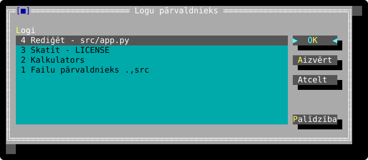
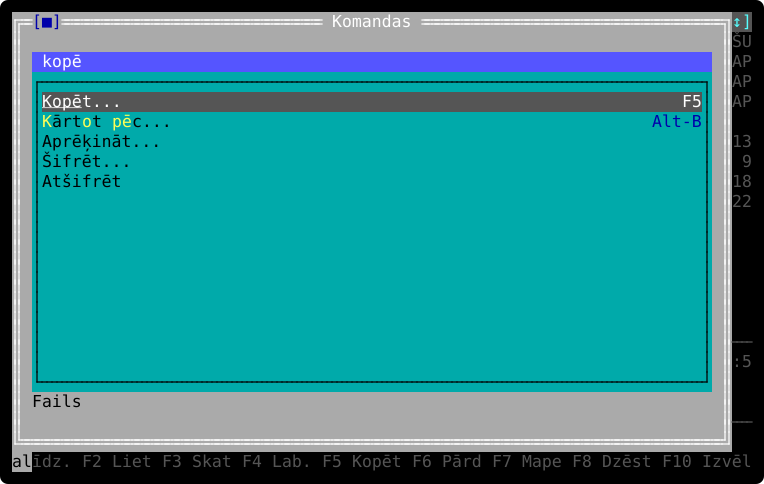

# Logi

Failu pārvaldnieki, skatītāji, redaktori un rīki katrs atveras pats savā logā uz darbvirsmas. Izvēlne *Logs* tos
sakārto.

## Darbs ar logiem

| Taustiņš | Ko tas dara |
|---|---|
| `F9` | Pāriet uz nākamo logu |
| `Shift+F9` | Pāriet uz iepriekšējo logu |
| `Alt+0` | Uzskaita logus |
| `Alt+Z` | Palielina logu līdz visai darbvirsmai un atpakaļ |
| `Ctrl+F5` | Pārvieto logu ar bultiņām vai maina tā izmēru ar `Shift` un bultiņām; `Enter` to patur, `Esc` atliek atpakaļ |
| `Ctrl+F4` | Aizver logu |

*Logs > Izklāt* un *Kaskāde* sakārto visus logus uzreiz, un *Aizvērt visus* tos visus aizver. Ar peli logu velk aiz
tā augšējās malas, tā izmēru maina aiz apakšējā labā stūra, un klikšķis uz loga to izceļ priekšplānā.

Katram logam ir numurs, kas redzams logu sarakstā.

## Divi viena teksta skati

*Logs > Jauns skats* jeb *Redaktors > Fails > Jauns skats* atver otru logu ar priekšā esošā redaktora tekstu. Abi
rāda to pašu tekstu: tas, ko rakstāt vienā, parādās otrā, un tiem ir viena kopīga atsaukšanas vēsture un viena
saglabāšana. Katram ir savs kursors, ritināšana un bloks, tāpēc varat strādāt vienlaikus divās gara faila vietās.

## Darbības fonā

Kopēšanu, pārvietošanu vai dzēšanu var nosūtīt fonā ar pogu *Fonā* tās progresa lodziņā. Procenti izvēlņu joslā
tad rāda, cik tālu tā ir, un `?` — ka tā gaida atbildi. *Logs > Fona darbība* vai klikšķis uz procentiem atkal
parāda progresa lodziņu; ja darbojas vairākas darbības, tas vispirms tās uzskaita, vecāko vispirms, ar kursoru uz
tās, kas gaida atbildi.

## Darbvirsmas saglabāšana

*Iestatījumi > Saglabāt darbvirsmu* saglabā atvērtos logus: katru failu pārvaldnieku ar tā paneļu direktorijām,
skatiem un kārtošanu, katru redaktoru ar tā failu un vietu, katru skatītāju ar tā failu un vietu, katru tabulu ar
tās ierakstu, koka logu, sējumu logu, kalkulatoru, kalendāru un katra loga atrašanās vietu. *Iestatījumi >
Ielādēt darbvirsmu* aizver tagad atvērtos logus un atjauno saglabātos; aktīvais panelis paliek direktorijā, kurā tas
ir tagad, ja vien iestatījumu lappusē [Startēšana](settings.md#startēšana) nav atzīmēts *Saglabāt direktoriju*. Ja tur
atzīmēts *Automātiski saglabāt darbvirsmu*, darbvirsma tiek saglabāta, kad izejat, un atjaunota nākamajā startā;
[komandrindā](command-line.md) norādītās direktorijas ir svarīgākas par saglabātajām.

## Logu saraksts

`Alt+0` jeb *Logs > Saraksts* uzskaita atvērtos logus, priekšā esošo vispirms.

- *OK* jeb `Enter` pāriet uz logu zem kursora.
- Cipars pāriet tieši uz logu ar šo numuru.
- *Aizvērt* aizver logu zem kursora. Saraksts paliek atvērts, lai varētu aizvērt vairākus.
- *Atcelt* atstāj visu, kā ir.

## Komandu palete

`Alt+Shift+P` jeb *Komandu palete* izvēlnē `≡` uzskaita katru komandu, kas attiecas uz vietu, kur esat: izvēlņu
vienumus, starp tiem arī aktīvā loga pašu, un komandas, ko palaiž tikai taustiņš. Katra tiek rādīta ar savu
taustiņu, un tā, ko tagad nevar palaist, ir pelēka.

Ierakstiet dažus komandas burtus pēc kārtas, lai sašaurinātu sarakstu. `Enter` palaiž komandu zem kursora, un `Esc`
aizver sarakstu.
