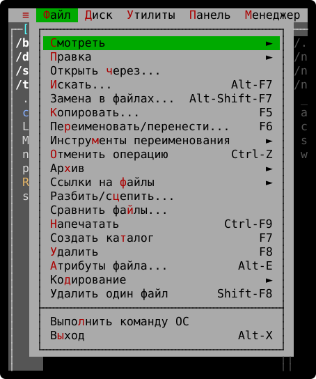

# Справка Navigator

Navigator — воссоздание двухпанельного файлового менеджера DOS Navigator для современных терминалов. Эти страницы
— его руководство: те же файлы показывает `F1` внутри Navigator.

## Начало работы

Наверху экрана — строка меню, под ней две [панели](panels.md) с файлами, под ними [командная
строка](console.md), а в нижней строке — строка клавиш, где написано, что делают функциональные клавиши. В
терминале, который об этом сообщает, удержание `Alt`, `Ctrl` или `Shift` показывает, что делают клавиши вместе с
ней.

| Клавиша | Что делает |
|---|---|
| `Tab` | Переключает панели |
| `Enter` | Входит в каталог или открывает файл |
| `F3`, `F4` | [Просмотр](viewer.md) или [редактирование](editor.md) файла |
| `F5`, `F6` | [Копирование либо переименование и перенос](file-operations.md#копирование-и-перемещение) |
| `F7` | Создаёт каталог |
| `F8` | Удаляет |
| `F10` | Открывает меню |
| `Ctrl+O` | Показывает [консоль](console.md) за окнами |
| `Alt+X` | Выход |
| `F1` | Справка о том, что вы делаете; см. [Справку о справке](help.md) |

Все команды есть в меню, рядом с каждой — её клавиша. `Alt+Shift+P` находит команду по части её названия.

## Содержание

Файлы и каталоги:

- [Панели](panels.md): перемещение, виды, сортировка, пометка, информационная панель, колонки, фильтр, поиск
  файлов и дубликатов, списки файлов
- [Операции с файлами](file-operations.md): копирование и перенос, переименование, удаление, отмена, атрибуты,
  ссылки, разбиение и сцепление, UU, хеш-суммы, шифрование, преобразование текста, открытие в другом приложении,
  печать
- [Архивы](archives.md): форматы, открытие, проверка, создание архива и извлечение из него
- [Сравнение](compare.md): каталоги, окно синхронизации, два файла
- [Деревья каталогов](trees.md): дерево рядом с панелью, смена каталога, окно дерева, размеры каталогов
- [Места помимо диска](drives.md): архивы, серверы, контейнеры, тома, образы дисков, корзина
- [Работа от имени root](as-root.md): как сделать то, на что не хватает прав, и доступ root
- [Соединения](connections.md): менеджер связей, пароли, ключи серверов, перенаправление портов, сохранённые
  связи
- [Закладки](bookmarks.md): список и его клавиши

Просмотр и изменение файлов:

- [Программа просмотра](viewer.md): её клавиши, открытие файла, страницы, PDF и картинки, поиск, фильтр строк,
  дерево данных, таблицы
- [Редактор](editor.md): его клавиши, открытие файла, блоки, поиск и замена, переход к строке, отступы, подсветка
  синтаксиса
- [Макросы](macros.md): записанные клавиши и макросы редактора

Работа с Navigator:

- [Командная строка и консоль](console.md): выполнение команд, окна команд, истории
- [Запуск Navigator](command-line.md): параметры команды `nav`
- [Окна](windows.md): переход между окнами, два вида одного текста, операции в фоне, сохранение рабочего стола,
  список окон, палитра команд
- [Диалоговые окна](dialogs.md): их клавиши и выбор файла
- [Копирование и вставка](clipboard.md): клавиши, инструменты буфера обмена и что с ними делает каждый терминал
- [Настройки](settings.md): все страницы Настройки > Настройки
- [Клавиши и цвета](customizing.md): назначение клавиш, цвета темы
- [Меню пользователя и связи файлов](user-menu.md)

Инструменты:

- [Калькулятор](calculator.md): его четыре вида, выражения и клавиши
- [Утилиты](utilities.md): список процессов, службы, монитор системы, окружение, системная информация,
  календарь, таблица символов, SmartPad, системное меню
- [Игра](game.md): её клавиши, десятка лучших, её настройка

- [Справка о справке](help.md): справка там, где вы находитесь, и клавиши этого окна
