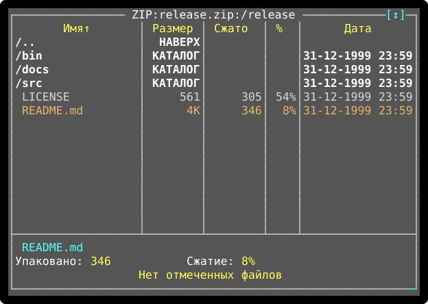
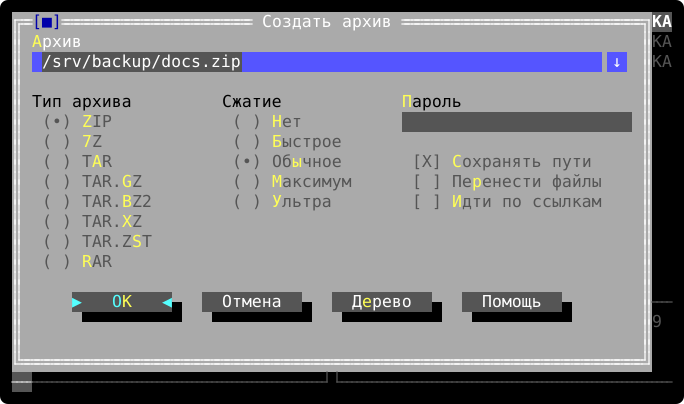
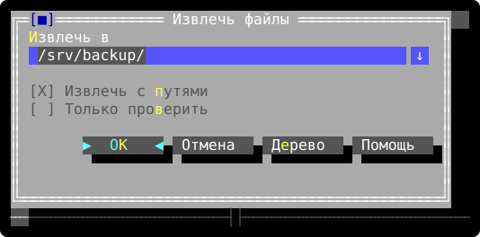

# Архивы

Navigator показывает архив как каталог: `Enter` на файле zip или tar входит в него, и файлы в нём можно
просматривать и копировать наружу, как любые другие. Эта страница — об открытии, создании и распаковке архивов.

## Открытие архива

`Enter` или `Ctrl+PgDn` на архиве входит в него; `..` на его верхнем уровне выводит обратно. `Enter` узнаёт архив
по имени: `.zip`, `.tar.gz`, `.7z`, `.deb` и подобные. *Файл > Архив > Открыть архив*, или `Ctrl+PgDn`, открывает
файл под курсором как архив, каким бы ни было его имя, — так можно заглянуть внутрь статической библиотеки (`.a`)
или AppImage, который `Enter` запустил бы. Если на странице [Файловые панели](settings.md#файловые-панели) настроек
снят флажок *Вход в архив по ENTER*, это делает только `Ctrl+PgDn`.

Внутри `F5` копирует файлы наружу. Там, где формат допускает изменения, `F8` удаляет файлы, а ещё в архив можно
копировать файлы. Подробный вид показывает для каждого файла его сжатый размер и степень сжатия.

| Формат | Что нужно | Можно ли изменять |
|---|---|---|
| ZIP, TAR и TAR, сжатый gzip, bzip2 или xz | Ничего | Да |
| Одиночный файл, сжатый gzip, bzip2, xz или lzma | Ничего | Только этот один файл |
| TAR или одиночный файл, сжатый zstd | Программа `zstd` для Python до 3.14 | Да; одиночный файл — только этот файл |
| 7Z | 7-Zip (`7z`, `7zz` или `7za`) | Да |
| RAR | `unrar` либо `7z` или `7zz` из 7-Zip | Только с `rar` от RARLAB |
| Пакеты Debian и RPM, CPIO, статические библиотеки (`.a`) | Ничего | Нет |
| Образы SquashFS и AppImage | `unsquashfs` из squashfs-tools | Нет |

Если программы нет, `Enter` сообщает, какую установить, вместо того чтобы запускать файл. Архив с паролем
спрашивает пароль.

## Проверка архива

*Файл > Архив > Проверить архив* внутри архива прочитывает выбранные файлы и проверяет каждый, а если курсор на
`..` и ничего не помечено — весь архив. Файл, не прошедший проверку, называется по имени. *Только проверить* в
окне [извлечения](#извлечение-файлов) делает то же снаружи.

## Создание архива

`Shift+F1`, или *Файл > Архив > Создать архив*, упаковывает выделенное в новый архив.

- *Архив* — имя архива. Строка открывается с каталогом другой панели; имя без каталога создаёт архив в текущем.
  *Дерево* выбирает каталог из дерева. Если архив уже есть, вас спросят, добавить в него или заменить его.
- *Тип архива* выбирает формат. Окончание имени следует за типом, а набранное окончание выбирает тип. Тип, для
  которого нужна неустановленная программа, показан серым, а строка над кнопками говорит, какая именно.
- *Сжатие* обменивает время на размер, от *Нет* до *Ультра*. Уровни, которых у формата нет, показаны серым; у
  простого TAR их нет совсем.
- *Пароль* шифрует архив. Он доступен для ZIP и 7Z, когда установлен 7-Zip, и для RAR. Пароль нужно ввести
  дважды.

Параметры:

- *Сохранять пути* сохраняет в архиве каталоги каждого файла, а не одно его имя.
- *Перенести файлы* удаляет файлы, когда они уже в архиве.
- *Идти по ссылкам* упаковывает то, на что указывает ссылка, а не саму ссылку.

## Извлечение файлов

`Shift+F2` на архиве, или *Файл > Архив > Извлечь из архива*, распаковывает его в указанный вами каталог. Внутри
архива *Извлечь в* распаковывает выделенное.

- *Извлечь с путями* создаёт каталоги архива. Без этого каждый файл попадает прямо в целевой каталог.
- *Только проверить* проверяет архив на ошибки и ничего не записывает.

*Дерево* выбирает целевой каталог из дерева.
