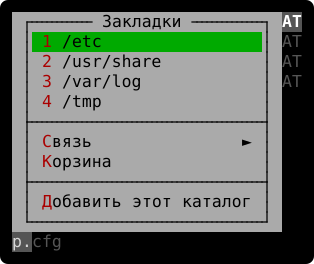

# Закладки

Закладки — это каталоги, в которые вы часто заходите. `Alt+F1` открывает список для левой панели, `Alt+F2` — для
правой, а `Alt+C` — для активной; они есть также в меню *Менеджер* как *Закладки слева* и *Закладки справа*.

## Список

У каждой закладки есть клавиша: `1`–`9`, `0`, затем буквы. Нажмите её или перейдите к закладке и нажмите `Enter`,
и панель перейдёт туда. Закладка, каталога которой сейчас нет, показывается серой.

| Клавиша | Что она делает |
|---|---|
| `Enter` или клавиша закладки | Перейти в каталог |
| `F2` | Дать закладке метку, показываемую вместо её пути. Пустая метка убирает её |
| `Ctrl+Up`, `Ctrl+Down` | Переместить закладку вверх или вниз по списку |
| `Del` | Удалить закладку |
| `Esc` | Закрыть список |

Последний пункт — *Добавить этот каталог*, который добавляет каталог панели в закладки, или *Убрать этот каталог*,
если он уже в закладках.

Под чертой идут диски, которые сейчас подключены и не являются закладками, например USB-флешка. Туда можно
перейти, но они не сохраняются. В списке есть также часть *Связь* с вашими [сохранёнными
соединениями](connections.md).

Перед удалением Navigator спрашивает. *Не спрашивать* в вопросе или *Удаление закладки* на странице
[Подтверждения](settings.md#подтверждения) отключает этот вопрос.

## Без списка

`Alt+1`–`Alt+9` сразу отправляют активную панель к первым девяти закладкам. `Alt+Shift+1`–`Alt+Shift+9` добавляют
каталог панели в закладки на это место.

## Первые закладки

При первом запуске Navigator добавляет в закладки ваш домашний каталог, существующие папки рабочего стола, например
«Документы» и «Загрузки», и каталоги, в которые подключены диски. После этого список ваш: удалённые закладки не
возвращаются.
