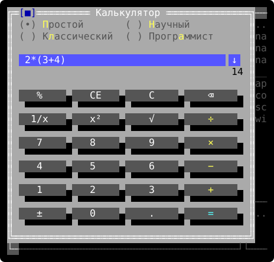
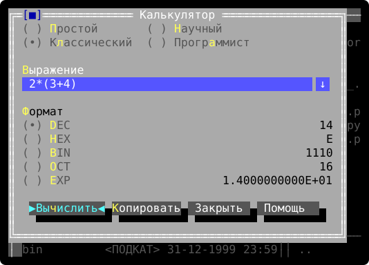
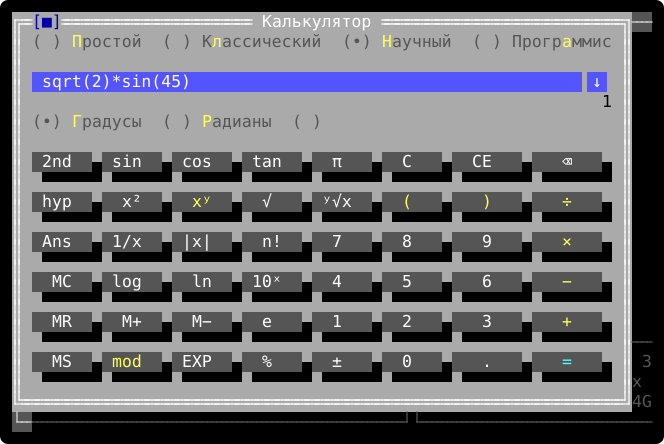
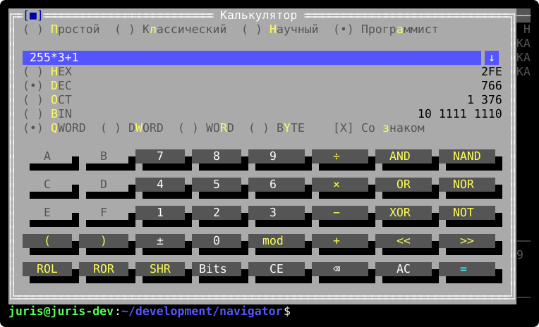

# Калькулятор

`Ctrl+F6`, или *Утилиты > Калькулятор*, открывает калькулятор. Вы набираете выражение в строке, и его значение
вычисляется по мере набора. `Enter` вычисляет его: выражение попадает в историю строки, а значение остаётся
выделенным, так что цифра начинает новое вычисление, а знак операции продолжает от значения.

## Четыре вида

У калькулятора четыре вида; их выбирают на полосе вдоль его верха, в меню *Калькулятор* или повторным нажатием
`Ctrl+F6`, переходя к следующему. Калькулятор запоминает вид, которым вы пользовались последним.

- *Простой* — карманный калькулятор: цифры и четыре действия.
- *Классический* показывает значение сразу в пяти формах: десятичной, шестнадцатеричной, двоичной, восьмеричной и
  экспоненциальной.
- *Научный* добавляет функции, выбор единицы углов, память и последний ответ.
- *Программист* работает с целыми числами выбранного размера в четырёх системах счисления.

В видах *Простой*, *Научный* и *Программист* панель клавиш под строкой печатает в неё, как и клавиатура. Клавиша
функции оборачивает число перед курсором: `9`, а затем `√` даёт `SQRT(9)`.

## Выражения

| Вы пишете | Что это |
|---|---|
| `12`, `1.5`, `.5`, `1E+3` | Числа |
| `$FF`, `0FFh`, `0x1F` | Шестнадцатеричные числа |
| `101b`, `0b101` | Двоичные числа |
| `17o` | Восьмеричное число |
| `+`, `-`, `*`, `/` | Четыре действия |
| `^` | Степень: `2^10` |
| `%` | Остаток от деления двух целых чисел |
| `&`, `\|`, `\`, `~` | Побитовые И, ИЛИ, исключающее ИЛИ и НЕ |
| `<<`, `>>` | Сдвиги |
| `=`, `<>`, `<`, `>`, `<=`, `>=` | Сравнения, дающие 1 или 0 |
| `&&`, `\|\|` | Логические И, ИЛИ |
| `(`, `)` | Скобки |
| `PI` | Число π |

Заглавные и строчные буквы не различаются. Умножение и деление выполняются раньше сложения и вычитания, а степень
— раньше их всех.

Функции: `SIN`, `COS`, `TAN`, `CTAN`, `ARCTAN`, `SQR` (квадрат), `SQRT` (квадратный корень), `LN`, `LG`
(десятичный логарифм), `EXP`, `SIGN` и `IF(condition, a, b)`, которая равна `a`, когда условие истинно, и `b` в
противном случае.

## Классический

Пять строк показывают значение в каждой форме; у нецелого числа в шестнадцатеричной, двоичной и восьмеричной
формах показана целая часть.

- *Вычислить* вычисляет выражение, как `Enter`.
- *Формат* выбирает форму, а *Копировать* помещает значение в буфер обмена в этой форме.
- *Закрыть* закрывает калькулятор.

## Научный

- *Градусы*, *Радианы* и *Грады* выбирают единицу, в которой тригонометрические функции принимают и возвращают
  углы.
- Ещё функции: `ASIN`, `ACOS`, `ATAN`, `SINH`, `COSH`, `TANH`, `ABS`, `CBRT`, `ROOT(x, n)`, `LOG`, `LOG2`,
  `FACT` и `!` после числа — его факториал. `E` — число e.
- `ANS`, или клавиша *Ans*, — последнее вычисленное значение.
- Клавиши памяти: *MS* запоминает значение, *MR* вызывает его, *M+* и *M−* прибавляют к нему и вычитают из него, а
  *MC* очищает его.
- *2nd* и *hyp* меняют то, что печатают клавиши функций: обратные функции и гиперболические.

## Программист

- *HEX*, *DEC*, *OCT* и *BIN* выбирают систему счисления, в которой вы набираете числа. Значение показано во всех
  четырёх.
- *QWORD*, *DWORD*, *WORD* и *BYTE* выбирают размер числа: 64, 32, 16 или 8 битов. Результат, который не
  помещается, обрезается до этого размера.
- *Со знаком* читает число как знаковое. Без этой отметки оно никогда не бывает отрицательным.
- Деление даёт целое число.
- Операции можно записывать и словами: `AND`, `OR`, `XOR`, `NAND`, `NOR`, `NOT`, `MOD`, `SHL`, `SHR`, `SAR`,
  `ROL` и `ROR`.
- *Битовая клавиатура* в меню *Калькулятор* показывает вместо клавиш 64 бита. Щелчок или `Space` переключает
  бит.

## Клавиши

| Клавиша | Что делает |
|---|---|
| `Enter` | Вычисляет |
| `Ctrl+F6` | Следующий вид |
| `Ctrl+1` — `Ctrl+4` | Простой, Классический, Научный, Программист — там, где терминал передаёт эти клавиши |
| `Down` в строке | История выражений |
| `Esc` | Закрывает калькулятор |
